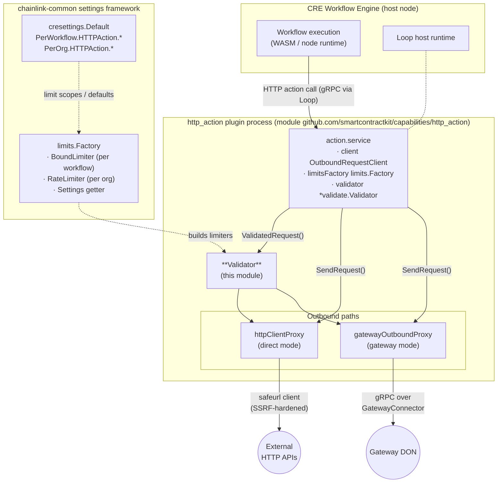
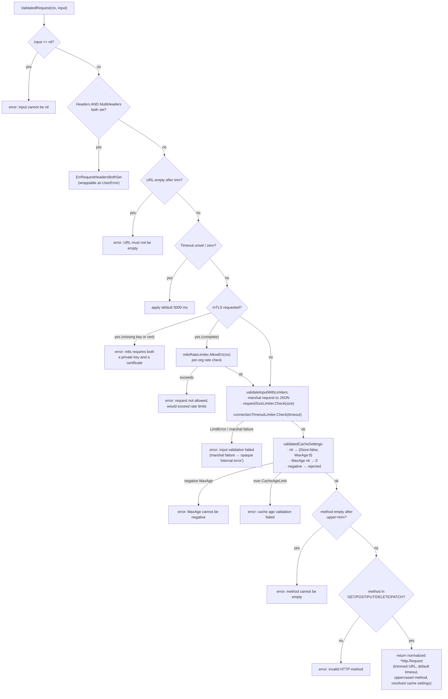
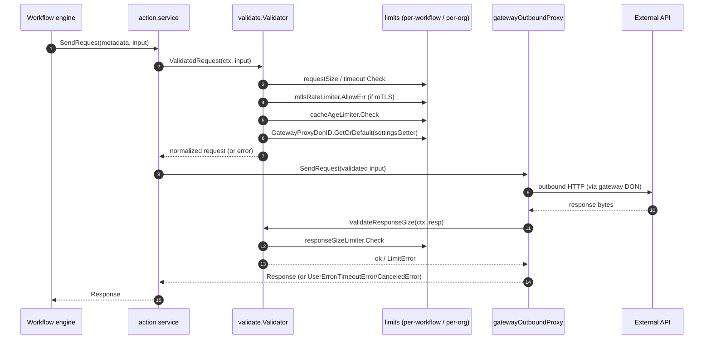
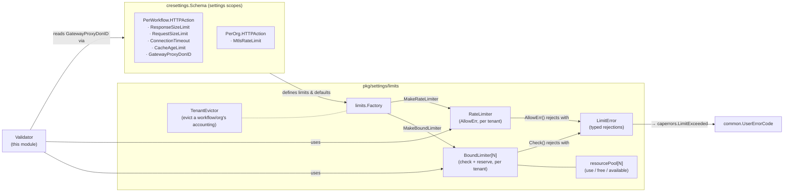

# HTTP Action Capability — Validation & Limits (`Validator`)

> **Module path:** `capabilities/http_action/validate` · **Artifact:** `capabilities/http_action/validate/validator.go`
> **Parent capability:** [HTTP Action Capability](../http_action_capability.md)

## 1. Introduction

This module implements the **request/response validation and resource-limit enforcement layer** of the HTTP Action capability, a standard capability of the [Workflow & Capability Runtime (CRE Engine)](../../Workflow___Capability_Runtime_(CRE_Engine).md). Every outbound HTTP request issued on behalf of a workflow — whether it leaves through the [direct proxy](http_action_capability_direct_proxy.md) or the [gateway proxy](http_action_capability_gateway_proxy.md) — passes through the `Validator` before any network I/O occurs, and every response passes back through it before being returned to the workflow engine.

The module's defining design decision is that **limits are not static configuration values**. Instead of comparing sizes and timeouts against fixed numbers read at boot, the `Validator` is constructed with dynamic, tenant-scoped **limiters** created from a `limits.Factory`. This allows operators to adjust request size caps, connection timeouts, cache ages, and mTLS request rates per workflow or per organization at runtime, through the [CRE settings framework](../../Shared_Foundation_Libraries___Domain_Types/settings.md), without redeploying the capability binary.

### Core components

| Component | Kind | Responsibility |
|---|---|---|
| `Validator` | struct | Validates and normalizes outbound `http.Request` values, validates response sizes, resolves gateway-proxy routing settings, and enforces all per-workflow / per-org resource limits |
| `NewValidator` | constructor | Builds a `Validator`, wiring four bound limiters and one rate limiter from the `limits.Factory`, failing fast if any limiter cannot be created |

## 2. Where the Validator sits in the system

The HTTP Action capability runs as a standalone **plugin process** served over the [Plugin Process Framework (Loop)](../../../Plugin_Process_Framework_(Loop)/loop-plugin-core.md): `capabilities/http_action/main.go` serves `action.NewService(s.Logger, s.LimitsFactory)` as a `StandardCapabilities` gRPC service, and passes the very same `limits.Factory` down into the service.



The `Validator` is the **shared gate** for both proxy modes. Both `common.httpClientProxy` (direct mode) and `gatewayOutboundProxy` (gateway mode) hold a `common.RequestValidator`, an interface that the `Validator` satisfies:

```go
type RequestValidator interface {
    ResponseValidator
    ValidatedRequest(ctx context.Context, input *httpcap.Request) (*httpcap.Request, error)
    ResolveGatewayProxyDonID(ctx context.Context) (string, error)
}
```

This interface contract means validation behavior is identical regardless of which egress path is selected by the [shared runtime `ServiceConfig`](http_action_capability_shared_runtime.md) (`ProxyMode: "gateway" | "direct"`).

### Module dependencies

Declared in `capabilities/http_action/go.mod` (module `github.com/smartcontractkit/capabilities/http_action`, Go 1.27.1). The dependencies most relevant to this module:

| Dependency | Role in validation/limits |
|---|---|
| `github.com/smartcontractkit/chainlink-common` | `pkg/settings` + `pkg/settings/cresettings` (limit definitions), `pkg/settings/limits` (limiter implementations), `pkg/capabilities/v2/actions/http` (request/response types), `pkg/logger` |
| `github.com/doyensec/safeurl` | SSRF-hardened HTTP client used by the direct proxy **after** validation passes (see [HTTP client library](../../Shared_Foundation_Libraries___Domain_Types/http-client.md) for the general pattern) |
| `go.opentelemetry.io/otel/metric` | Counters/histograms in [shared runtime metrics](http_action_capability_shared_runtime.md); `Validator` failures surface as `inputValidationFailures` |
| `github.com/google/uuid` | Request ID generation in shared util — correlates a validation failure with a specific call |

## 3. Component reference

### 3.1 `Validator`

```go
type Validator struct {
    lggr                     logger.SugaredLogger
    settingsGetter           settings.Getter
    responseSizeLimiter      limits.BoundLimiter[config.Size]
    requestSizeLimiter       limits.BoundLimiter[config.Size]
    connectionTimeoutLimiter limits.BoundLimiter[time.Duration]
    cacheAgeLimiter          limits.BoundLimiter[time.Duration]
    mtlsRateLimiter          limits.RateLimiter
}
```

Each field is a **live limiter handle**, not a snapshot of a limit value. Calling `Check(ctx, amount)` consults the current scoped limit at call time, so a settings update by an operator takes effect on the next request without restarting the capability.

### 3.2 `NewValidator`

```go
func NewValidator(lggr logger.Logger, limitsFactory limits.Factory) (*Validator, error)
```

Construction wires one limiter per protected resource:

| Limiter | Settings scope (CRE settings schema) | Enforced quantity |
|---|---|---|
| `responseSizeLimiter` | `PerWorkflow.HTTPAction.ResponseSizeLimit` | Size of the response body returned by the external API |
| `requestSizeLimiter` | `PerWorkflow.HTTPAction.RequestSizeLimit` | Size of the JSON-serialized request envelope |
| `connectionTimeoutLimiter` | `PerWorkflow.HTTPAction.ConnectionTimeout` | Request `Timeout` duration |
| `cacheAgeLimiter` | `PerWorkflow.HTTPAction.CacheAgeLimit` | `CacheSettings.MaxAge` |
| `mtlsRateLimiter` | `PerOrg.HTTPAction.MtlsRateLimit` | Rate of mTLS-authenticated requests per organization |

Notes:

- The first four are **bound limiters** (`limits.MakeBoundLimiter`) scoped to `{workflow}`; the mTLS limiter is a **rate limiter** scoped to `{org}` — mTLS requests are strictly more privileged (they authenticate the node to the target), so they are throttled per organization rather than per workflow.
- The same `limits.Factory` is retained as `settingsGetter` (`limitsFactory.Settings`), which is later used by `ResolveGatewayProxyDonID` to read dynamic settings through the limiter framework itself.
- The constructor is **total**: any limiter that cannot be created aborts startup with a wrapped error (e.g. `failed to create response size limiter: ...`). A capability that cannot enforce its limits refuses to run rather than running unbounded.

### 3.3 Package-level helpers

| Symbol | Purpose |
|---|---|
| `allowedMethods` | Allowlist: `GET`, `POST`, `PUT`, `DELETE`, `PATCH` — anything else is rejected |
| `defaultTimeoutMs = 5_000` | Timeout injected when the caller leaves `Timeout` unset/zero |
| `internalError` | Opaque `"internal error"` message used when a failure must not leak internals (e.g. request marshal failure) |
| `ErrRequestHeadersBothSet` | Sentinel error: request set both legacy `Headers` and `MultiHeaders` |
| `RequestHeaders(input)` | Exported helper returning the header-conflict error, so callers (e.g. the [gateway proxy](http_action_capability_gateway_proxy.md)) can wrap it in a `UserError` themselves |

## 4. Request validation pipeline

`ValidatedRequest` is the primary entry point. It both **rejects** invalid requests and **normalizes** valid ones (defaults, casing, header form), returning a fresh `http.Request` that downstream proxies can execute as-is.



Key behaviors worth highlighting:

1. **Header form mutual exclusion** — the legacy singular `Headers` field and the canonical `MultiHeaders` field may not both be populated. `ErrRequestHeadersBothSet` is a package-level sentinel so that egress code can distinguish a *user* mistake (wrap in [`UserError`](http_action_capability_gateway_proxy.md)) from an infrastructure failure.
2. **mTLS is validated before it is rate-limited** — an mTLS block missing either key or certificate is rejected outright; a well-formed one consumes org-level rate budget. Rejection messages deliberately say *"would exceed rate limits"* so the caller knows no request was sent.
3. **Request size = serialized size** — the request is JSON-marshaled to measure what will actually travel over the wire (including headers, body, and mTLS material), not a nominal field count. Marshal failure is treated as an internal (non-user) fault and reported opaquely as `internal error`.
4. **Cache settings normalization** — absent settings become explicit `{Store: false, MaxAge: 0}`; a `nil` `MaxAge` becomes `0`; negative ages are user errors; the effective age is checked against the `cacheAgeLimiter`.
5. **Method canonicalization** — the method is upper-cased and trimmed *after* the emptiness check, so `" get "` is accepted and stored as `"GET"`; unknown verbs are rejected.
6. **Output is a new struct** — the returned `http.Request` is rebuilt field-by-field from validated inputs, so no unvalidated caller-supplied value can bypass the gate.

### Response validation

```go
func (v *Validator) ValidateResponseSize(ctx context.Context, response []byte) error
```

A single check: `responseSizeLimiter.Check(ctx, config.SizeOf(response))`. It is invoked by both proxies on the bytes returned by the external endpoint (or relayed by the gateway), bounding the data a workflow can pull through the HTTP Action capability regardless of what the remote server sends.

### Gateway routing resolution

```go
func (v *Validator) ResolveGatewayProxyDonID(ctx context.Context) (string, error)
```

Reads `cresettings.Default.PerWorkflow.HTTPAction.GatewayProxyDonID` dynamically through the settings getter. The returned DON ID is consumed by the [`routingGatewayConnector`](http_action_capability_gateway_proxy.md) (`GatewayIDsForDon`) to pin outbound requests to the gateways serving a specific gateway DON. **An empty string means no pinning**: all connected gateways are eligible. Because the read goes through `settingsGetter`, routing can be repointed per workflow at runtime.

## 5. Request lifecycle (sequence)

The typical gateway-mode execution, showing where this module participates:



In direct mode the same sequence applies with `httpClientProxy` in place of the gateway proxy; the `safeurl` client additionally enforces the network-level egress policy (`BlockedIPs`, `AllowedPorts`, `AllowedSchemes`, …) defined in the [shared runtime `HTTPClientConfig`](http_action_capability_shared_runtime.md) — validation decides *whether* to send, the safe client decides *where* it may connect.

## 6. Error model

Validation errors are classified downstream by the [shared runtime util](http_action_capability_shared_runtime.md):

```go
func UserErrorCode(err error) caperrors.ErrorCode {
    if _, ok := errors.AsType[limits.LimitError](err); ok {
        return caperrors.LimitExceeded
    }
    return caperrors.InvalidArgument
}
```

| Error origin | Example | Classification seen by caller |
|---|---|---|
| Typed limiter rejection (`limits.LimitError` from the [limits framework](../../Shared_Foundation_Libraries___Domain_Types/settings.md)) | request too large, timeout above cap, cache age over cap, mTLS rate exceeded | `LimitExceeded` |
| Semantic request mistakes | nil input, empty URL, header conflict, negative `MaxAge`, bad method | `InvalidArgument` |
| Internal faults | JSON marshal failure during size calculation | opaque `"internal error"` (`InvalidArgument`, no internals leaked) |

The gateway proxy additionally wraps user-facing rejections in `UserError`, `TimeoutError`, or `CanceledError` (see [gateway proxy module](http_action_capability_gateway_proxy.md)); the `Validator` deliberately returns plain errors and leaves that wrapping to egress code, keeping this module free of transport concerns.

## 7. Interaction with the CRE settings & limits framework



Why this matters operationally:

- **Multi-tenancy isolation** — because limiters are tenant-scoped (workflow / org), one runaway workflow cannot exhaust the HTTP Action budget of another; sustained abuse by a tenant can be remediated with `TenantEvictor` (drop that tenant's accounting state) without touching others.
- **Live tunability** — limits are `Setting[T]` values; the limiter `Check` re-resolves the effective bound each call, so operations can tighten a misbehaving workflow's quota instantly.
- **Deterministic startup** — `NewValidator` surfaces configuration problems (e.g. malformed limit specs) at capability start, not on the request path.

## 8. Testing & observability hooks

- The capability binary registers OpenTelemetry metric views at startup (`loop.WithOtelViews(common.MetricViews())` in `capabilities/http_action/main.go`). Validation rejections increment `inputValidationFailures` in the [shared runtime metrics](http_action_capability_shared_runtime.md); `LimitExceeded`-classified failures are therefore distinguishable from `InvalidArgument` in dashboards.
- The `Validator`'s logger is a named child (`"Validator"`) of the service logger, so size-calculation marshal failures are attributable in logs.
- Request IDs produced by `common.GetRequestID` (see [shared runtime util](http_action_capability_shared_runtime.md)) correlate a rejected request with the workflow execution that issued it.

## 9. Configuration quick reference

| Setting | Scope | Effect | Default behavior when unset |
|---|---|---|---|
| `PerWorkflow.HTTPAction.RequestSizeLimit` | workflow | Max JSON-serialized request size | Enforced via `requestSizeLimiter` |
| `PerWorkflow.HTTPAction.ResponseSizeLimit` | workflow | Max response body size | Enforced via `responseSizeLimiter` |
| `PerWorkflow.HTTPAction.ConnectionTimeout` | workflow | Max request `Timeout` | Request default: `5000 ms` if unset |
| `PerWorkflow.HTTPAction.CacheAgeLimit` | workflow | Max `CacheSettings.MaxAge` | Nil settings → no caching, age 0 |
| `PerOrg.HTTPAction.MtlsRateLimit` | org | Max mTLS request rate | Enforced via `mtlsRateLimiter` |
| `PerWorkflow.HTTPAction.GatewayProxyDonID` | workflow | Gateway DON to pin routing to | Empty → all connected gateways eligible |

Related, but enforced *outside* this module: gateway-side outbound concurrency and global/per-node rate settings (`GatewayHTTPActionOutboundConcurrencyLimit`, `GatewayHTTPActionOutboundPerNodeConcurrencyLimit`, `GatewayHTTPActionMtlsConcurrencyLimit`, `GatewayHTTPGlobalRate`, …) belong to the gateway tier, and direct-mode network policy (`HTTPClientConfig`) to the [direct proxy](http_action_capability_direct_proxy.md).

## 10. Related documentation

- [HTTP Action Capability](../http_action_capability.md) — capability overview and mode selection
- [Action service lifecycle](http_action_capability_action_service.md) — `action.service`, `NewService`, Loop plugin serving
- [Direct proxy](http_action_capability_direct_proxy.md) — `RequestValidator` / `OutboundRequestClient` interfaces, `safeurl` client
- [Gateway proxy](http_action_capability_gateway_proxy.md) — gateway routing, `UserError` / `TimeoutError` / `CanceledError`
- [Shared runtime](http_action_capability_shared_runtime.md) — `ServiceConfig`, metrics, error-code mapping, request IDs
- [Capability core contracts](../capabilities/capabilities_core.md) — `Validatable`, capability execution semantics
- [Workflow engine](../workflows/workflows_engine.md) — the caller side of HTTP actions
- [CRE settings & limits framework](../../Shared_Foundation_Libraries___Domain_Types/settings.md) — `BoundLimiter`, `RateLimiter`, `LimitError`, `TenantEvictor`
- [Metering & billing](../../Shared_Foundation_Libraries___Domain_Types/metering-and-billing.md) — resource accounting patterns shared across capabilities
