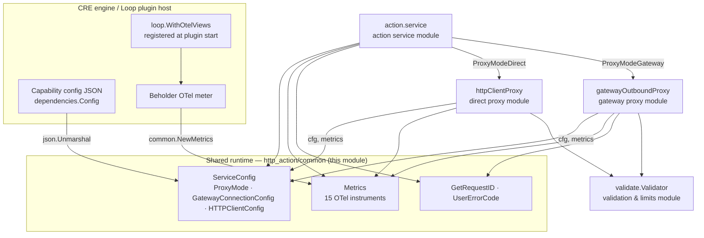
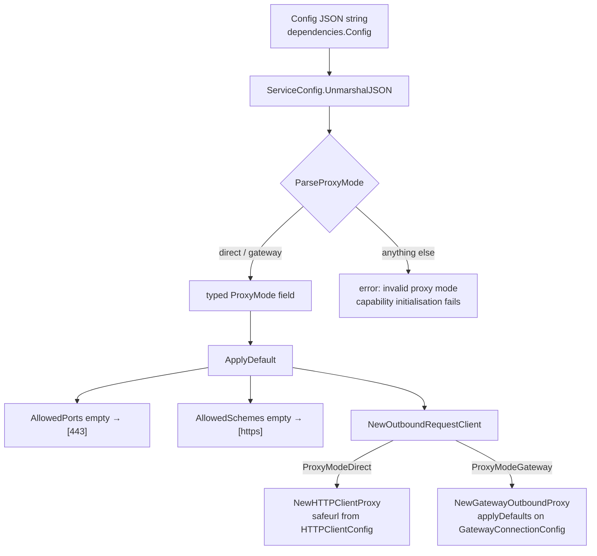
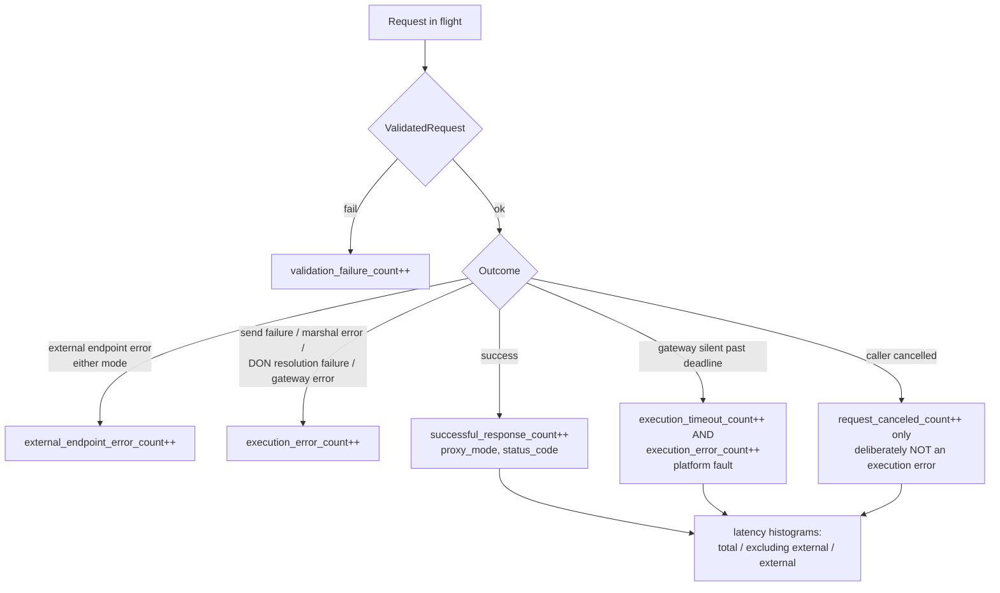
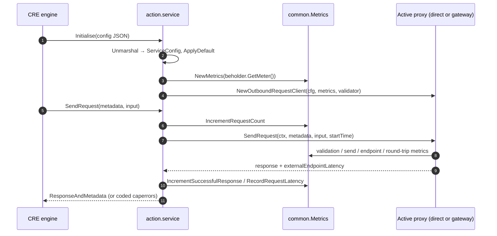

# HTTP Action Capability — Shared Runtime (`common`)

The `http_action_capability_shared_runtime` module is the small, dependency-light heart of the [HTTP Action capability](../http_action_capability.md). It lives in `capabilities/http_action/common` and owns the three things every other part of the capability must agree on:

1. **`ServiceConfig`** — the capability's JSON configuration contract: the outbound **proxy mode** plus per-mode tuning, with parsing, defaulting and custom (de)serialization.
2. **`Metrics`** — the single OpenTelemetry instrument set shared by the [action service](http_action_capability_action_service.md) and both outbound proxies ([direct](http_action_capability_direct_proxy.md), [gateway](http_action_capability_gateway_proxy.md)), with uniform fault classification.
3. **Utilities** — request-ID generation (`GetRequestID`) and user-facing error-code mapping (`UserErrorCode`).

The same package also hosts the `OutboundRequestClient` / `RequestValidator` contracts and the UTF-8 sanitisation helper; per the module decomposition those are covered by the [Direct proxy](http_action_capability_direct_proxy.md) page, which documents the contracts both proxies implement.

| Fact | Value |
|---|---|
| Go module | `github.com/smartcontractkit/capabilities/http_action` (`capabilities/http_action/go.mod`, Go 1.27.1) |
| Files | `capabilities/http_action/common/service_config.go`, `capabilities/http_action/common/metrics.go`, `capabilities/http_action/common/util.go` |
| Core types | `ServiceConfig`, `ProxyMode`, `GatewayConnectionConfig`, `HTTPClientConfig`, `Metrics`, `GetRequestID`, `UserErrorCode` |
| Key dependencies | OpenTelemetry (`go.opentelemetry.io/otel`, `.../metric`, `.../sdk/metric` v1.46.0), `chainlink-common` (`logger`, `capabilities/errors`, `settings/limits`), `github.com/google/uuid` |
| Consumed by | [Action service](http_action_capability_action_service.md) (wiring + error coding), [Direct proxy](http_action_capability_direct_proxy.md) (`HTTPClientConfig`), [Gateway proxy](http_action_capability_gateway_proxy.md) (`GatewayConnectionConfig`, request IDs), plugin entrypoint `main.go` (`MetricViews`) |
| Lifecycle | Stateless value types; `Metrics` is the only stateful object, created once at capability initialisation |

---

## Position in the system

The shared runtime sits at the centre of the HTTP Action capability: configuration flows **into** it from the CRE engine, and its types are injected **out** into whichever outbound client the configured `ProxyMode` selects.



Relationships in detail:

- The **[action service](http_action_capability_action_service.md)** unmarshals the capability config into `ServiceConfig`, applies defaults, creates `Metrics` from the Beholder meter, and uses `NewOutboundRequestClient` to dispatch to one of the two proxies based on `ProxyMode`. It also uses `UserErrorCode` when coding user-facing failures.
- The **[direct proxy](http_action_capability_direct_proxy.md)** consumes `HTTPClientConfig` (IP/port/scheme allow/block lists) to build its SSRF-hardened `safeurl` client, and records through the shared `Metrics`.
- The **[gateway proxy](http_action_capability_gateway_proxy.md)** consumes `GatewayConnectionConfig` (backoff/grace tuning), builds request IDs with `GetRequestID`, and records through the same `Metrics` instance.
- The **[validation & limits layer](http_action_capability_validation_limits.md)** is the `RequestValidator` both proxies call at the send boundary; its `limits.LimitError` values are what `UserErrorCode` maps to `LimitExceeded`.
- Telemetry leaves the process through **Beholder** — see [Beholder telemetry](../../Telemetry___Observability_Platform/beholder-telemetry.md); the meter provider is created by the [Loop plugin host](../../Plugin_Process_Framework_(Loop)/loop-plugin-core.md) with `common.MetricViews()` applied (see `capabilities/http_action/main.go`).

---

## Core components

### `ServiceConfig` — the configuration contract

`ServiceConfig` is the complete, JSON-serialised configuration of the HTTP Action capability. It is supplied by the CRE engine as a raw string on `core.StandardCapabilitiesDependencies.Config` and parsed during `service.Initialise` (see [Action service](http_action_capability_action_service.md)). The effective JSON schema:

```json
{
  "proxyMode": "direct" | "gateway",
  "gatewayConnection": {
    "initialIntervalMs": 100,
    "maxElapsedTimeMs": 5000,
    "multiplier": 2.0,
    "responseGraceMs": 5000
  },
  "httpClient": {
    "blockedIPs": [], "blockedIPsCIDR": [],
    "allowedPorts": [443], "allowedSchemes": ["https"],
    "allowedIPs": [], "allowedIPsCIDR": []
  }
}
```

**`ProxyMode`** selects the outbound strategy and is the capability's single most consequential setting:

| Value | Behaviour | Implementation |
|---|---|---|
| `ProxyModeDirect` (`"direct"`) | Requests executed in-process by an SSRF-hardened HTTP client. | [Direct proxy](http_action_capability_direct_proxy.md) |
| `ProxyModeGateway` (`"gateway"`) | Requests relayed to a gateway DON over the node's `GatewayConnector`. | [Gateway proxy](http_action_capability_gateway_proxy.md) |

Parsing is deliberately strict and forgiving of formatting only: `ParseProxyMode` lower-cases and trims the input, accepts exactly `"direct"` or `"gateway"`, and fails with `invalid proxy mode: %q, must be either 'direct' or 'gateway'` otherwise. Because `Initialise` returns this error, an invalid mode **fails capability startup** rather than degrading at request time. The custom `MarshalJSON`/`UnmarshalJSON` pair keeps the wire format human-readable (the enum travels as its lowercase string) while the in-memory type stays a typed enum whose `String()` renders unknown values as `"unknown"`.

**`GatewayConnectionConfig`** tunes the gateway proxy's routing loop — exponential backoff for gateway selection/reconnection and an extra response-grace window. Defaults are *not* baked into the shared type; the gateway module's `applyDefaults` backstops zero values (100 ms initial interval, 5 000 ms ceiling, ×2.0 multiplier, 5 000 ms grace). See [Gateway proxy — Configuration](http_action_capability_gateway_proxy.md).

**`HTTPClientConfig`** is the SSRF-hardening surface used **only** in direct mode. It is translated 1:1 into a `safeurl` client configuration by `NewHTTPClientProxy` (redirects are additionally hard-disabled there):

| Field | Role |
|---|---|
| `allowedPorts` | Egress ports. **Defaults to `[443]`** when empty (`ApplyDefault`). |
| `allowedSchemes` | URL schemes. **Defaults to `["https"]`** when empty (`ApplyDefault`). |
| `allowedIPs` / `allowedIPsCIDR` | Explicit egress allow-list (IPs / CIDR blocks). |
| `blockedIPs` / `blockedIPsCIDR` | Egress deny-list (IPs / CIDR blocks). |

`ApplyDefault` is the shared-runtime's only mutation of configuration and encodes a safe-by-default posture: absent operator configuration, direct-mode egress is restricted to HTTPS on port 443. The deny/allow lists have no defaults (empty lists mean "no additional restrictions beyond the safeurl library's own SSRF protections"). Because the same defaults apply to gateway mode too (the field is simply unused there), the capability can be started with a minimal `{"proxyMode": "..."}` config.

Configuration lifecycle:



### `Metrics` — the shared telemetry surface

`Metrics` wraps 15 OpenTelemetry instruments (11 counters, 4 histograms) created from a single `metric.Meter` — in practice `beholder.GetMeter()`, obtained by the action service during `Initialise`. One instance is injected into whichever outbound client is active, so dashboards see one consistent stream regardless of mode; per-mode attribution is carried by the `proxy_mode` attribute rather than by separate instruments.

| Instrument | Type | Records | Attributes |
|---|---|---|---|
| `http_action_request_count` | Counter | Requests accepted | — |
| `http_action_validation_failure_count` | Counter | `ValidatedRequest` failures | — |
| `http_action_successful_response_count` | Counter | Successful responses | `proxy_mode`, `status_code` |
| `http_action_execution_error_count` | Counter | Execution errors (see classification below) | `proxy_mode` |
| `http_action_execution_timeout_count` | Counter | Gateway silent past the response deadline | `proxy_mode` |
| `http_action_request_canceled_count` | Counter | Caller cancelled before a response arrived | `proxy_mode` |
| `http_action_external_endpoint_error_count` | Counter | External endpoint failures (either mode) | `proxy_mode` |
| `http_action_no_gateways_available_count` | Counter | Empty gateway ring for the resolved DON | `gateway_proxy_don_id` |
| `http_action_capability_gateway_send_count` | Counter | Successful sends to a gateway | `node_address`, `gateway_proxy_don_id` |
| `http_action_capability_gateway_send_error_count` | Counter | Gateway send/connection errors | `node_address`, `gateway_proxy_don_id` |
| `http_action_capability_gateway_round_trip_ms` | Histogram | Node-observed round trip (send → response, incl. Loop boundary latency; error responses included, failed waits excluded) | `gateway_id` |
| `http_action_capability_gateway_round_trip_failures` | Counter | Round trips that ended without a response | `gateway_id`, `reason` |
| `http_action_request_latency_ms` | Histogram | Total request latency | `proxy_mode`, `success` |
| `http_action_request_latency_ms_excluding_external_endpoint` | Histogram | Total minus external-call time | `proxy_mode`, `success` |
| `http_action_external_endpoint_latency_ms` | Histogram | External endpoint call latency | `proxy_mode`, `success` |

Naming convention: `http_action_*` instruments are mode-agnostic; `http_action_capability_*` instruments are gateway-mode specifics.

**Attribute dictionary** (kept intentionally small — cardinality control is a design constraint):

| Constant | Key | Meaning |
|---|---|---|
| `AttrNodeAddress` | `node_address` | Node address on gateway send metrics (ingest supplies `node_id` for round-trip metrics). |
| `AttrGatewayProxyDonID` | `gateway_proxy_don_id` | Resolved gateway-proxy DON. |
| `AttrProxyMode` | `proxy_mode` | `direct` or `gateway`. |
| `AttrStatusCode` | `status_code` | HTTP status of a successful response. |
| `AttrGatewayID` | `gateway_id` | Selected gateway for round-trip metrics. |
| `AttrReason` | `reason` | `send_error` or `context_done` only. |
| `AttrSuccess` | `success` | Latency outcome flag. |
| `AttrMethodName` | `method_name` | Declared for method-scoped tagging (reserved; not attached by current call sites). |

**Fault classification** is centralised here so both proxies and the action service report identical semantics:



Semantic guarantees encoded in the helper methods:

- **Gateway silence is a platform fault**: `IncrementExecutionTimeout` increments *both* `execution_timeout_count` and `execution_error_count`, so `execution_error_count` is a complete "something went wrong on our side" series.
- **Caller cancellation is nobody's fault**: `IncrementRequestCanceled` deliberately does *not* touch `execution_error_count`; alerts on execution errors should therefore not fire on `Canceled` codes.
- **Gateway send errors double-count by design**: `IncrementGatewaySendError` increments both `gateway_send_error_count` (with node/DON attribution) and `execution_error_count`.
- **Low-cardinality reasons**: gateway round-trip failures are restricted to `RoundTripReasonSendError` (`"send_error"`) and `RoundTripReasonContextDone` (`"context_done"`), keeping the `reason` label's cardinality at two.
- **Latency decomposition**: `RecordRequestLatency(total, external)` records three series in one call — total, external, and their difference (cost of the capability itself) — all labelled with `proxy_mode` and `success`.

**Histogram buckets via `MetricViews`**: the OpenTelemetry specification requires all explicit-bucket boundaries to be defined when the meter provider is created, not per-recording. The package therefore exports `MetricViews() []sdkmetric.View`, currently defining fine-grained boundaries for `http_action_capability_gateway_round_trip_ms` (10, 25, 50, 100, 250, 500, 1000, 2500, 5000, 10000, 25000, 50000, 90000 ms — millisecond-scale granularity at the low end, up to 90 s since maximum request timeouts are on that order). The plugin entrypoint wires this into provider creation:

```go
// capabilities/http_action/main.go
loopserver.ServeNew(action.ServiceName, ..., loop.WithOtelViews(common.MetricViews()))
```

### `GetRequestID` and `UserErrorCode`

**`GetRequestID(methodName string, parts ...string) string`** builds a unique, hierarchical request ID: `methodName/part1/.../partN/<uuid>`, joined with `/`. The trailing UUID guarantees uniqueness even when the same workflow execution is replayed or retried. The gateway proxy uses it to mint the JSON-RPC request ID for every outbound relay — `GetRequestID(gc.MethodHTTPAction, metadata.WorkflowID, metadata.WorkflowExecutionID)` — which doubles as the correlation key in its response registry (duplicates are rejected, which is why uniqueness matters). The direct proxy currently uses a bare UUID for its per-request log correlation.

**`UserErrorCode(err error) caperrors.ErrorCode`** maps an error chain to a user-facing capability error code:

| Error chain contains | Returned code |
|---|---|
| `limits.LimitError` (from `chainlink-common/pkg/settings/limits` — see [Settings & limits](../../Shared_Foundation_Libraries___Domain_Types/settings.md)) | `caperrors.LimitExceeded` |
| anything else | `caperrors.InvalidArgument` |

The action service calls it when wrapping `common.InputValidationError` and `gateway.UserError` failures into public user errors (`caperrors.NewPublicUserError`), so a workflow author whose request breaches a configured size/timeout/cache limit gets a precise `LimitExceeded` code rather than a generic validation failure. See [Validation & limits](http_action_capability_validation_limits.md) for where those limit errors originate and [Capabilities core](../capabilities/capabilities_core.md) for the error-code framework.

---

## Telemetry lifecycle across a request

The shared runtime participates in every request twice — config is read once, metrics are written throughout:



Notes for dashboard authors:

- In **gateway mode** the request counter is incremented twice per request — once by the action service on receipt and once by the gateway proxy just before dispatching to the gateway (same `Metrics` instance). Treat `http_action_request_count` as "capability requests + gateway dispatches" in that mode, or aggregate only on `proxy_mode="direct"` for a 1:1 series.
- `externalEndpointLatency` is gateway-reported in gateway mode and locally measured in direct mode; the derived "excluding external" histogram is only meaningful as a self-cost metric in direct mode.
- Metric helper methods accept a `logger.Logger` parameter for uniform call-site signatures across proxies; the current implementations only record, they do not log.

---

## Design notes

- **Config as a value type.** `ServiceConfig` and its sub-structs are plain values copied into consumers (`httpClientProxy` keeps its own copy). The only shared mutable state is `Metrics`, and all mutation goes through concurrency-safe OTel instruments.
- **Defaults live where they are used.** The shared runtime defaults the HTTP client's ports/schemes (`ApplyDefault`); the gateway package defaults its own connection backoff (`applyDefaults`, 100/5000/2.0/5000). Neither defaults the other's section, and the two defaulting passes compose (config → `ApplyDefault` → mode constructor).
- **Fail fast on bad config.** `ParseProxyMode` errors propagate out of `Initialise`; the capability never runs in a half-configured state.
- **One instrument set, attributed by label.** Both proxies and the service share one `Metrics`, so comparisons across modes come free via the `proxy_mode` attribute, and new instruments only need to be added once.

## Configuration and build

The shared runtime is part of the `capabilities/http_action` Go module (`capabilities/http_action/go.mod`), which additionally pulls in `doyensec/safeurl` (SSRF-hardened transport for direct mode), `stathat.com/c/consistent` (gateway hash routing) and the OpenTelemetry metric API/SDK. The module belongs to the `capabilities` workspace, whose codegen and module hygiene (`protoc`, `mockery`, `gomodtidy`) are orchestrated by `capabilities/Makefile`.

There is no node-level TOML configuration in this module — all configuration arrives as capability config JSON through the CRE engine's standard-capability registration path (see [Workflows engine](../workflows/workflows_engine.md) and [Capabilities framework](../capabilities.md)).

## Related documentation

- [HTTP Action capability](../http_action_capability.md) — capability overview and mode selection.
- [Action service](http_action_capability_action_service.md) — parses `ServiceConfig`, owns `Metrics` creation and error classification.
- [Direct proxy](http_action_capability_direct_proxy.md) — the `"direct"` outbound client; defines `OutboundRequestClient`, `RequestValidator`, `SanitizeUTF8`.
- [Gateway proxy](http_action_capability_gateway_proxy.md) — the `"gateway"` outbound client; documents `GatewayConnectionConfig` defaults in depth.
- [Validation & limits](http_action_capability_validation_limits.md) — the `Validator` whose limit errors `UserErrorCode` maps.
- [Capabilities core](../capabilities/capabilities_core.md) — capability interfaces and error-code framework (`caperrors`).
- [Beholder telemetry](../../Telemetry___Observability_Platform/beholder-telemetry.md) — the meter/exporter behind `NewMetrics` and `MetricViews`.
- [Loop plugin framework](../../Plugin_Process_Framework_(Loop)/loop-plugin-core.md) — plugin host that registers the OTEL views and serves the capability.
- [Settings & limits](../../Shared_Foundation_Libraries___Domain_Types/settings.md) — the `limits` package referenced by `UserErrorCode`.
