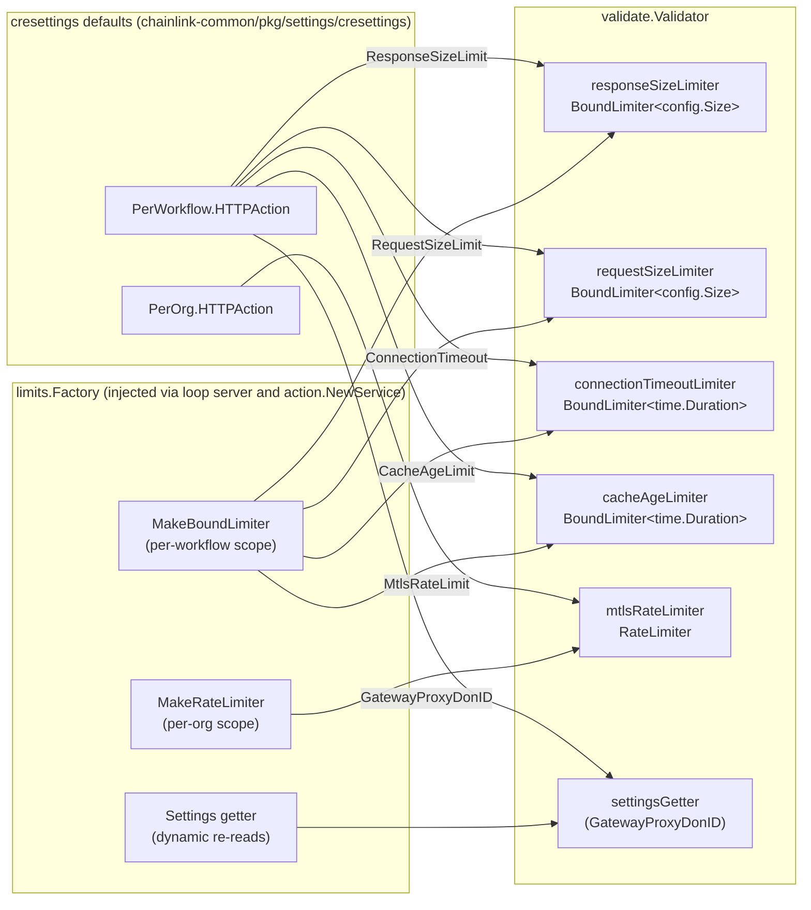
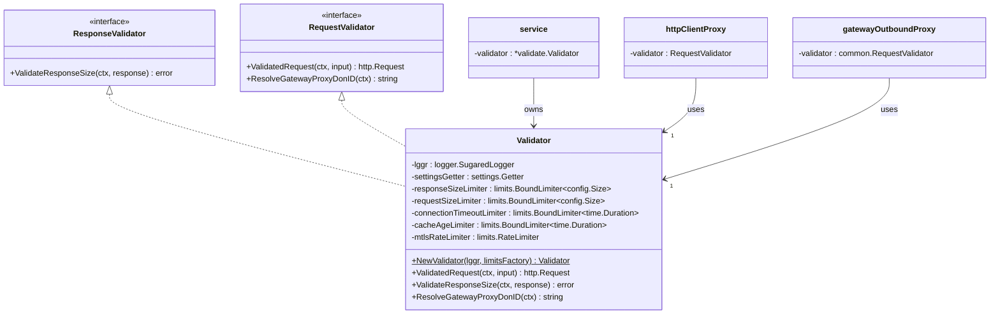
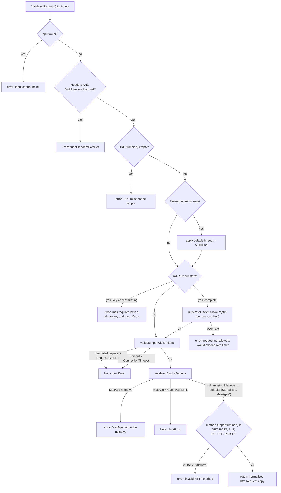
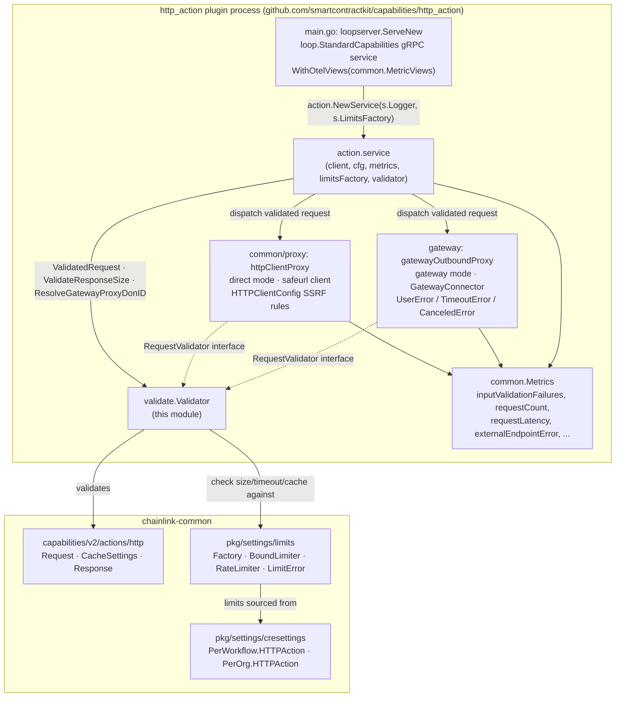
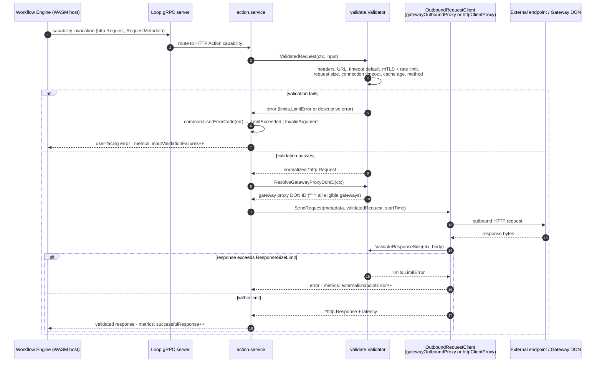

# HTTP Action Capability — Validation & Limits

## Introduction

The **`http_action_capability_validation_limits`** module is the request/response validation and resource-limit enforcement layer of the [HTTP Action capability](../http_action_capability.md) — a standard, outbound HTTP action exposed to CRE workflows. Its single core component, the **`Validator`** (`capabilities/http_action/validate/validator.go`), sits between workflow executions and the outbound HTTP proxies (direct or gateway-backed) and guarantees that every request a workflow issues, and every response it receives, conforms to:

- **Protocol correctness** — required fields, mutually exclusive header representations, and an allow-list of HTTP methods.
- **Resource limits** — per-workflow bounds on request size, response size, connection timeout, and cache age, plus a per-org rate limit on mTLS-authenticated requests. Limits are enforced through the shared [`settings/limits`](../../Shared_Foundation_Libraries___Domain_Types/settings/settings_limits.md) framework and resolved from the [CRE settings schema](../../Shared_Foundation_Libraries___Domain_Types/settings/settings_cre_schema.md), so operators can tune them centrally per workflow and per organization.
- **Safe defaults** — a 5-second default timeout and zeroed cache settings are applied when workflows omit them.
- **Gateway routing hints** — resolution of the configured gateway proxy DON ID used by the [gateway proxy](http_action_capability_gateway_proxy.md) to narrow the set of eligible gateways.

Because the HTTP Action capability is directly exposed to workflow authors (and, through the gateway, to untrusted external traffic), this module is a primary defense against resource-exhaustion (oversized payloads, unbounded timeouts, cache abuse) and is one layer of the capability's SSRF defense-in-depth strategy (see [Security posture](#security-posture)).

---

## Position in the system

This module is a leaf sub-module of the HTTP Action capability inside the [Workflow & Capability Runtime (CRE Engine)](../../Workflow___Capability_Runtime_(CRE_Engine).md). The capability itself runs as a separate plugin process hosted over the [Loop plugin framework](../../../Plugin_Process_Framework_(Loop).md) and is registered in the [Capabilities Registry](../capabilities/capabilities_registry.md).

| Sibling module | Responsibility | Relationship to validation & limits |
|---|---|---|
| [Action service](http_action_capability_action_service.md) | gRPC capability entry point (`action.service`); orchestrates a request end-to-end | Constructs and owns the `Validator`; calls it before dispatch and lets proxies call it for responses |
| [Shared runtime](http_action_capability_shared_runtime.md) | `ServiceConfig`, metrics, request IDs, user-error codes | Supplies the `limits.Factory` (via `main.go`), the metrics counters that record validation failures, and the error-code mapping |
| [Direct proxy](http_action_capability_direct_proxy.md) | Outbound HTTP via a `safeurl`-wrapped client in `"direct"` proxy mode | Holds the `Validator` as its `common.RequestValidator`; network-level SSRF rules (blocked IPs/CIDRs, allowed ports/schemes) live here, not in the validator |
| [Gateway proxy](http_action_capability_gateway_proxy.md) | Outbound HTTP via a Gateway DON in `"gateway"` proxy mode | Holds the `Validator` as its `common.RequestValidator`; consumes `ResolveGatewayProxyDonID` for routing; wraps validation rejections in `UserError` |
| Constructor & API reference | `Validator` / `NewValidator` deep-dive | See the sibling page [http_action_capability_http_action_capability_validation_limits.md](http_action_capability_http_action_capability_validation_limits.md) |

---

## Core component: `Validator`

The `Validator` is a stateless-per-request service configured once at capability startup with a set of *limiters* obtained from a `limits.Factory`. It implements the `common.RequestValidator` contract consumed by both outbound proxies:

```go
// capabilities/http_action/common/proxy.go
type ResponseValidator interface {
    ValidateResponseSize(ctx context.Context, response []byte) error
}

type RequestValidator interface {
    ResponseValidator
    ValidatedRequest(ctx context.Context, input *http.Request) (*http.Request, error)
    ResolveGatewayProxyDonID(ctx context.Context) (string, error)
}
```

### API surface

| Method | Description |
|---|---|
| `NewValidator(lggr logger.Logger, limitsFactory limits.Factory) (*Validator, error)` | Builds the validator and its five limiters from CRE settings defaults; wires `limitsFactory.Settings` as the dynamic `settings.Getter`. Called by `action.NewService(s.Logger, s.LimitsFactory)` in `capabilities/http_action/main.go`. |
| `ValidatedRequest(ctx, input *http.Request) (*http.Request, error)` | Full request validation pipeline (below). Returns a **normalized copy** of the request (trimmed URL, upper-cased method, defaulted timeout/cache settings) ready for the outbound proxies. |
| `ValidateResponseSize(ctx, response []byte) error` | Checks the serialized response body against the per-workflow `ResponseSizeLimit` bound limiter. Invoked by the proxies via the embedded `ResponseValidator` interface. |
| `ResolveGatewayProxyDonID(ctx) (string, error)` | Reads `cresettings.Default.PerWorkflow.HTTPAction.GatewayProxyDonID` (via `GetOrDefault`, so it re-evaluates dynamically per call). Empty string ⇒ *all* connected gateways are eligible through the connector's `GatewayIDsForDon`. |
| `RequestHeaders(input *http.Request) error` | Package-level helper exposing the headers-mutual-exclusivity check so gateway-side callers can surface it as a user-facing error (e.g., wrapped in [`UserError`](http_action_capability_gateway_proxy.md)). Returns the sentinel `ErrRequestHeadersBothSet`. |

### Limiter wiring

Each check is backed by a limiter created from the [settings/limits](../../Shared_Foundation_Libraries___Domain_Types/settings/settings_limits.md) framework. Bound limiters are scoped **per workflow**; the mTLS rate limiter is scoped **per org** — the scopes come from the `scope:"workflow"` / `scope:"org"` tags on [`cresettings.Schema`](../../Shared_Foundation_Libraries___Domain_Types/settings/settings_core_framework.md).



Structural view:



---

## Request validation flow

`ValidatedRequest` applies its checks in a fixed order. Header checks run first (cheap, structural), then defaults, then mTLS rate limiting, then the limit-guarded size/timeout/cache checks, and finally method normalization. Any failure aborts the pipeline with a descriptive error.



Notes on individual stages:

1. **Headers mutual exclusivity.** A request may carry either the deprecated singular `Headers` map or the repeated `MultiHeaders`, never both. The check is also exported as `RequestHeaders` for callers that need the sentinel error (`ErrRequestHeadersBothSet`) for user-facing messaging.
2. **Defaults.** `Timeout` defaults to `defaultTimeoutMs` (5 s). Missing `CacheSettings` become `{Store: false, MaxAge: 0}` — i.e., caching off — so no implicit caching ever occurs.
3. **mTLS gating.** mTLS requests require *both* `Mtls.PrivateKey` and `Mtls.Certificate`; because client-certificate handshakes are comparatively expensive, they are additionally gated by the per-org `MtlsRateLimit` rate limiter.
4. **Size measurement.** The request size is computed by JSON-marshaling the whole proto request (`json.Marshal(input)`) and checking that against `RequestSizeLimit`. Marshaling failure is deliberately reported as the opaque `internal error` string to avoid leaking internals.
5. **Method allow-list.** Only `GET`, `POST`, `PUT`, `DELETE`, `PATCH` are accepted; the method is normalized to upper-case/trimmed before the request copy is returned.

---

## Component interactions within the HTTP Action capability

The validator is constructed once per capability process and shared by the action service and both outbound proxies:



---

## End-to-end request lifecycle

The sequence below shows how validation integrates with a workflow-triggered execution in gateway mode (the direct proxy follows the same contract, minus gateway routing):



---

## Error taxonomy & observability

Validation failures are deliberately two-tiered:

| Layer | Type | Example | User-facing effect |
|---|---|---|---|
| Typed limit rejections | `limits.LimitError` | request/response over size, timeout/connection/cache-age over bound, mTLS over rate | `common.UserErrorCode` maps them to `caperrors.LimitExceeded` — workflow authors see a clear "limit exceeded" signal |
| Structural / input errors | `fmt.Errorf` / sentinel errors | `ErrRequestHeadersBothSet`, empty URL, missing mTLS material, invalid method | mapped to `caperrors.InvalidArgument` |
| Internal failures | opaque `internal error` | JSON marshal failure during size measurement | no internals leaked to users; details go to the validator's named (`Validator`) sugared logger |

Observability hooks live in the [shared runtime](http_action_capability_shared_runtime.md): `common.Metrics` exposes an `inputValidationFailures` counter (among request-count, latency, and endpoint-error instruments), and the validator's rejections are the main contributor to it. Platform-level HTTP Action limits that apply *before* requests ever reach this capability (gateway inbound payload size, per-node/global gateway rates, outbound concurrency) are defined on `cresettings.Schema` and enforced in the gateway stack — see [settings](../../Shared_Foundation_Libraries___Domain_Types/settings.md) for the full picture.

---

## Configuration reference

All validator limits resolve from the CRE settings schema (`chainlink-common/pkg/settings/cresettings`), keeping enforcement dynamic — bound limiters re-check current settings per call.

| Setting | Scope | Type | Enforced by | Checked at |
|---|---|---|---|---|
| `PerWorkflow.HTTPAction.RequestSizeLimit` | workflow | `config.Size` | `requestSizeLimiter` | `ValidatedRequest` (JSON-marshaled request) |
| `PerWorkflow.HTTPAction.ResponseSizeLimit` | workflow | `config.Size` | `responseSizeLimiter` | `ValidateResponseSize` |
| `PerWorkflow.HTTPAction.ConnectionTimeout` | workflow | `time.Duration` | `connectionTimeoutLimiter` | `ValidatedRequest` (after default applied) |
| `PerWorkflow.HTTPAction.CacheAgeLimit` | workflow | `time.Duration` | `cacheAgeLimiter` | `ValidatedRequest` (cache settings stage) |
| `PerWorkflow.HTTPAction.GatewayProxyDonID` | workflow | `string` | — (routing hint) | `ResolveGatewayProxyDonID` (gateway proxy routing) |
| `PerOrg.HTTPAction.MtlsRateLimit` | organization | `config.Rate` | `mtlsRateLimiter` | `ValidatedRequest` (mTLS requests only) |

Static constants in the module: `defaultTimeoutMs = 5_000` and the method allow-list (`GET`, `POST`, `PUT`, `DELETE`, `PATCH`).

---

## Security posture

The HTTP Action capability applies SSRF and abuse protections in **layers**, each owned by a different module:

1. **This module — semantic & resource limits**: field validation, method allow-list, per-workflow size/timeout/cache bounds, per-org mTLS rate limiting. These bounds are the accounting layer that keeps a single workflow (or org) from monopolizing node resources.
2. **[Direct proxy](http_action_capability_direct_proxy.md) — network egress control**: `HTTPClientConfig` (blocked/allowed IPs and CIDRs, allowed ports and schemes) enforced by a `doyensec/safeurl`-wrapped HTTP client, which defeats DNS-rebinding-style bypasses at dial time.
3. **[Gateway proxy](http_action_capability_gateway_proxy.md) — topology isolation**: egress can be routed through a trusted Gateway DON (optionally pinned via `GatewayProxyDonID`), with user-facing `UserError`/`TimeoutError`/`CanceledError` semantics and node-identifying headers managed by the gateway connector.

---

## Build & dependency context

The module lives in the `github.com/smartcontractkit/capabilities/http_action` Go module (`capabilities/http_action/go.mod`), whose direct dependencies relevant here are:

- `github.com/smartcontractkit/chainlink-common` — provides `pkg/capabilities/v2/actions/http` (the `Request`/`Response`/`CacheSettings` protos being validated), `pkg/settings` + `pkg/settings/cresettings` (the schema and defaults above) and `pkg/settings/limits` (the `Factory`/`BoundLimiter`/`RateLimiter` machinery, via the Loop server's `limits.Factory`).
- `go.opentelemetry.io/otel/metric` — backs `common.Metrics`, which records validation outcomes.

The capability is wired as a Loop standard-capability plugin in `capabilities/http_action/main.go`, which is where the logger and `limits.Factory` handed to `NewValidator` originate.

---

## Related documentation

- Parent capability: [http_action_capability](../http_action_capability.md) · [Workflow & Capability Runtime (CRE Engine)](../../Workflow___Capability_Runtime_(CRE_Engine).md)
- Adjacent sub-modules: [action service](http_action_capability_action_service.md) · [shared runtime](http_action_capability_shared_runtime.md) · [direct proxy](http_action_capability_direct_proxy.md) · [gateway proxy](http_action_capability_gateway_proxy.md) · [constructor & API reference](http_action_capability_http_action_capability_validation_limits.md)
- Capability contracts & registry: [capabilities core](../capabilities/capabilities_core.md) · [capabilities registry](../capabilities/capabilities_registry.md)
- Shared foundation: [settings framework](../../Shared_Foundation_Libraries___Domain_Types/settings/settings_core_framework.md) · [settings limits](../../Shared_Foundation_Libraries___Domain_Types/settings/settings_limits.md) · [CRE settings schema](../../Shared_Foundation_Libraries___Domain_Types/settings/settings_cre_schema.md) · [HTTP client library](../../Shared_Foundation_Libraries___Domain_Types/http-client.md)
