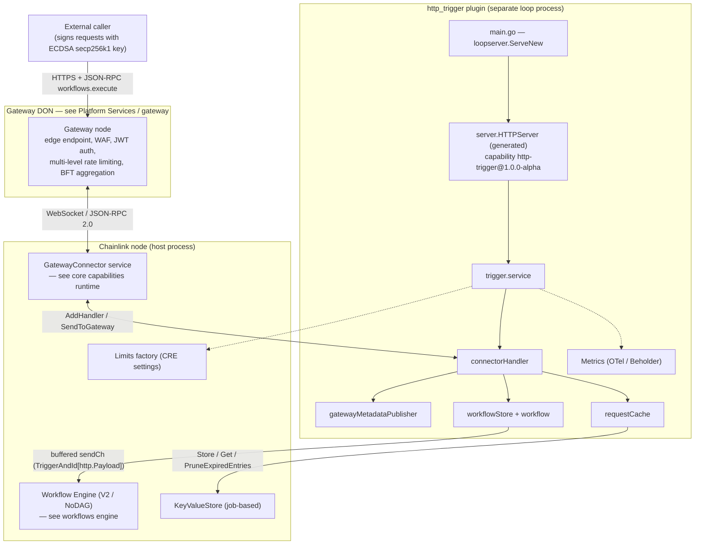
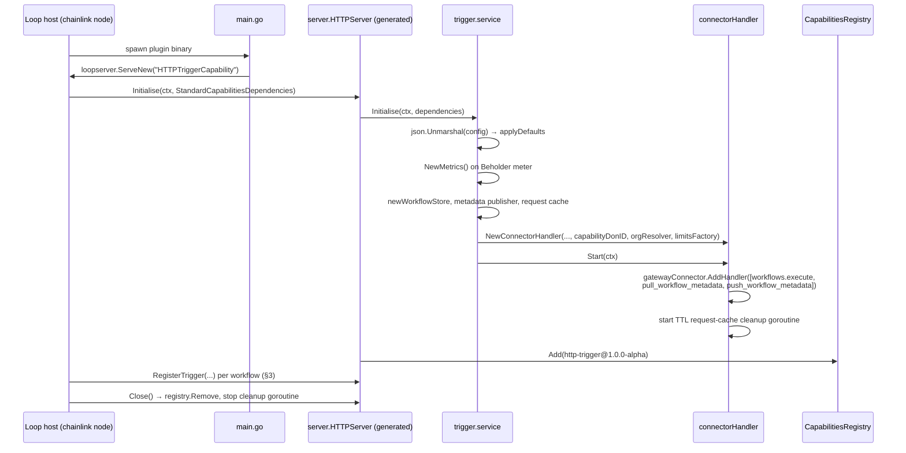
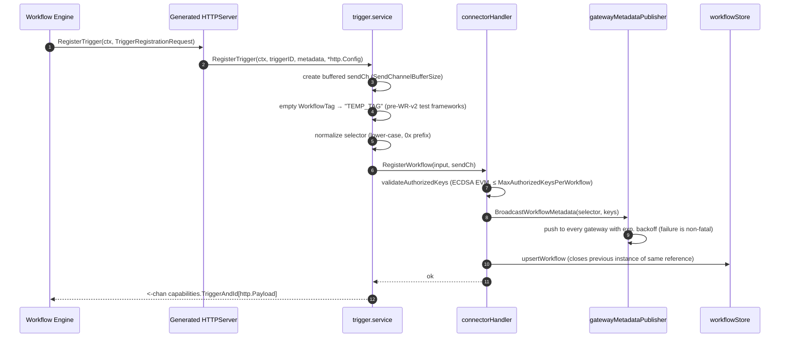
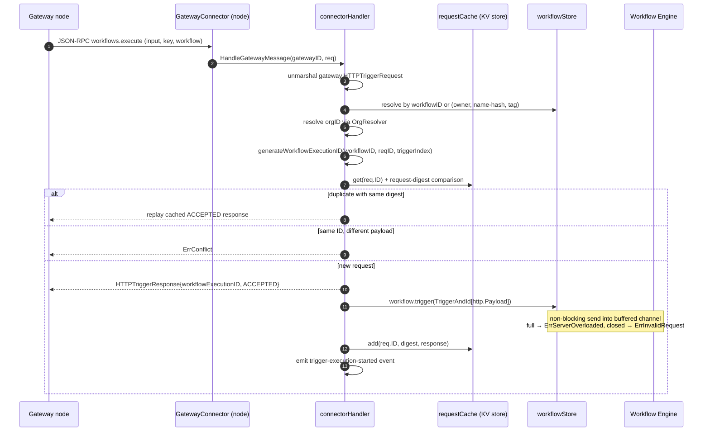
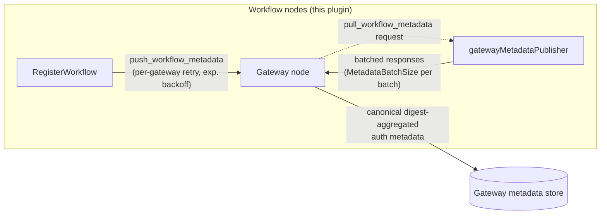

# HTTP Trigger Capability (`http_trigger`)

> **Module:** `github.com/smartcontractkit/capabilities/http_trigger` (repo root: `capabilities/http_trigger/`)
> **Domain:** [Workflow & Capability Runtime (CRE Engine)](Workflow___Capability_Runtime_(CRE_Engine).md)

## 1. Purpose

The HTTP Trigger Capability is a standalone **standard capability** plugin that lets *external* systems start CRE workflow executions by sending signed HTTP requests. It is the inbound counterpart of the [HTTP Action capability](http_action_capability.md): where `http_action` performs **outbound** calls on behalf of a running workflow, `http_trigger` accepts **inbound** calls that *start* a workflow. It is packaged as a separate binary that runs beside the chainlink node and communicates with it through the [Loop plugin framework](../Plugin_Process_Framework_(Loop)/loop-plugin-core.md); `capabilities/http_trigger/project.json` identifies it as `projectType: "capability"` with an implicit dependency on `loopserver`.

External traffic never reaches the workflow node directly: clients call a gateway endpoint, and the [gateway DON](../Node_Platform_Services/gateway.md) forwards the request over the node's `GatewayConnector`. The plugin is therefore purely *inbound* — its `go.mod` has no outbound HTTP client dependency at all.

Core responsibilities:

| # | Responsibility | Where |
|---|----------------|-------|
| 1 | Expose `RegisterTrigger`/`UnregisterTrigger` to the workflow engine and deliver trigger events on a per-workflow channel | `trigger/trigger.go` (`service`, capability ID `http-trigger@1.0.0-alpha`) |
| 2 | Process gateway JSON-RPC messages: `workflows.execute`, `pull_workflow_metadata`, `push_workflow_metadata` | `trigger/connector_handler.go` (`connectorHandler`, implements `core.GatewayConnectorHandler`) |
| 3 | Maintain a dual-index registry of registered workflows and their authorized keys | `trigger/workflow.go` (`workflowStore`, `workflow`) |
| 4 | Distribute workflow metadata (selector + authorized keys) to gateway nodes — push on registration, batched pull on demand | `trigger/gateway_metadata_publisher.go` |
| 5 | Guarantee idempotency for retried executions via a persistent request cache | `trigger/request_cache.go` (backed by the host's `core.KeyValueStore`) |
| 6 | Emit OpenTelemetry metrics through [Beholder](../Telemetry___Observability_Platform/beholder-telemetry.md) | `trigger/metrics.go` |

---

## 2. Architecture Overview

### 2.1 Component map



### 2.2 Package layout

```
capabilities/http_trigger/
├── main.go                              # Loop-plugin entry point (loopserver.ServeNew)
├── trigger/
│   ├── trigger.go                       # Capability service: lifecycle, trigger (de)registration
│   ├── connector_handler.go             # Gateway message handling, execution-ID generation, caching hooks
│   ├── gateway_metadata_publisher.go    # Push/broadcast + batched pull of workflow metadata
│   ├── workflow.go                      # workflowStore (dual index) + per-workflow send channel
│   ├── request_cache.go                 # Idempotency cache over core.KeyValueStore
│   ├── config.go                        # ServiceConfig + defaults
│   └── metrics.go                       # OTel counters/histograms (Beholder meter)
├── go.mod                               # Module manifest (see §8)
├── project.json                         # Nx build/test/lint targets
└── README.md                            # Feature overview & API examples
```

The wire types the plugin speaks are shared, not local:

- `chainlink-common/pkg/capabilities/v2/triggers/http` — generated proto types (`Config`, `Payload`, `AuthorizedKey`, `KeyType`) plus the generated `server.HTTPServer`/`HTTPCapability` wrapper (capability ID `http-trigger@1.0.0-alpha`, type *combined*). Part of the [capabilities framework](capabilities.md).
- `chainlink-common/pkg/types/gateway` — `WorkflowSelector`, `AuthorizedKey`, `WorkflowMetadata` (with canonical-JSON `Digest()` for cross-node aggregation), the JSON-RPC method constants, and `HTTPTriggerRequest`/`HTTPTriggerResponse` with deterministic (sorted-key) marshaling.

### 2.3 Startup and lifecycle



Notes on `Initialise` (`trigger/trigger.go`):

- `dependencies.Config` is a raw JSON string parsed into `ServiceConfig` and passed through `applyDefaults` (`trigger/config.go`).
- `dependencies.CapabilityDonID` is the **authoritative sending DON ID** of the capability DON this plugin serves; it is labeled onto emitted trigger events so the workflow service can resolve on-chain quorum parameters. `0` means the host could not resolve it (multi-DON job-spec nodes or hosts predating CRE-4409) and the handler permanently falls back to the workflow's own `WorkflowDONID` from registration metadata.
- `dependencies.OrgResolver` resolves the workflow owner to an organization ID for billing/attribution labels; a nil resolver only degrades labeling (warned at startup).
- The generated `server.HTTPServer` wrapper (from the v2 protoc tooling, see [capabilities v2 tooling](capabilities/capabilities_v2_tooling.md)) registers the capability in the host `CapabilitiesRegistry`, records init metrics via `capmon.NewInitMetrics`, and removes the capability again on `Close`.

---

## 3. Trigger Registration

Workflows subscribe to the HTTP trigger like any other trigger capability. The engine calls the generated server, which decodes the trigger config (`http.Config` = list of `AuthorizedKey`) and forwards to `service.RegisterTrigger`.



Key mechanics:

- **Selector normalization.** `WorkflowID` and `WorkflowOwner` are lower-cased and `0x`-prefixed; `WorkflowName` is stored as a 20-byte hex hash (names are truncated/hashed via `workflows.HashTruncateName` before lookup). Field lengths are validated strictly: workflow ID `0x` + 64 hex chars, owner `0x` + 40 hex chars (EVM address), name hash `0x` + 20 hex chars.
- **Authorized key validation** (`connectorHandler.validateAuthorizedKeys`): at least one key, at most `MaxAuthorizedKeysPerWorkflow`, each of type `KEY_TYPE_ECDSA_EVM` and `0x`-prefixed 40-hex-digit public key. Violations fail registration with a public system error (`caperrors`, origin `Internal`) and increment the register-failure counter.
- **Upsert semantics** (`workflowStore.upsertWorkflow`): registering a new workflow instance for an existing `(owner, name, tag)` reference closes the previous workflow's channel and replaces it — the latest instance always serves the reference. Registrations must arrive in workflow-registration order for this to be correct.
- **Metadata broadcast is non-blocking for registration:** push failures are logged and counted but never abort registration; the publisher retries with exponential backoff within `MaxPushMetadataDurationMs`, and gateways reconcile via pull anyway (§5).
- **Dual indexing.** The store keeps `workflowID → workflow` *and* `(owner, name, tag) → workflowID`, so executions may address the workflow either way.

---

## 4. Request Lifecycle (`workflows.execute`)

The `connectorHandler` implements `core.GatewayConnectorHandler` and is registered for the three gateway methods during `Start`. `HandleGatewayMessage` always returns `nil` — results (including errors) are delivered asynchronously as JSON-RPC responses.



Step highlights (`connectorHandler.processTrigger`):

- **Workflow resolution** (`resolveWorkflowMetadata`): if the request carries a `workflowID`, metadata (owner, name, tag, registry chain selector/address, engine version, DON ID, reference ID) is populated from the store; otherwise the `(owner, name-hash, tag)` reference is resolved to an ID. Unknown workflows get `ErrInvalidRequest`/"Workflow not registered".
- **Execution ID generation** (`generateWorkflowExecutionID`): the trigger index is parsed from the registration `ReferenceID` (defaulting to `0` if unparseable), a [CRE context](../Shared_Foundation_Libraries___Domain_Types/services.md) (`Org`, `Owner`, `Workflow`) is attached to the request context, and `workflows.GenerateExecutionIDWithTriggerIndex(workflowID, reqID, triggerIndex)` produces a deterministic, per-workflow-unique execution ID that can be traced back to the originating request.
- **Engine hand-off** (`workflow.trigger`): the `http.Payload` (raw JSON `Input` + the verified `AuthorizedKey`) is sent *non-blocking* into the workflow's buffered channel. A full channel maps to `ErrServerOverloaded`, a channel closed by re-registration/deregistration maps to `ErrInvalidRequest`; cancellation is detected before the send. The engine itself also ignores duplicate trigger IDs, forming a second dedup layer.
- **Event emission:** a `custmsg.Labeler` carries trigger ID, workflow ID/execution ID, owner, (decoded) workflow name, workflow-registry chain selector and address, engine version, effective DON ID, and org ID; `events.EmitTriggerExecutionStarted` marks the start of the execution in the platform event pipeline (see [core capabilities runtime](core_capabilities_runtime.md)).

### 4.1 Gateway JSON-RPC methods

| Method | Direction | Handling |
|---|---|---|
| `workflows.execute` | gateway → node | `processTrigger` (§4) |
| `pull_workflow_metadata` | gateway → node request, node → gateway response | `gatewayMetadataPublisher.SendWorkflowMetadata`; the request ID must start with the `pull_workflow_metadata/` prefix or it is rejected with `ErrInvalidRequest` |
| `push_workflow_metadata` | node → gateway only | Subscribed for handler registration; inbound pushes fall through to the unsupported-method log path (push is unidirectional) |

Request-ID conventions: execution requests use the client-supplied JSON-RPC ID; metadata requests use `method/identifier/uuid` (via `gateway.GetRequestID`), e.g. `push_workflow_metadata/<workflowID>/<uuid>`.

---

## 5. Workflow Metadata Distribution

Gateway nodes need two things from workflow nodes: which workflows exist (for selector-based routing) and which keys may trigger them (for JWT verification at the edge). The `gatewayMetadataPublisher` provides both directions:



- **Push (registration-driven):** `BroadcastWorkflowMetadata` wraps the selector + authorized keys into a `gateway.WorkflowMetadata`, then loops over `GatewayConnector.GatewayIDs`, retrying each send with exponential backoff (`InitialIntervalMs` × `Multiplier`, capped at `MaxIntervalTimeMs`) until the `MaxPushMetadataDurationMs` deadline. Failure is non-fatal (see §3).
- **Pull (gateway-driven):** `SendWorkflowMetadata` iterates the workflow store in batches of `MetadataBatchSize`, sending one JSON-RPC response per batch — this supports pagination for large workflow sets and lets a (re)booted gateway reconcile state. No node-side retries; the gateway orchestrates re-pulls.
- **Auth consistency:** `WorkflowMetadata.Digest()` (canonical, sorted JSON → SHA-256) lets gateways aggregate metadata across workflow nodes and reach eventually-consistent authorization even when nodes see registrations at different times — the basis for the gateway's BFT handling of trigger requests.

---

## 6. Idempotency & Request Cache

`requestCache` (`trigger/request_cache.go`) prevents double executions and retry storms. It persists entries in the host's `core.KeyValueStore` (a job-based KV store in the core node), so dedup state survives plugin restarts.

- **Entry:** `requestCacheEntry{ReqHash, Response, WorkflowID, ExecutionID, RequestID}` — keyed by the JSON-RPC request ID, where `ReqHash` is the digest of the complete request payload (`req.Digest()`).
- **Lookup** (`handleRequestCaching`): no entry → process normally; entry with **same digest** → replay the cached `ACCEPTED` response (idempotent retry); entry with **different digest** → `ErrConflict` ("Request already in progress with different payload"), protecting against request-ID reuse.
- **Retention:** a background goroutine ticks once per TTL and calls `kvstore.PruneExpiredEntries(ctx, ttl)`; pruned counts are exported as metrics.

### 6.1 Error taxonomy

| Condition | JSON-RPC error surfaced to gateway | Note |
|---|---|---|
| Workflow not registered / unknown selector | `ErrInvalidRequest` ("Workflow not registered") | |
| Digest or execution-ID generation failure | `ErrInternal` ("Internal server error") | |
| Request-ID reuse with different payload | `ErrConflict` | cache-detected |
| Workflow channel closed (re-registered/dereregistered mid-flight) | `ErrInvalidRequest` | `errWorkflowClosed` |
| Workflow channel full (engine overloaded) | `ErrServerOverloaded` | back-pressure signal; also surfaced to the engine via the channel send |
| Duplicate request, same payload | *(none — success)* | cached response replayed |
| Unsupported method | *(none — logged)* | message dropped |

Rate limiting is enforced **in the gateway DON** (global, per-gateway, and per-workflow-owner levels); throttled requests are dropped without a response to prevent amplification. The plugin exposes `gateway_global_throttled` / `gateway_node_throttled` counters so throttling is observable where the trigger is monitored.

---

## 7. Security Model

- **Authentication** is JWT-based with EVM-style ECDSA signatures on secp256k1. Every workflow's `http.Config.AuthorizedKeys` (proto `KeyType_KEY_TYPE_ECDSA_EVM`) enumerates the public keys allowed to trigger it; at least one key is mandatory.
- **Authorization is distributed to the edge:** registration validates and publishes keys to all gateways via push, and gateways reconcile via pull (§5), so signature verification happens *before* traffic ever reaches workflow nodes. The verified key is also forwarded inside the `http.Payload` delivered to the workflow.
- **Hardening layers:** gateway WAF/JWT verification and multi-level rate limiting at the edge; strict selector validation and bounded metadata (max keys per workflow, batched metadata) at the plugin; deterministic request digests + persistent idempotency cache in the middle.

---

## 8. Observability

All instruments are registered on the Beholder meter (`trigger/metrics.go`), following the [telemetry platform](../Telemetry___Observability_Platform/beholder-telemetry.md) conventions:

| Instrument | Type | Notes |
|---|---|---|
| `http_trigger_register_count` / `http_trigger_register_failure_count` | counter | trigger registrations from the engine |
| `http_trigger_deregister_count` / `http_trigger_deregister_failure_count` | counter | trigger deregistrations |
| `http_trigger_request_cache_cleanup_count` | counter | entries pruned per cleanup cycle |
| `http_trigger_capability_request_count` | counter | every `workflows.execute` processed |
| `http_trigger_capability_request_latency_ms` | histogram | end-to-end `processTrigger` latency |
| `http_trigger_capability_gateway_request_count` / `http_trigger_capability_gateway_send_error` | counters | attrs: `node_address`, `method_name` |
| `http_trigger_capability_gateway_global_throttled` / `_gateway_node_throttled` | counters | gateway-side throttling visibility (`node_address` attr) |
| `http_trigger_capability_broadcast_metadata_count` / `_failures` / `_latency_ms` | counters + histogram | push path |
| `http_trigger_capability_pull_metadata_count` / `_failures` / `_latency_ms` | counters + histogram | pull path |

Logs are correlation-tagged with `gatewayID`, `requestID`, `workflowID`, `referenceID`, `workflowExecutionID`, and `triggerIndex`.

---

## 9. Configuration

`ServiceConfig` (`trigger/config.go`) is unmarshaled from the capability's JSON config during `Initialise`; every zero value is replaced by its default via `applyDefaults`:

| Field | Type | Default | Meaning |
|---|---|---|---|
| `metadataBatchSize` | uint16 | 50 | workflows per pull-metadata batch |
| `sendChannelBufferSize` | uint16 | 1000 | buffer of each workflow's trigger channel (back-pressure headroom) |
| `maxAuthorizedKeysPerWorkflow` | uint16 | 100 | cap on keys per workflow (bounds auth metadata size) |
| `requestCacheTTL` | uint32 (seconds) | 86400 (24 h) | idempotency window + cleanup interval |
| `gatewayConnection.maxPushMetadataDurationMs` | uint32 | 30000 | deadline for broadcast-to-all-gateways |
| `gatewayConnection.maxPullMetadataDurationMs` | uint32 | 30000 | deadline for answering a pull request |
| `gatewayConnection.retryConfig.initialIntervalMs` | int | 100 | push backoff start |
| `gatewayConnection.retryConfig.maxIntervalTimeMs` | int | 30000 | push backoff cap |
| `gatewayConnection.retryConfig.multiplier` | float64 | 2.0 | push backoff growth factor |

```json
{
  "metadataBatchSize": 50,
  "sendChannelBufferSize": 1000,
  "maxAuthorizedKeysPerWorkflow": 100,
  "requestCacheTTL": 86400,
  "gatewayConnection": {
    "maxPushMetadataDurationMs": 30000,
    "maxPullMetadataDurationMs": 30000,
    "retryConfig": {
      "initialIntervalMs": 100,
      "maxIntervalTimeMs": 30000,
      "multiplier": 2.0
    }
  }
}
```

The limits factory injected from the host comes from the [CRE settings/limits framework](../Shared_Foundation_Libraries___Domain_Types/settings.md); CRE settings updates are intercepted and hot-applied by the loopserver wrapper (see [shared capability libs](capabilities_shared_libs.md)).

---

## 10. Build, Packaging & Dependencies

`capabilities/http_trigger/project.json` (Nx workspace) defines the CI targets: `build` cross-compiles CGO-free Linux binaries (`CGO_ENABLED=0`, amd64 + arm64) to `capabilities/bin/{arch}/http_trigger` — deployed as standard-capability loop plugins (see [CRE & Keystone Deployment Suite / cre-jobs](../CRE___Keystone_Deployment_Suite/cre-jobs.md)) — plus `test` (with coverage), `race`, `lint`, `tidy`, and `generate`. Workspace-level orchestration (protoc, mockery, pnpm/Nx) lives in the [capabilities workspace tooling](../Build,_CI___Release_Infrastructure/capabilities_workspace_tooling.md) page; tests run with `go test ./...` and `go test -race ./...` (the trigger channel and store are concurrency-sensitive).

Direct dependencies from `capabilities/http_trigger/go.mod` (Go 1.27):

| Dependency | Role |
|---|---|
| `chainlink-common` | capability framework & proto types (`pkg/capabilities`, `pkg/capabilities/v2/triggers/http`), `pkg/types/core` (`GatewayConnector`, `KeyValueStore`, `StandardCapabilitiesDependencies`, `OrgResolver`), `pkg/types/gateway` (selectors, metadata, JSON-RPC methods), `pkg/workflows` (execution IDs, name hashing, trigger events), `jsonrpc2`, logger, services state machine, `settings/limits`, `custmsg`, Beholder |
| `capabilities/libs` | `loopserver` (plugin serving + settings interception) — part of the [shared capability libs](capabilities_shared_libs.md) |
| `go.opentelemetry.io/otel` (+ `otel/metric`) | metric API for the capability's instruments |
| `stretchr/testify` | tests |

Consciously **absent**: any outbound HTTP client (e.g. the `safeurl` used by the sibling action capability). All external traffic terminates at the gateway DON; the plugin only consumes gateway messages and hands trigger events to the engine.

---

## 11. Related Modules

- [HTTP Action capability](http_action_capability.md) — the outbound mirror (workflow → external HTTP), including its direct/gateway proxy modes.
- [Capabilities framework](capabilities.md) — `ExecutableAndTriggerCapability`, `TriggerAndId`, capability error model, and the v2 generated server wrapper.
- [Workflows](workflows.md) / [workflow engine](workflows/workflows_engine.md) — the consumer of this capability's trigger channels.
- [Core capabilities runtime](core_capabilities_runtime.md) — the node-side `GatewayConnector` service and trigger event pipeline this plugin plugs into.
- [Gateway](../Node_Platform_Services/gateway.md) — the gateway-DON counterpart that terminates client HTTP, verifies JWTs, rate-limits, and aggregates metadata.
- [Loop plugin framework](../Plugin_Process_Framework_(Loop)/loop-plugin-core.md) — host↔plugin transport used by `main.go`.
- [Beholder telemetry](../Telemetry___Observability_Platform/beholder-telemetry.md) and [CRE settings](../Shared_Foundation_Libraries___Domain_Types/settings.md) — observability and limits plumbing.
