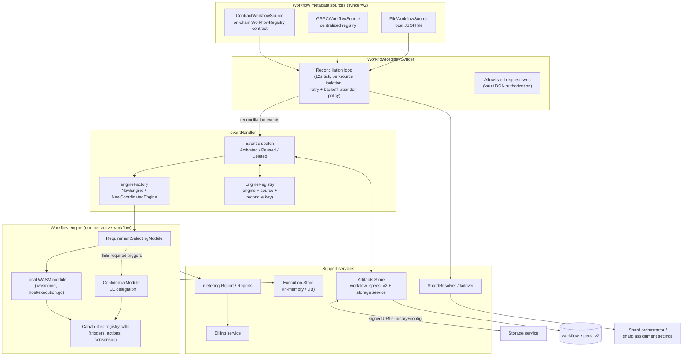
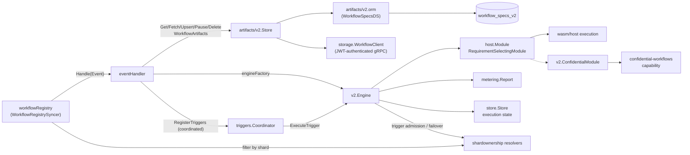
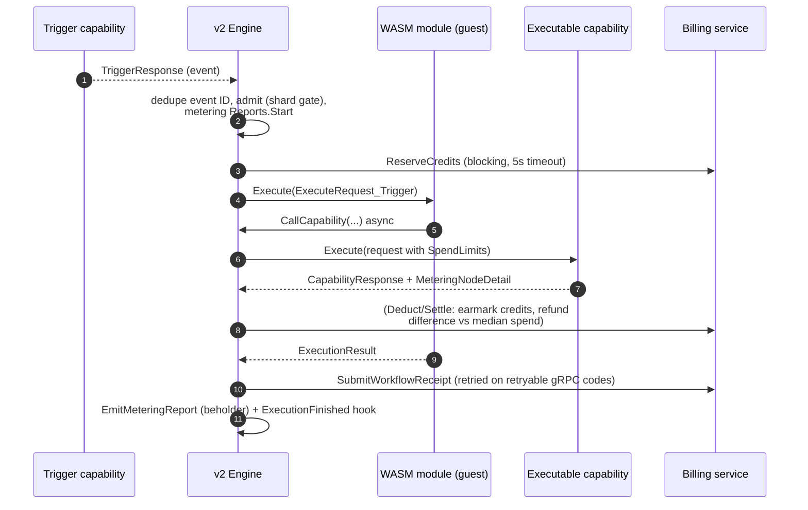

# Workflows (CRE Engine — Core Services)

> **Code roots:** `chainlink/core/services/workflows/...` (node side) and `chainlink-common/pkg/workflows/...` (shared contracts & WASM host)
> **Parent module:** [Workflow & Capability Runtime (CRE Engine)](../Workflow___Capability_Runtime_(CRE_Engine).md)

## 1. Overview

The `workflows` module is the node-side runtime for **Chainlink Workflows (Workflow Engine v2)** — the "NoDAG" CRE engine. It turns declarative *workflow registrations* — published to an on-chain `WorkflowRegistry` contract, a centralized gRPC registry, or a local JSON file — into long-running node services that:

- fetch and cache workflow **artifacts** (WASM binary + YAML config) from the storage service,
- **execute** those binaries in a wasmtime sandbox in response to capability **trigger** events,
- route capability calls and secrets between the WASM guest and the node's **capabilities registry**,
- **meter** the compute, gas, and network resources each execution consumes and settle them against the billing service,
- keep execution state in an **execution store**, and
- support **sharding**, so a large DON can split workflow ownership across capability DONs with failover.

A workflow identity is content-addressed: `WorkflowID = GenerateWorkflowID(owner, name, binary, config, secretsURL)` — a 32-byte hash. The node verifies this identity whenever it (re)deploys an engine (`prepareEngineInputs` in the event handler), so a stored artifact can never be silently swapped for a different workflow.

## 2. Architecture

### 2.1 Layered view



### 2.2 Component relationships



### 2.3 Deployment surfaces

The same engine binary is reached from three registration surfaces, unified behind the `WorkflowMetadataSource` interface (`syncer/v2/types.go`):

| Source | Identifier format | Notes |
|---|---|---|
| `ContractWorkflowSource` | `contract:{chain_selector}:{address}` | Reads `getWorkflowListByDON` via the versioned contract-reader factory |
| `GRPCWorkflowSource` | `grpc:{name}:v1` | Centralized registry; optional JWT + centralized owner/org verification |
| `FileWorkflowSource` | `file:{name}:v1` | Local JSON (`FileWorkflowSourceData`); synthetic head from wall clock; DON-family filtered |

Per-source reconciliation isolation is a core invariant: **a source that fails to fetch never generates destructive events for another source's engines**, and the engine registry records the owning `Source` plus a `ReconcileKey` (owner+name fingerprint) to detect workflow-ID collisions across sources.

## 3. Sub-modules

The module is organized into the following sub-modules. Click through for detailed documentation.

| Sub-module | Scope | Documentation |
|---|---|---|
| **Registry Syncer & Event Handling** | Multi-source metadata polling, reconciliation, retry/abandon policy, allowlisted-request sync, and the event handler that translates events into DB + engine transitions. | [workflows_syncer.md](workflows/workflows_syncer.md) |
| **Workflow Engine & WASM Host** | The v2 engine (trigger registration, execution, drain), the wasmtime host, requirement/restriction-aware module contracts, the confidential (TEE) module, and coordinated-engine trigger routing. | [workflows_engine.md](workflows/workflows_engine.md) |
| **Artifacts & Persistence** | `workflow_specs_v2` ORM, the artifact store (fetch/cache/tombstone semantics), the storage-service gRPC client, the execution store, and the CLI-side compile/upload pipeline. | [workflows_artifacts.md](workflows/workflows_artifacts.md) |
| **Metering & Billing** | Per-execution credit reports: reserve → deduct → settle → receipt, rate cards, metering-mode fail-open, and storage-lifecycle meter records. | [workflows_metering.md](workflows/workflows_metering.md) |
| **Shard Ownership & Routing** | Ring-OCR, manual (settings-driven), and override shard resolvers; DON-ID mapping; failover-safe `AllShardsResolver`. | [workflows_sharding.md](workflows/workflows_sharding.md) |
| **Standalone Engine & Local Simulation** | `NewStandaloneEngine` with fake capabilities, file-based secrets, and loop-plugin standard capabilities — the runtime behind CRE CLI simulation. | [workflows_standalone.md](workflows/workflows_standalone.md) |
| **Shared Workflow Contracts** | Cross-repo types in `chainlink-common/pkg/workflows`: DON-time request/response protocol, execution results, and private-registry registration types. | [workflows_common_types.md](workflows/workflows_common_types.md) |

## 4. Key flows

The flows below are described at the architectural level; the authoritative per-component behavior lives in the generated sub-module pages: the [registry syncer & event handler](workflows/workflows_syncer.md), the [engine & WASM host](workflows/workflows_engine.md), the [artifact store & persistence](workflows/workflows_artifacts.md), [metering](workflows/workflows_metering.md), and [shard ownership](workflows/workflows_sharding.md). The [standalone engine](workflows/workflows_standalone.md) reuses the same engine construction path for local simulation, and the [shared contracts](workflows/workflows_common_types.md) page documents the cross-repo types used by all of them.

### 4.1 Workflow lifecycle (register → activate → pause → delete)

```mermaid
stateDiagram-v2
    [*] --> Active: WorkflowActivated<br/>(fetch artifacts, upsert spec, start engine)
    Active --> Active: redelivery (no-op)<br/>or DON update
    Active --> Draining: WorkflowPaused / WorkflowDeleted<br/>(drain; reject while executions active)
    Draining --> Active: WorkflowActivated<br/>(re-fetch cleared artifacts, new engine)
    Draining --> Paused: drain complete + PauseWorkflowArtifacts<br/>(tombstone: payload cleared, storage_bytes kept)
    Paused --> Active: WorkflowActivated (artifact re-fetch)
    Paused --> [*]: WorkflowDeleted<br/>(release spec storage, metering -1 delta)
    Active --> [*]: WorkflowDeleted
```



Important semantics implemented by the handler and artifact store:

- **Pause tombstones** the spec row (`status=paused`, artifact payload cleared) but deliberately *keeps* `storage_bytes` — storage remains metered for the registration's lifetime, and re-activation must **re-fetch** artifacts rather than serve the empty row as a cache hit.
- **Deletion is drain-aware**: if executions are still active, the delete is deferred (`ErrDrainInProgress`) and retried on a later tick; DB release happens before engine-registry removal, with exactly-once metering deltas derived from the row's own `registered_at`.
- **Activation is initialization-aware**: `startEngine` blocks until the engine signals `initDone` (trigger subscriptions complete), so status events reflect real deployability.

### 4.2 Reconciliation tick (syncer)

```mermaid
sequenceDiagram
    autonumber
    participant SRC as Source (contract/gRPC/file)
    participant WRS as WorkflowRegistrySyncer
    participant ER as EngineRegistry
    participant H as eventHandler
    participant E as WorkflowEngine

    loop every sync tick (12s default)
        WRS->>SRC: ListWorkflowMetadata(ctx, DON)
        SRC-->>WRS: []WorkflowMetadataView + head
        WRS->>WRS: filter by shard ownership (myDONID)
        WRS->>ER: diff metadata vs running engines (per source)
        WRS->>H: Handle(WorkflowActivated / Paused / Deleted)
        H->>E: create / drain / close (via engineFactory)
        Note over WRS: failures → retry w/ exponential backoff;<br/>activations abandoned after N retries or on<br/>non-retryable errors (ActivationAbandoned event)
    end
    loop every 5s (independent goroutine)
        WRS->>SRC: totalAllowlistedRequests / getActiveAllowlistedRequestsReverse
        WRS-->>WRS: prune expired, cache for Vault DON
    end
```

### 4.3 Trigger execution and metering round



Metering **fails open**: if the billing service is unreachable, rate cards are empty, or spend accounting breaks, the `Report` switches to *metering mode* (no credit enforcement, still records raw spends) so consensus is never blocked by billing (see CRE-5160 notes in `metering.go`).

### 4.4 Legacy vs coordinated engines

`workflowRegistry` (the handler) routes engine creation based on the `CoordinatedEngine` feature flag and the presence of a `triggers.Coordinator`:

- **Legacy engine** (`NewEngine`): the engine itself registers triggers with the capabilities registry during startup, holds trigger handles, and ACKs events.
- **Coordinated engine** (`NewCoordinatedEngine`): registers no triggers itself; after the engine is in the registry, the handler calls `Coordinator.RegisterTriggers`, which calls the engine's `Subscribe` and owns handles/ACKs. This centralizes trigger ingress for DON-level coordination and is disabled on sharded nodes (sharding + coordination not yet compatible).

## 5. Configuration, limits & observability

- **Settings**: engine behavior is driven by `cresettings` (`chainlink-common/pkg/settings/cresettings`) — execution timeout, capability call timeout, trigger-subscription limits, confidential-workflow gates, `CoordinatedEngine`, `CachedTriggerSubscriptionsEnabled`, shard-assignment config. See [settings](../Shared_Foundation_Libraries___Domain_Types/settings.md).
- **Limiters**: `v2.EngineLimiters` bound WASM binary/memory sizes, execution response size, capability concurrency, pending calls, user metrics; `ratelimiter.RateLimiter` throttles events; `syncerlimiter.WorkflowLimits` enforce global/per-owner workflow counts.
- **Caching**: persisted trigger subscriptions (`workflow_specs_v2.trigger_subscriptions`) let restarted engines skip WASM `Subscribe()` execution; a disk-backed `ModuleLRU` caches compiled binaries across restarts, version-tagged to reject ABI-incompatible reloads.
- **Telemetry**: workflow lifecycle, metering, and activation-abandonment events are emitted as beholder protobuf events (`events.EmitWorkflowStatusChangedEventV2`, `EmitActivationAbandoned`, `EmitMeteringReport`); OTel tracing is enabled by `WithDebugMode`. See [beholder-telemetry](../Telemetry___Observability_Platform/beholder-telemetry.md).
- **Billing client**: the handler wires a `metering.BillingClient` (gRPC to the billing service with a 5s per-call timeout); the storage client uses JWT auth via [node-auth-jwt](../Shared_Foundation_Libraries___Domain_Types/node-auth-jwt.md).

## 6. How it fits into the rest of the system

- **Job service**: workflows run as `workflow`-type jobs spawned by the node's job service — see [Job Service](../Node_Platform_Services/job_service.md). The `WorkflowSpec` persisted here is the v2 successor of the legacy pipeline-based workflow spec (legacy engine in [Pipeline](../Oracle_Engines___Data_Pipelines/pipeline.md)).
- **Capabilities runtime**: the engine only executes through capabilities registered in the capabilities registry. Standard capabilities (cron, HTTP, consensus), chain capabilities, and the remote/trigger plumbing are documented in [capabilities.md](capabilities.md) and [core_capabilities_runtime.md](core_capabilities_runtime.md); concrete capability implementations live in [cron_capability.md](cron_capability.md), [http_action_capability.md](http_action_capability.md), [http_trigger_capability.md](http_trigger_capability.md), [consensus_capability.md](consensus_capability.md), and the chain-specific pages (`chain_capability_*.md`).
- **Developer toolchain**: workflows are authored with the CRE SDK and deployed with the CRE CLI — the CLI's deploy/simulate commands talk to the private registry and storage service this module consumes; see [cre-cli-workflow-commands](../Developer_Toolchain_(CLI,_SDKs___API_Clients)/cre-cli-workflow-commands.md) and [cre-sdk-core](../Developer_Toolchain_(CLI,_SDKs___API_Clients)/cre-sdk-core.md). Artifact compilation/upload tests in `chainlink-common/pkg/workflows/artifacts` mirror the CLI contract.
- **Deployment**: the workflow registry contracts, forwarders, and capability registries that this module reads are deployed via the CRE/Keystone deployment suite — see [cre-workflow-registry](../CRE___Keystone_Deployment_Suite/cre-workflow-registry.md) and [cre-capabilities-registry](../CRE___Keystone_Deployment_Suite/cre-capabilities-registry.md).
- **Metering/billing shared libs**: protobuf schemas and unit definitions for metering live in [metering-and-billing](../Shared_Foundation_Libraries___Domain_Types/metering-and-billing.md).

## 7. Testing notes

- Handler, artifact-store, and engine suites use real Postgres test databases (`pgtest`) and real WASM binaries built from `core/services/workflows/test/wasm/v2/cmd/*` via `wasmtest.GetTestBinary`.
- WASM host test binaries are built with `GOOS=wasip1 GOARCH=wasm` — see `chainlink-common/pkg/workflows/wasm/host/standard_tests/Makefile` and the regression-test Makefile (documented in [workflows_engine.md](workflows/workflows_engine.md)), which also supports hand-written `main.wat` cases compiled by a local `wat2wasm` helper.
- Metering, billing, and trigger-subscription caching are exercised through mocked `BillingClient`s and beholder test observers (e.g. `TestEngine_Metering_ValidBillingClient`, `TestEngine_Subscribe_CachedTriggerSubscriptions`).
