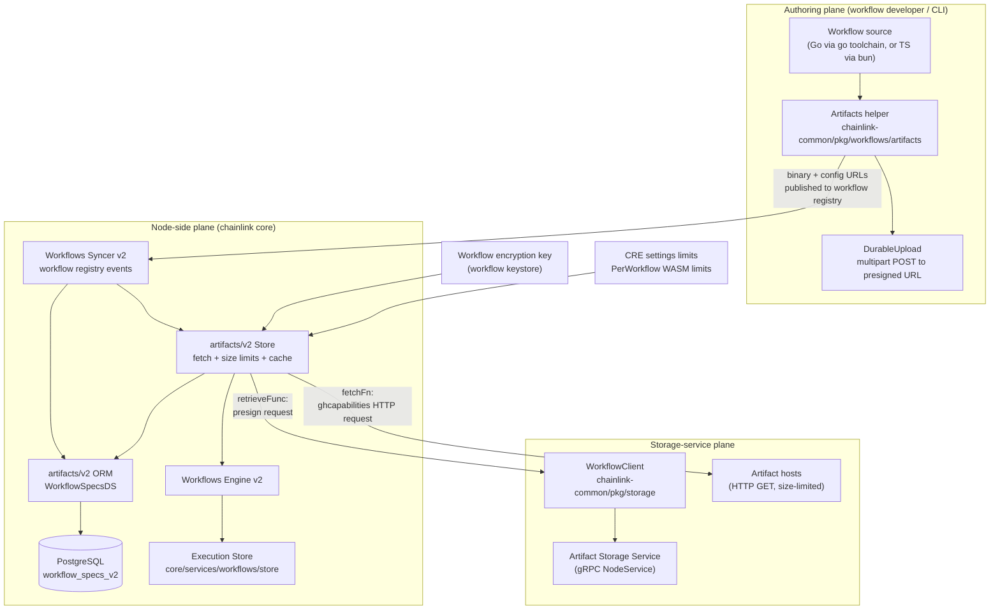
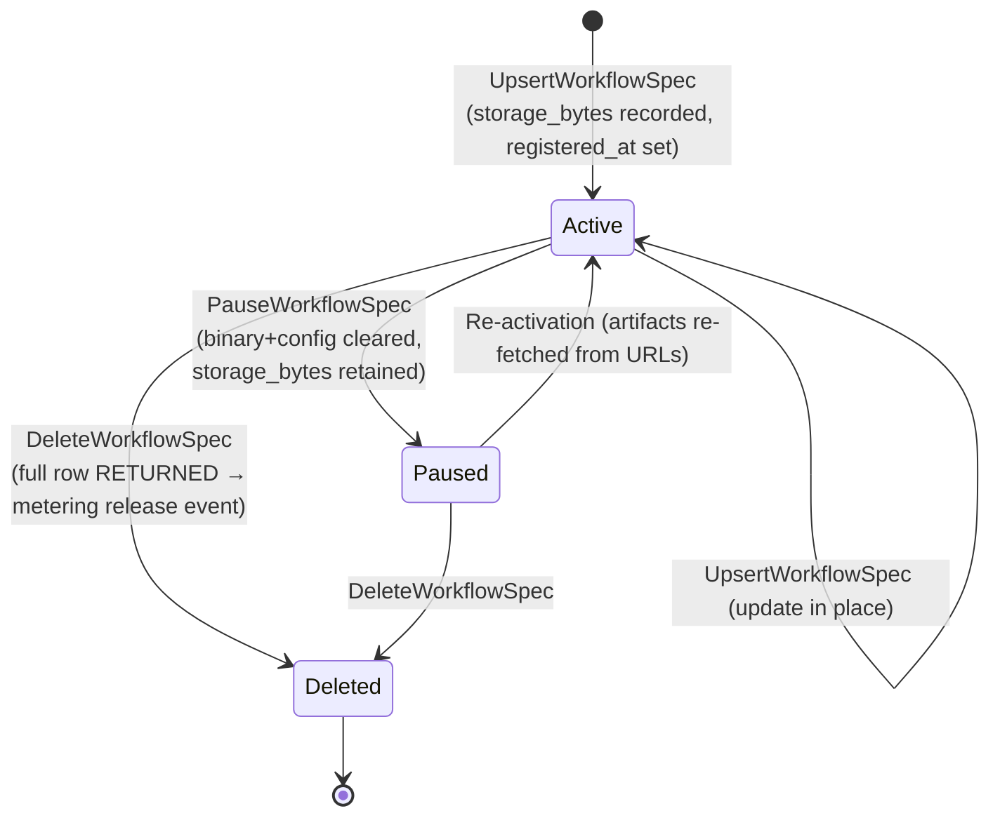
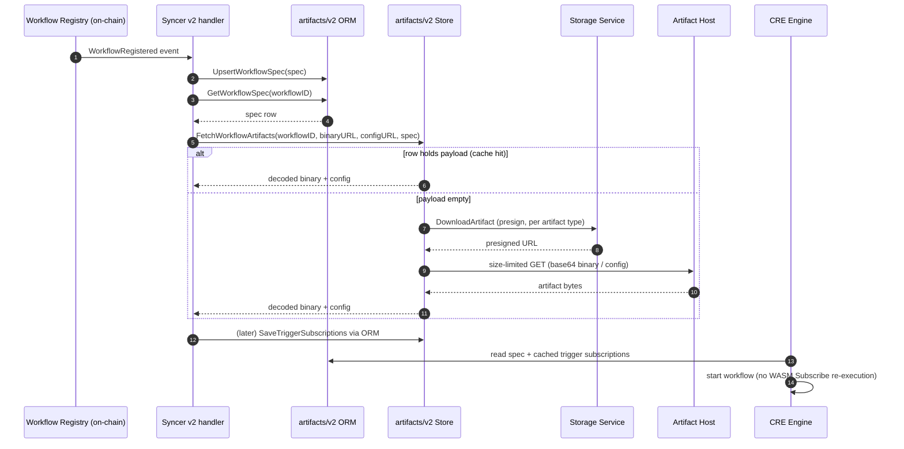

# Workflows Artifacts

## 1. Overview

The **workflows_artifacts** module manages the full lifecycle of *workflow artifacts* — the compiled WASM binary and its YAML configuration — inside the Chainlink Runtime Environment (CRE). It spans three cooperating planes:

1. **Authoring plane** (`chainlink-common/pkg/workflows/artifacts`): compiles Go/TypeScript workflow source into a WASM binary, prepares base64-encoded artifacts, derives the deterministic `workflow_id`, and durably uploads artifacts to a presigned-URL storage service.
2. **Node-side persistence & caching plane** (`chainlink/core/services/workflows/artifacts/v2`): a PostgreSQL ORM over the `workflow_specs_v2` table plus a `Store` service that fetches, size-limits, decodes, caches, pauses, and deletes artifacts on the node.
3. **Storage-service access plane** (`chainlink-common/pkg/storage`): the gRPC `WorkflowClient` used to exchange artifact URLs for presigned download URLs from the artifact storage service, authenticated via TLS and optional JWT.

A fourth, easily-confused component — the execution-state `Store` in `chainlink/core/services/workflows/store` — tracks *workflow execution* progress (steps and statuses) in memory. It is documented here because it is a listed module component, but it is a distinct concern from artifact storage (see [Execution State Store](#5-execution-state-store-coreservicesworkflowsstore)).

| Aspect | Detail |
|---|---|
| Go packages | `chainlink/core/services/workflows/artifacts/v2`, `chainlink-common/pkg/workflows/artifacts`, `chainlink-common/pkg/storage`, `chainlink/core/services/workflows/store` |
| Primary persistence | PostgreSQL table `workflow_specs_v2` (via `sqlutil.DataSource`) |
| External services | Artifact storage service (gRPC, `chainlink-protos/storage-service`), HTTP artifact hosts |
| Consumers | [Workflows Syncer](workflows_syncer.md) (registration/fetch), [Workflows Engine](workflows_engine.md) (artifact consumption), [Workflows Metering](workflows_metering.md) (storage-bytes accounting) |
| Security | Workflow encryption key (workflow keystore), TLS + JWT to storage service, per-artifact size limits |

This module is a child of [Workflows](../workflows.md) within the [Workflow & Capability Runtime (CRE Engine)](../../Workflow___Capability_Runtime_(CRE_Engine).md).

---

## 2. Component Inventory

| Component | Location | Role |
|---|---|---|
| `ORM` / `WorkflowSpecsDS` | `chainlink/core/services/workflows/artifacts/v2/orm.go` | Interface + sqlx implementation for `workflow_specs_v2` CRUD, tombstoning, and trigger-subscription caching. Also aliased as `WorkflowRegistryDS`. |
| `Store` (artifacts v2) | `chainlink/core/services/workflows/artifacts/v2/store.go` | Orchestrates artifact fetch/decode/cache, delete and pause; enforces size limits; routes storage-host URLs through the presign retriever. |
| `StoreConfig` | `chainlink/core/services/workflows/artifacts/v2/store.go` | Configuration for the artifact `Store` (`ArtifactStorageHost`). |
| `ArtifactLimiters` | `chainlink/core/services/workflows/artifacts/v2/store.go` | Upper-bound limiters for binary/config/secrets sizes sourced from CRE settings. |
| `mockFetchResp` / `mockFetcher` | `chainlink/core/services/workflows/artifacts/v2/store_test.go` | Test doubles for the fetcher and presign retriever used by the store test suite. |
| `ArtifactsTestSuite` | `chainlink-common/pkg/workflows/artifacts/artifacts_test.go` | Verifies compile/prepare behavior, keccak256 reproducibility of the compiled binary, workflow-ID derivation, and file-type classification. |
| `UploadTestSuite` | `chainlink-common/pkg/workflows/artifacts/upload_test.go` | Verifies durable multipart upload against a local test server (status codes, retry/backoff, sad paths). |
| `WorkflowClient` | `chainlink-common/pkg/storage/workflow_client.go` | gRPC client for the storage service `NodeService`; `DownloadArtifact` returns a presigned URL; supports TLS pinning and JWT auth. |
| `Store` (executions) | `chainlink/core/services/workflows/store/store.go` | Interface for tracking workflow execution state (`WorkflowExecution`/`WorkflowExecutionStep`); returns `ErrDuplicateExecution` on ID collision; in-memory implementation. |

---

## 3. Architecture



**Key relationships**

- The [Workflows Syncer](workflows_syncer.md) is the primary production caller: it reacts to on-chain workflow-registry events, persists each registration through the ORM, and hands the already-loaded `job.WorkflowSpec` row to `Store.FetchWorkflowArtifacts` (the store itself never performs the initial row lookup).
- The [Workflows Engine](workflows_engine.md) consumes the decoded binary/config and the cached trigger subscriptions to start workflows without re-executing the WASM `Subscribe()` path.
- Deleted/paused rows feed [Workflows Metering](workflows_metering.md): `storage_bytes` and `registered_at` allow every node to derive the identical, generation-scoped metering event id (see [Storage accounting semantics](#43-storage-accounting-semantics)).
- Generic size-limited HTTP fetching reuses the gateway capability request type from [Gateway handlers](../../Node_Platform_Services/gateway/gateway_handlers.md).

---

## 4. Node-Side Persistence: `workflow_specs_v2` ORM

### 4.1 API surface (`WorkflowSpecsDS`, exposed as `ORM` / `WorkflowRegistryDS`)

| Method | Semantics |
|---|---|
| `UpsertWorkflowSpec(ctx, spec) (int64, error)` | `INSERT ... ON CONFLICT (workflow_id) DO UPDATE ... RETURNING id` inside a `sqlutil.TransactDataSource` transaction. Uniqueness is by `workflow_id`; multiple specs may share an owner/name combination. Stamp `UpdatedAt` (UTC now); `CreatedAt` defaults to now when zero. |
| `GetWorkflowSpec(ctx, id) (*job.WorkflowSpec, error)` | `SELECT * WHERE workflow_id = $1`. Returns `sql.ErrNoRows` when absent — callers must treat that distinctly from other errors. |
| `ListWorkflowSpecs(ctx) ([]*job.WorkflowSpec, error)` | Projects only identity columns plus `storage_bytes` (`workflow_id`, `workflow_owner`, `registered_at`, `source`, `storage_bytes`) to keep batch size small; powers the orphan sweep and metering snapshot paths. |
| `DeleteWorkflowSpec(ctx, id) (*job.WorkflowSpec, error)` | Single-row `DELETE ... RETURNING` of the full row. **Idempotent**: a missing row yields `(nil, nil)`. The returned row (including `storage_bytes`, `registered_at`) lets the caller emit the deletion metering event. |
| `PauseWorkflowSpec(ctx, id) (error)` | Tombstones the row in one statement: sets `status = paused` and clears the heavy payload (`workflow` hex binary and `config`) while **keeping `storage_bytes`**. Idempotent no-op for absent or already-paused rows. |
| `DeleteWorkflowSpecs(ctx, ids) (error)` | Batch delete via `WHERE workflow_id = ANY($1)` (`pq.Array`); no-op for an empty slice. |
| `SaveTriggerSubscriptions(ctx, id, payload) (error)` | Persists the marshaled `sdkpb.TriggerSubscriptionRequest` payload so future engine starts can skip re-executing the WASM binary's `Subscribe()`. Best-effort: a concurrently deleted/paused row is a silent no-op. |

### 4.2 Row schema (as mapped onto `job.WorkflowSpec`)

| Column | Field | Notes |
|---|---|---|
| `workflow` | `Workflow` | Raw hex-encoded WASM binary payload. **Cleared on pause**; cache-hit key for `FetchWorkflowArtifacts`. |
| `config` | `Config` | Raw workflow config (YAML). **Cleared on pause**. |
| `workflow_id` | `WorkflowID` | Deterministic content-derived ID (see [Workflow identity](#62-workflow-identity)); the upsert conflict key. |
| `workflow_owner` / `workflow_name` / `workflow_tag` | … | Registry identity columns. |
| `status` | `Status` | `WorkflowSpecStatus` (`active` / `paused`). |
| `binary_url` / `config_url` | … | Source artifact URLs. |
| `spec_type` | `SpecType` | e.g. `WASMFile`. |
| `attributes` | `Attributes` | Marshaled `WorkflowAttributes` (see confidential module in [workflows engine](workflows_engine.md)). |
| `registered_at` | `RegisteredAt` | Registration generation timestamp; input to the metering event id. |
| `source` | `Source` | Which metadata source produced the spec (e.g. `ContractWorkflowSource`). |
| `storage_bytes` | `StorageBytes` | Workflow + config size, set at registration and intentionally **not** cleared by pause (storage is billed for the registration lifetime). |
| `trigger_subscriptions` | `TriggerSubscriptions` | Cached marshaled trigger subscription requests. |
| `created_at` / `updated_at` | … | Bookkeeping timestamps managed by the ORM. |

### 4.3 Storage accounting semantics

The schema is deliberately shaped so metering stays consistent across nodes with different local cache staleness:



- **Pause = tombstone, not deletion.** The row remains the durable record that the registration generation is still held (level-neutral for metering), while freeing binary/config storage.
- **Delete returns the deleted row** so the caller can derive the *generation-scoped* metering `event_id` from the row's own persisted `registered_at` and release the original `storage_bytes` — every node emits the identical id regardless of local staleness. See [Workflows Metering](workflows_metering.md) and the shared [metering & billing libraries](../../Shared_Foundation_Libraries___Domain_Types/metering-and-billing.md).

---

## 5. Node-Side Artifact `Store` (`artifacts/v2`)

### 5.1 Construction

```go
NewStore(lggr, orm, fetchFn, retrieveFunc, clock, encryptionKey, emitter, limitsFactory, opts...)
```

- `orm` accepts the same `WorkflowRegistryDS` interface implemented by the ORM above.
- `fetchFn` performs size-limited HTTP GETs (`ghcapabilities.Request` with `MaxResponseBytes`).
- `retrieveFunc` exchanges an artifact identity for a presigned URL (`storage_service.DownloadArtifactRequest`); may be `nil` (local/standalone CRE — tracked as TODO CRE-632 to make it mandatory).
- `encryptionKey` is the workflow key from the [node keyring](../../Node_Platform_Services/keystore/keystore_node_keyring.md).
- `limitsFactory` builds the `ArtifactLimiters` from CRE settings defaults (`PerWorkflow.WASM{Binary,Config,Secrets}SizeLimit` — see [settings library](../../Shared_Foundation_Libraries___Domain_Types/settings.md)).
- `WithConfig(StoreConfig{ArtifactStorageHost: ...})` sets the host whose URLs are routed through the presign retriever. **Validation**: if `retrieveFunc != nil` and `ArtifactStorageHost` is empty, construction fails.

### 5.2 Fetch decision flow

```mermaid
flowchart TD
    A["FetchWorkflowArtifacts(workflowID, binaryURL, configURL, existingSpec)"] --> B{"existingSpec.Workflow != \"\" ?"}
    B -->|"yes (cache hit)"| C["hex-decode stored binary;<br/>return config as-is"]
    B -->|"no (empty/tombstone/first fetch)"| D{"binaryURL host ==<br/>ArtifactStorageHost<br/>and retrieveFunc set?"}
    D -->|"yes"| E["retrieveFunc(DownloadArtifactRequest<br/>{Id, ARTIFACT_TYPE_BINARY})<br/>→ presigned binary URL"]
    D -->|"no"| F["use binaryURL directly"]
    E --> G["fetchFn: size-limited GET<br/>(MaxBinarySize limiter)"]
    F --> G
    G --> H["base64-decode binary"]
    H --> I{"configURL != \"\"?"}
    I -->|"yes"| J{"configURL host ==<br/>ArtifactStorageHost?"}
    J -->|"yes"| K["retrieveFunc(…ARTIFACT_TYPE_CONFIG)<br/>→ presigned config URL"]
    J -->|"no"| L["use configURL directly"]
    K --> M["fetchFn: size-limited GET<br/>(MaxConfigSize limiter)"]
    L --> M
    I -->|"no"| N["return decoded binary, empty config"]
    M --> N
```

- Fetch failures are wrapped in `types.ArtifactFetchError{ArtifactType, URL, Err}` so callers can attribute errors to the binary vs. config artifact.
- The binary payload is expected **base64-encoded** (matching what the authoring plane produced).
- The message id passed to `fetchFn` is derived from `(url, workflowID)`, correlating logs/traces.

### 5.3 Registration → fetch → engine sequence



### 5.4 Pause/re-activation (tombstone correctness)

`Store.PauseWorkflowArtifacts` delegates to the ORM tombstone. The subsequent fetch behavior is a deliberate contract, covered by `Test_Store_FetchWorkflowArtifacts_PauseTombstone`:

- A paused row's cleared `workflow`/`config` must **not** be served as a cache hit — `FetchWorkflowArtifacts` falls through to the URLs.
- The caller then re-persists the artifacts. Serving the tombstone payload would make the caller persist empty artifacts and subsequently fail activation with a `workflowID` mismatch.

Lifecycle mutators: `DeleteWorkflowArtifacts` (single), `DeleteWorkflowArtifactsBatch` (batch), `PauseWorkflowArtifacts` — all thin wrappers over the ORM, keeping metering-relevant row-return behavior in one place.

---

## 6. Authoring Plane: Compile, Prepare, Upload (`chainlink-common/pkg/workflows/artifacts`)

### 6.1 Lifecycle

```mermaid
sequenceDiagram
    autonumber
    participant DEV as Developer / CLI
    participant ART as Artifacts
    participant TOOL as Toolchain (go / bun)
    participant STG as Presigned storage endpoint

    DEV->>ART: NewWorkflowArtifacts(Input{Owner, Name, Paths})
    ART->>ART: Compile()
    alt Go workflow
        ART->>TOOL: ensure go in PATH (GOTOOLCHAIN pinned by go.mod)
        TOOL-->>ART: WASM binary (base64)
    else TypeScript workflow
        ART->>TOOL: ensure bun in PATH
        TOOL-->>ART: WASM binary (base64)
    end
    ART->>ART: Prepare() — load + validate binary (base64 wasm/wasm.br) and YAML config
    ART->>ART: GetWorkflowID() — keccak256-derived, deterministic
    DEV->>ART: DurableUpload(UploadInput{PresignedURL, Fields, Type, Filepath, Timeout})
    ART->>STG: multipart POST (3 attempts, backoff; expects 204/201)
    STG-->>ART: stored
    DEV->>DEV: publish workflow (binary/config URLs) to registry
```

### 6.2 Behavior details

- **Input**: `Input{WorkflowOwner, WorkflowName, WorkflowPath, ConfigPath, BinaryPath}` plus a `*slog.Logger`.
- **Compile()**:
  - Locates the workflow main file by scanning a directory (or accepting a direct path) for Go (`//go:build wasip1` style WASM entry) or TypeScript sources; non-Go/TS files are ignored.
  - Toolchain requirements produce actionable errors, including install URLs (`https://go.dev/dl`, `https://bun.com/docs/installation`).
  - Compilation pins the Go toolchain via `GOTOOLCHAIN` resolved from the nearest `go.mod` (the `chainlink-common` module pins `go 1.27.1` — see `chainlink-common/go.mod`), making the compiled binary — and therefore its hash — reproducible across machines. This property is asserted in `ArtifactsTestSuite` by comparing a keccak256 digest computed with `sha3.NewLegacyKeccak256` against a pinned expectation.
- **Prepare()**: loads the binary (only `.wasm`/`.wasm.br` are accepted by `IsBinaryFile`; other extensions error) and the YAML config; failures include missing files and non-base64 binary data.
- **Workflow identity**: `GetWorkflowID()` returns a deterministic, content-derived identifier (keccak256-based). This is the value used as `workflow_id`, the ORM upsert conflict key, and the storage-service artifact `Id`.
- **DurableUpload()**: multipart POST of the artifact file to a presigned URL with extra presigned fields and a content-type of binary or config. It retries **3 attempts** with backoff (`backOffSleep`, overridable for tests) and fails with `upload failed after 3 attempts: …` when the endpoint does not return HTTP 204/201 or the file cannot be read.

The upload path is exercised end-to-end by `UploadTestSuite` against an in-test HTTP server that stores multipart bodies per `(workflowID, artifact type)` and asserts byte-for-byte (first/last 100 bytes) equality with `GetBinaryData()`.

---

## 7. Storage-Service Client (`chainlink-common/pkg/storage`)

`WorkflowClient` is the node-side gRPC client for the artifact storage service (protos from `chainlink-protos/storage-service`):

| Element | Detail |
|---|---|
| Interface | `DownloadArtifact(ctx, *pb.DownloadArtifactRequest) (*pb.DownloadArtifactResponse, error)` and `Close()`. The response carries the **presigned URL** used by `DurableUpload` (authoring side) or `retrieveFunc` (node side). |
| Transport | `grpc.NewClient` with functional options: `WithWorkflowTransportCredentials`, `WithWorkflowTLSCert` (PEM pool; requires `WithServerName` override to match the cert), default is insecure with `serverName="localhost"`. |
| Auth | Optional `WithJWTGenerator(nodeauth.JWTGenerator)` — see the [node-auth JWT library](../../Shared_Foundation_Libraries___Domain_Types/node-auth-jwt.md). Before each RPC, `CreateJWTForRequest` mints a token injected as outgoing metadata `authorization: Bearer <token>`. |
| Creation | `NewWorkflowClient(lggr, address, opts...)`; dial failures are wrapped as `failed to dial storage service at <address>`. |

Two consumers share this pattern: the authoring/upload flow and the node-side `Store` presign retriever. The request/response types (`DownloadArtifactRequest{Id, Type}` with `ARTIFACT_TYPE_BINARY` / `ARTIFACT_TYPE_CONFIG`) are the contract between them.

---

## 8. Execution State Store (`core/services/workflows/store`)

```go
type Store interface {
    services.Service
    Add(ctx, steps map[string]*WorkflowExecutionStep, executionID, workflowID, status string) (WorkflowExecution, error)
    UpsertStep(ctx, step *WorkflowExecutionStep) (WorkflowExecution, error)
    FinishExecution(ctx, executionID, status string) (WorkflowExecution, error)
    Get(ctx, executionID) (WorkflowExecution, error)
    DeleteByWorkflowID(ctx, workflowID) error
}
```

- Tracks **execution progress** (`WorkflowExecution`, `WorkflowExecutionStep`) — who ran, which steps, with which status — not artifact bytes.
- `Add` returns the sentinel `ErrDuplicateExecution` when an execution ID already exists.
- The in-memory implementation satisfies the interface (`var _ Store = (*InMemoryStore)(nil)`), embedding the [services](../../Shared_Foundation_Libraries___Domain_Types/services.md) lifecycle contract (`services.Service`).
- Do **not** confuse this with the artifacts `Store` in §5: the artifacts Store manages artifact bytes in PostgreSQL + URLs; this store manages execution bookkeeping for the [workflows engine](workflows_engine.md) and observability.

---

## 9. Dependencies

### 9.1 Internal (sibling modules)

| Dependency | Direction | Purpose |
|---|---|---|
| [Workflows Syncer](workflows_syncer.md) | → this module | Registry event ingestion; persists specs and drives artifact fetch/caching. |
| [Workflows Engine](workflows_engine.md) | → this module | Consumes cached artifacts + trigger subscriptions; the confidential module stores `WorkflowAttributes` in the spec row. |
| [Workflows Metering](workflows_metering.md) | ← this module | Consumes `storage_bytes` / `registered_at` for spend reporting (`SpendTuple`, `ProtoDetail`). |
| [Workflows common types](workflows_common_types.md) | ← this module | Registry/registration types underpinning the workflow identity the artifacts package derives. |
| [Workflows standalone](workflows_standalone.md) | ↔ this module | Local CRE runs without the storage-service retriever (`retrieveFunc == nil`, TODO CRE-632). |
| [Keystore / node keyring](../../Node_Platform_Services/keystore/keystore_node_keyring.md) | → this module | Provides the workflow `encryptionKey` consumed by the artifacts `Store`. |
| [PostgreSQL layer](../../Node_Platform_Services/database_persistence/database_persistence_pg_layer.md) | → this module | `sqlutil.DataSource`, transactions, and the `workflow_specs_v2` schema/migrations. |
| [Gateway handlers](../../Node_Platform_Services/gateway/gateway_handlers.md) | → this module | `ghcapabilities.Request` type reused for size-limited artifact HTTP fetches. |
| [Settings](../../Shared_Foundation_Libraries___Domain_Types/settings.md) | → this module | `cresettings` PerWorkflow WASM size limits feeding `ArtifactLimiters`. |

### 9.2 External

- `github.com/jmoiron/sqlx`, `github.com/lib/pq` — named-parameter upserts and array deletes.
- `github.com/jonboulle/clockwork` — injectable clock in the artifacts `Store` (tests use `NewFakeClock`).
- `github.com/smartcontractkit/chainlink-protos/storage-service/go` — `NodeService` gRPC contract.
- `golang.org/x/crypto/sha3` — keccak256 for workflow-ID hashing (test-verified).
- `github.com/gagliardetto/…`/wasmtime runtime is *not* used here; WASM execution lives in the [workflows engine](workflows_engine.md) host modules.

---

## 10. Configuration Reference

| Setting | Where | Effect |
|---|---|---|
| `StoreConfig.ArtifactStorageHost` | `WithConfig` option | Hostname for which URLs are routed through the presign retriever instead of fetched directly. Required when `retrieveFunc != nil`. |
| `PerWorkflow.WASM{Binary,Config,Secrets}SizeLimit` | CRE settings | Upper bounds applied to fetched binary/config payloads (`ArtifactLimiters`; secrets limiter currently unused — TODO). |
| Workflow client TLS | `WithWorkflowTLSCert`, `WithServerName`, `WithWorkflowTransportCredentials` | Server cert pinning / transport security for the storage service. |
| Workflow client JWT | `WithJWTGenerator` | Per-request Bearer token injection to the storage service. |
| `retrieveFunc` presence | `NewStore` argument | Optional during local CRE bring-up (TODO CRE-632); when nil, storage-host routing is skipped. |

---

## 11. Testing Overview

| Suite | File | Covers |
|---|---|---|
| Artifact ORM/Store | `core/services/workflows/artifacts/v2/store_test.go` | `mockFetchResp`/`mockFetcher` doubles drive: single & batch artifact deletion (rows gone → `sql.ErrNoRows`), fetch with storage service (presign then base64 binary), fetch without storage, skipping retrieval when `retrieveFunc == nil`, and the pause-tombstone contract (tombstoned rows must not be served as cache hits). |
| Compile/Prepare | `chainlink-common/pkg/workflows/artifacts/artifacts_test.go` | Deterministic keccak256 of the compiled Go binary (toolchain pinned via go.mod), exact base64 payload shape, workflow-ID stability, Go vs. TS toolchain error messages, main-file discovery, binary-file classification. |
| Upload | `chainlink-common/pkg/workflows/artifacts/upload_test.go` | Local multipart test server; success (204), retry/backoff after 3 attempts on bad filepath or bad presigned URL (404). |

---

## 12. Related Documentation

- Parent: [Workflows](../workflows.md) · [Workflow & Capability Runtime (CRE Engine)](../../Workflow___Capability_Runtime_(CRE_Engine).md)
- Siblings: [Workflows Syncer](workflows_syncer.md) · [Workflows Engine](workflows_engine.md) · [Workflows Metering](workflows_metering.md) · [Workflows Sharding](workflows_sharding.md) · [Workflows Standalone](workflows_standalone.md) · [Workflows Common Types](workflows_common_types.md)
- Platform services: [Keystore node keyring](../../Node_Platform_Services/keystore/keystore_node_keyring.md) · [PostgreSQL layer](../../Node_Platform_Services/database_persistence/database_persistence_pg_layer.md) · [Gateway handlers](../../Node_Platform_Services/gateway/gateway_handlers.md)
- Shared libraries: [Settings](../../Shared_Foundation_Libraries___Domain_Types/settings.md) · [Node-auth JWT](../../Shared_Foundation_Libraries___Domain_Types/node-auth-jwt.md) · [Metering & Billing](../../Shared_Foundation_Libraries___Domain_Types/metering-and-billing.md) · [Services](../../Shared_Foundation_Libraries___Domain_Types/services.md)
