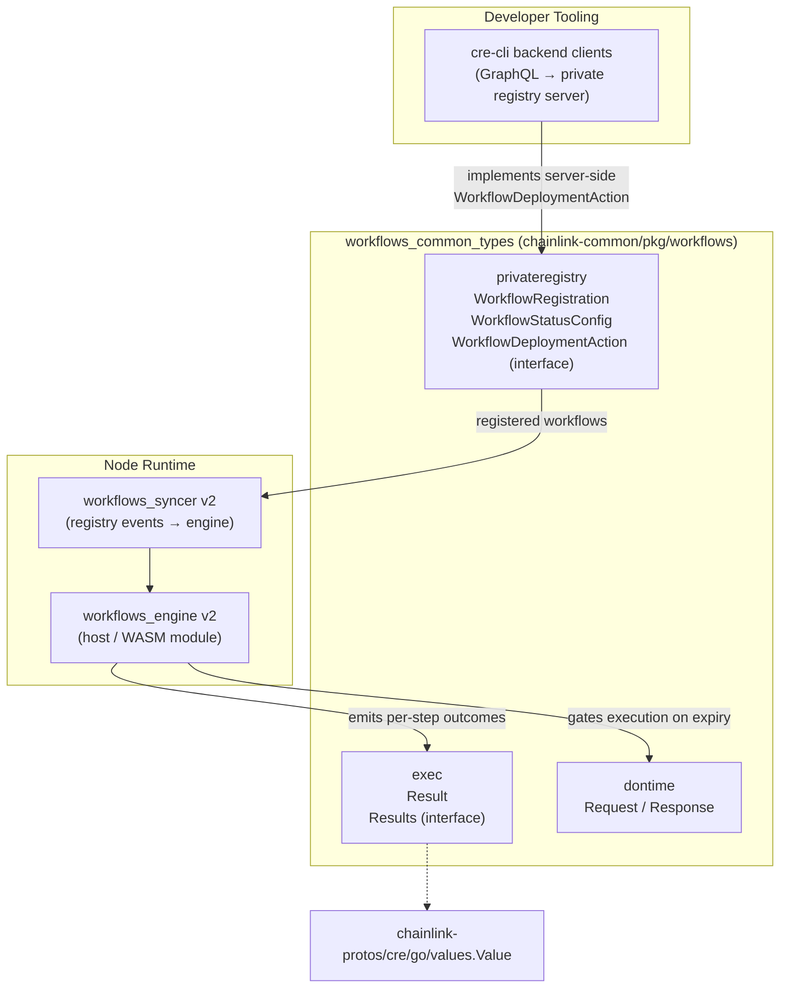
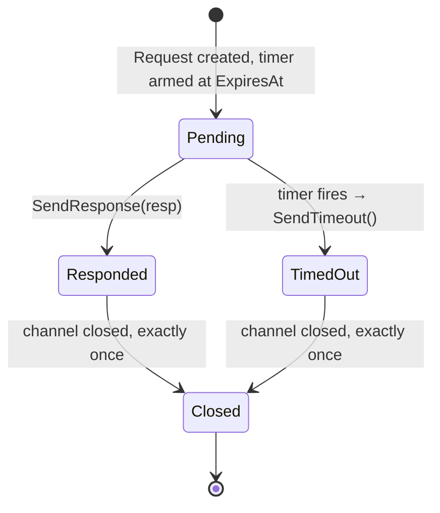
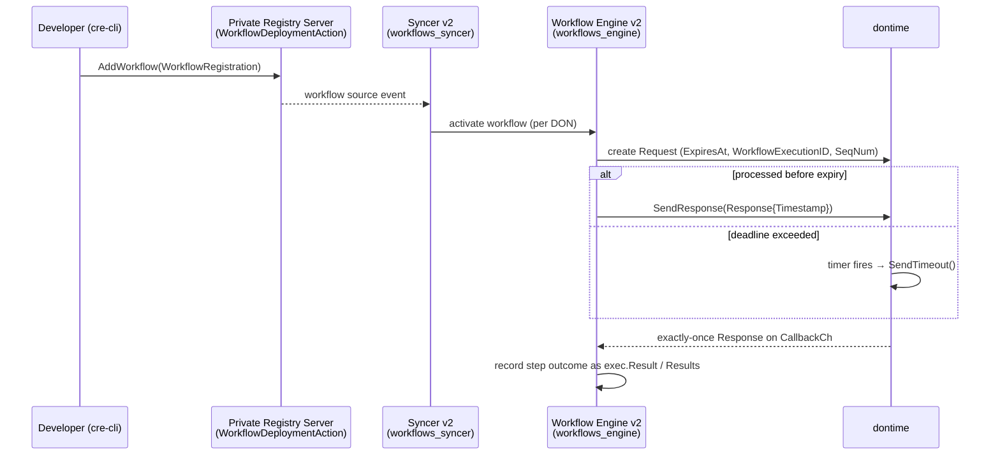

# Workflows Common Types (`workflows_common_types`)

## 1. Overview

`workflows_common_types` is the shared vocabulary of the CRE (Chainlink Runtime Environment) workflow system. It is a small, dependency-free package group inside the `chainlink-common` Go module (`github.com/smartcontractkit/chainlink-common`, see `chainlink-common/go.mod`) that defines the three foundational data contracts used by every other workflows sub-module:

| Package | Location | Purpose |
|---|---|---|
| `dontime` | `chainlink-common/pkg/workflows/dontime/request.go` | Coordinating time-sensitive workflow requests across a DON, with expiry and timeout semantics |
| `exec` | `chainlink-common/pkg/workflows/exec/results.go` | The canonical shape of workflow execution results per step |
| `privateregistry` | `chainlink-common/pkg/workflows/privateregistry/types.go` | Registration and status-management contracts for off-chain (private) workflow registries |

Because these types are used simultaneously by the **node-side engine**, the **syncer**, and the **developer tooling (cre-cli)**, they live in a leaf package with no internal dependencies — only the standard library and `chainlink-protos` `values` types. This keeps them stable and safe to import from any layer of the stack.

For the module's role within the broader runtime, see the parent page [Workflows](../workflows.md) and [Workflow & Capability Runtime (CRE Engine)](../workflows.md).

## 2. Architecture and Component Relationships

The three packages play distinct, complementary roles in the workflow lifecycle:



Key relationships:

- **`privateregistry`** defines the *control-plane* contract. The `WorkflowDeploymentAction` interface is explicitly designed to be implemented by two servers: a **mock server for testing** and the **actual private workflow registry server**. The [cre-cli backend clients](../../Developer_Toolchain_(CLI,_SDKs___API_Clients)/cre-cli-backend-clients.md) talk to these servers over GraphQL (`UpsertOffchainWorkflowResponse`, `PauseOffchainWorkflowResponse`, etc.).
- **`exec`** defines the *data-plane* result contract. The [workflows engine](workflows_engine.md) produces `Result`/`Results` for every step; capability hosts and metering consumers read them.
- **`dontime`** defines *time-gating* semantics so that workflows that must not run past a deadline can be expired deterministically, even under concurrent racing of response and timer.

## 3. Package Reference

### 3.1 `dontime` — DON-Time Request/Response Coordination

File: `chainlink-common/pkg/workflows/dontime/request.go`

The package pairs a `Request` with a `Response` to coordinate a time-bounded operation identified by a workflow execution ID and sequence number.

#### `Request`

| Field | Type | Description |
|---|---|---|
| `ExpiresAt` | `time.Time` | Absolute deadline for processing the request |
| `CallbackCh` | `chan Response` | Channel used to deliver the response back to the requester after processing or timeout |
| `WorkflowExecutionID` | `string` | Identifier of the owning workflow execution; also serves as the request ID (`ID()`) |
| `SeqNum` | `int` | Sequence number to correlate request/response pairs |
| `expiryTimer` *(private)* | `*time.Timer` | Timer armed by the owner to trigger `SendTimeout` at `ExpiresAt` |
| `respondOnce` *(private)* | `sync.Once` | Guarantees exactly-once response delivery |

Methods:

- `ID() string` — returns `WorkflowExecutionID`.
- `SendResponse(resp Response)` — the single delivery path. Wrapped in `sync.Once`, so only the first caller wins. It stops the expiry timer, performs a **non-blocking** channel send (a full/unattended channel never deadlocks the responder), then **closes** the channel to signal completion to all listeners.
- `SendTimeout()` — constructs a `Response` carrying a descriptive `timeout exceeded` error (including the workflow execution ID) and delegates to `SendResponse`.
- `stopExpiry()` *(private)* — cancels the armed timer.

#### `Response`

| Field | Type | Description |
|---|---|---|
| `WorkflowExecutionID` | `string` | Echoes the originating request ID (`RequestID()`) |
| `SeqNum` | `int` | Echoes the request sequence number |
| `Timestamp` | `int64` | DON-time timestamp of the response |
| `Err` | `error` | Nil on success; carries timeout or processing errors otherwise |

#### Request lifecycle



Design invariants:

- **Exactly-once delivery**: `sync.Once` makes `SendResponse` and `SendTimeout` idempotent — a race between the processing path and the expiry timer can never double-deliver.
- **Never blocks**: delivery uses a `select` with a `default` branch; if the requester is gone the response is dropped rather than blocking the responder.
- **Closed-channel completion**: closing `CallbackCh` lets multiple listeners detect termination without additional signaling.

### 3.2 `exec` — Execution Results

File: `chainlink-common/pkg/workflows/exec/results.go`

This package defines the standard outcome type for workflow execution steps.

#### `Result`

| Field | Type | Description |
|---|---|---|
| `Inputs` | `values.Value` | Typed input values passed into the step |
| `Outputs` | `values.Value` | Typed output values produced by the step |
| `Error` | `error` | Step-level failure, if any |

`values.Value` comes from `github.com/smartcontractkit/chainlink-protos/cre/go/values` (pinned in `chainlink-common/go.mod`), which gives every workflow — regardless of host language (Go, WASM/TypeScript) — a common, serializable value representation shared with the [capabilities](../capabilities.md) system.

#### `Results`

```go
type Results interface {
    ResultForStep(string) (*Result, bool)
}
```

`Results` is a lookup abstraction over the step results of a single execution. Consumers (e.g., consensus or reporting logic) ask for a step's `*Result` by name and receive a boolean indicating existence, rather than depending on a concrete map implementation.

### 3.3 `privateregistry` — Workflow Registration Contracts

File: `chainlink-common/pkg/workflows/privateregistry/types.go`

This package defines the data contract for managing workflows in an **off-chain (private) workflow registry**, complementing the on-chain [workflow registry](workflows_syncer.md).

#### `WorkflowRegistration`

The registration payload for a new workflow:

| Field | Type | Description |
|---|---|---|
| `WorkflowID` | `[32]byte` | Unique workflow identifier |
| `Owner` | `[]byte` | Owner identity (e.g., address bytes) |
| `WorkflowName` | `string` | Human-readable workflow name |
| `BinaryURL` | `string` | Location of the compiled workflow binary (artifact) |
| `ConfigURL` | `string` | Location of the workflow configuration |
| `DonFamily` | `string` | DON family the workflow targets |
| `Tag` | `string` | Deployment/version tag |
| `Attributes` | `[]byte` | Opaque serialized attributes (e.g., a `WorkflowAttributes` payload from the engine layer) |

#### `WorkflowStatusConfig`

The desired state of a workflow's status:

| Field | Type | Description |
|---|---|---|
| `Paused` | `bool` | `true` pauses the workflow, `false` makes it active |

The single-field design keeps status updates minimal and forward-compatible — new status dimensions can be added without changing the update call signature.

#### `WorkflowDeploymentAction` (interface)

The mutation surface for a workflow source, implemented by **both the mock server (testing) and the actual private workflow registry server**:

| Method | Semantics |
|---|---|
| `AddWorkflow(ctx, *WorkflowRegistration) error` | Registers a new workflow |
| `UpdateWorkflow(ctx, workflowID [32]byte, *WorkflowStatusConfig) error` | Updates the status configuration of an existing workflow |
| `DeleteWorkflow(ctx, workflowID [32]byte) error` | Removes the workflow from the source |

## 4. End-to-End Data Flow

The types above map onto the full workflow lifecycle, from developer tooling to node execution:



Notes on the flow:

1. **Registration**: the CLI issues upsert/activate/pause/delete operations (see [cre-cli backend clients](../../Developer_Toolchain_(CLI,_SDKs___API_Clients)/cre-cli-backend-clients.md)); the registry server fulfils them through `WorkflowDeploymentAction`.
2. **Propagation**: the [syncer v2](workflows_syncer.md) observes workflow sources (on-chain registry or off-chain private registry) and feeds activations to the engine.
3. **Execution**: the [engine](workflows_engine.md) runs workflow steps, uses `dontime.Request` where executions must honour a DON-time deadline, and records outcomes as `exec.Result` values, which feed [metering](workflows_metering.md) and [artifact storage](workflows_artifacts.md).

## 5. Dependencies

**Outbound (what this module depends on):**

- Go standard library: `context`, `fmt`, `sync`, `time`.
- `github.com/smartcontractkit/chainlink-protos/cre/go/values` — the shared protobuf-backed value type used by `exec.Result` (pinned in `chainlink-common/go.mod`).

There are no dependencies on other workflows sub-packages, node services, or capabilities — by design, to keep the contract importable from every layer (including WASM hosts and CLI tooling without pulling in the node).

**Inbound (who depends on this module):**

| Consumer | Types used | See |
|---|---|---|
| Workflows engine v2 / WASM host | `exec.Result`, `exec.Results`; `dontime` for expiry gating | [workflows_engine](workflows_engine.md) |
| Syncer v2 & registry syncer | `privateregistry` workflow sources and status flows | [workflows_syncer](workflows_syncer.md) |
| Artifact storage & upload | `[32]byte` workflow IDs, artifact URLs from `WorkflowRegistration` | [workflows_artifacts](workflows_artifacts.md) |
| Metering | per-step `exec.Result` outcomes as metering input | [workflows_metering](workflows_metering.md) |
| cre-cli (GraphQL clients) | registry operations mirroring `WorkflowDeploymentAction` | [cre-cli backend clients](../../Developer_Toolchain_(CLI,_SDKs___API_Clients)/cre-cli-backend-clients.md) |
| Standalone engine utilities | registration/config wiring | [workflows_standalone](workflows_standalone.md) |

## 6. Related Documentation

- [Workflows (parent module)](../workflows.md) — the workflows subsystem as a whole.
- [Capabilities](../capabilities.md) — the capability contracts whose requests/results interoperate with `exec`.
- [Shared Foundation Libraries & Domain Types](../../Shared_Foundation_Libraries___Domain_Types.md) — foundational cross-product contracts, including [types-core](../../Shared_Foundation_Libraries___Domain_Types/types-core.md) and [metering-and-billing](../../Shared_Foundation_Libraries___Domain_Types/metering-and-billing.md).
- [Sharding](workflows_sharding.md) — shard ownership resolution used alongside engine execution.
