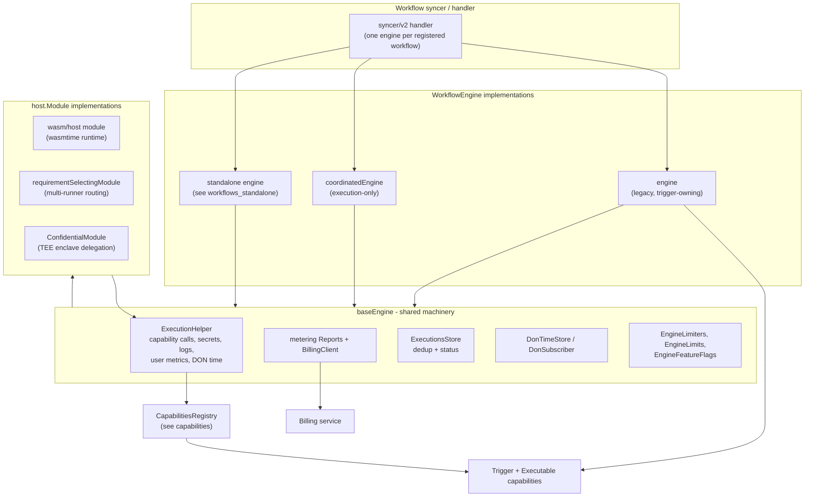
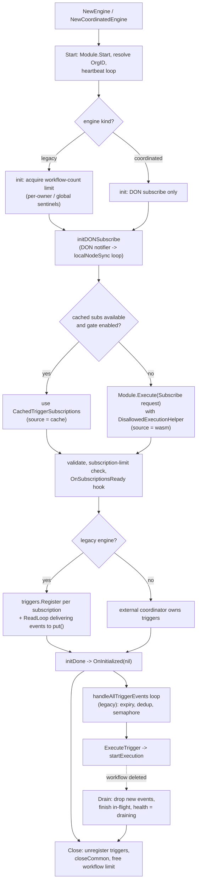
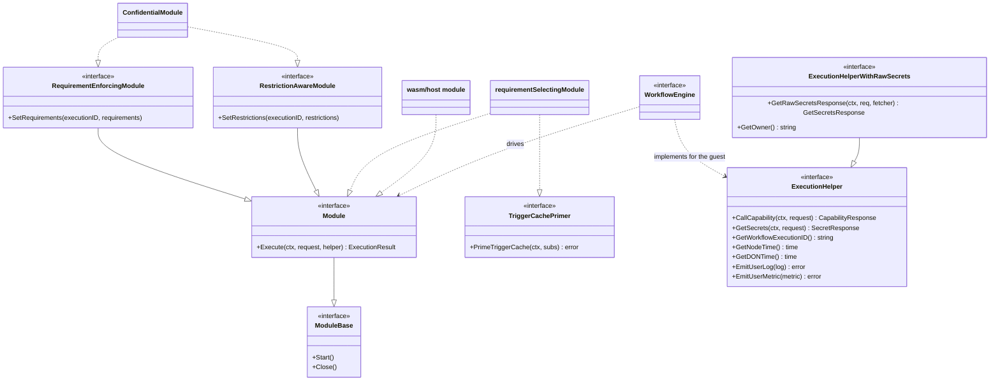
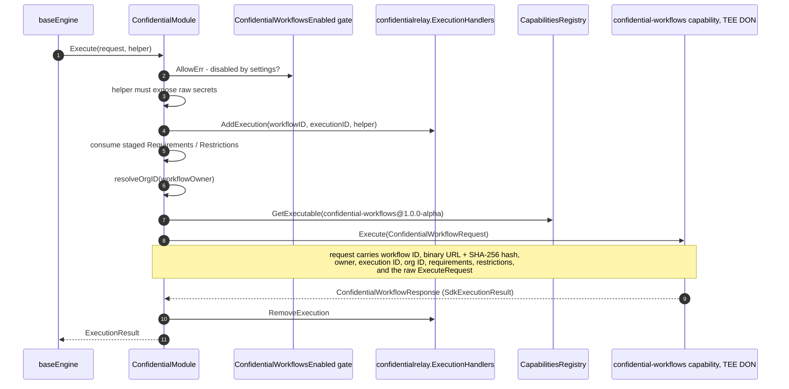
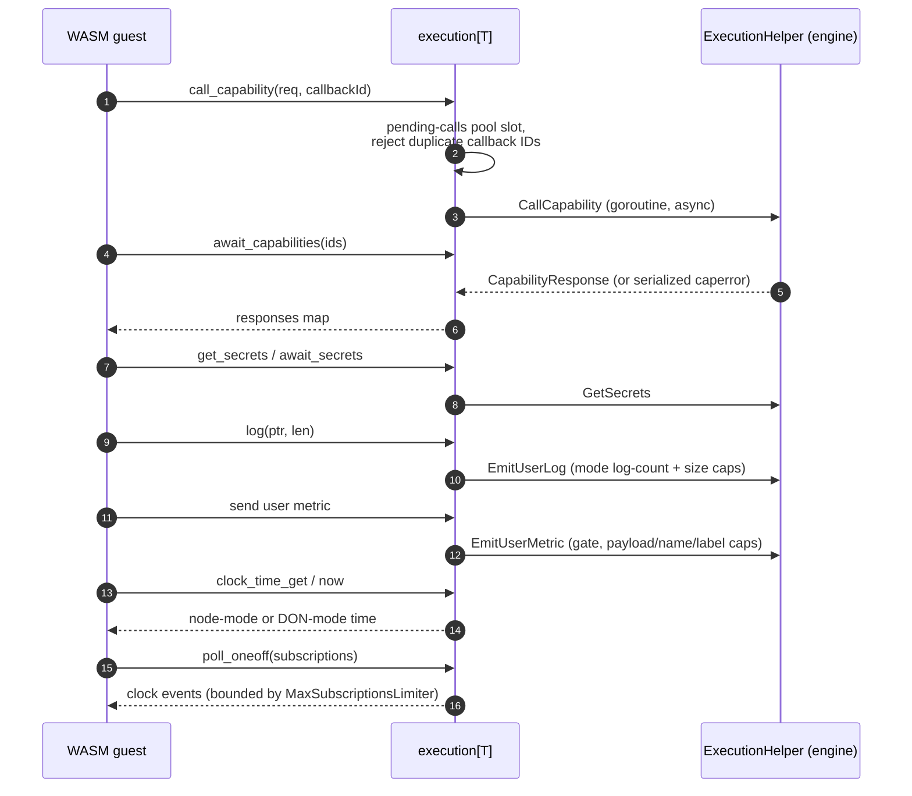

# Workflows Engine (CRE V2 Execution Engine)

The **workflows_engine** module is the execution heart of the Chainlink Runtime Environment (CRE): it runs compiled workflow binaries (WASM, or delegated confidential compute) in response to trigger events, mediates every interaction between the running workflow and node capabilities, enforces resource limits and metering, and reports execution outcomes to the node operator, the workflow owner, and the billing platform.

One engine instance exists per registered workflow on a node. Engines are constructed and supervised by the [workflow syncer](workflows_syncer.md), which consumes workflow registry state and pairs each workflow spec with its binary from the [artifacts store](workflows_artifacts.md). The engine itself is engine-version **v2** ("NoDAG" model): instead of the legacy DAG pipeline interpreter ([pipeline v1](../../Oracle_Engines___Data_Pipelines/pipeline.md)), the entire workflow runs as a sandboxed module that talks to the host through a small, capability-based RPC surface.

## Module at a glance

| Concern | Where |
|---|---|
| Engine contract and lifecycle | `chainlink/core/services/workflows/v2` (`engine.go`, `coordinated_engine.go`, `base_engine.go`, `types.go`, `config.go`) |
| Host/module abstraction (platform-agnostic) | `chainlink-common/pkg/workflows/host/module.go`, `requirement_selecting_module.go` |
| WASM runtime host | `chainlink-common/pkg/workflows/wasm/host` (`module.go`, `engine.go`, `execution.go`) |
| Confidential (TEE) execution | `chainlink/core/services/workflows/v2/confidential_module.go` |
| Test support | `chainlink/core/services/workflows/v2/engine_test.go`, `wasm/host/standard_tests`, `wasm/host/regression_tests` |

## Position in the system



Related modules that interact with the engine:

- [workflows](../workflows.md) – parent module overview (syncer, artifacts, metering, sharding, standalone).
- [workflows_syncer](workflows_syncer.md) – constructs engines from workflow registry events and drains/deletes them; consumes the engine's `Drainable` surface.
- [workflows_artifacts](workflows_artifacts.md) – binary retrieval and hashing (binary URL/hash feed `ConfidentialModule`); `store.Store` dedups executions.
- [workflows_metering](workflows_metering.md) – `BillingClient` rate cards, credit reservation, spend reports (`ProtoDetail`, `SpendTuple`).
- [workflows_sharding](workflows_sharding.md) – shard ownership resolution; denial decisions surface through the engine's admission hook.
- [workflows_common_types](workflows_common_types.md) – shared result/dontime/privateregistry types.
- [capabilities](../capabilities.md) – the capability contract (`CapabilityRequest`/`CapabilityResponse`, trigger capabilities, registry).
- [core_capabilities_runtime](../core_capabilities_runtime.md) – remote trigger transport, DON notifier (`DonSubscriber`), confidential relay `ExecutionHandlers`.
- [loop-plugin-core](../../Plugin_Process_Framework_(Loop)/loop-plugin-core.md) – gRPC plugin transport that can sit behind the registry for remote capabilities.
- [settings](../../Shared_Foundation_Libraries___Domain_Types/settings.md) / [metering-and-billing](../../Shared_Foundation_Libraries___Domain_Types/metering-and-billing.md) / [logger](../../Shared_Foundation_Libraries___Domain_Types/logger.md) / [beholder-telemetry](../../Telemetry___Observability_Platform/beholder-telemetry.md) – the foundation libraries the engine is built on.
- [cre-sdk-core](../../Developer_Toolchain_(CLI,_SDKs___API_Clients)/cre-sdk-core.md) – the SDKs that compile workflow binaries against the host contract verified here.
- [system-tests](../../Dev,_Test___Simulation_Environments/system-tests.md) – end-to-end CRE tests that exercise real engines.

---

## Engine contract

`chainlink/core/services/workflows/v2/types.go` defines the single interface every engine satisfies:

```go
type WorkflowEngine interface {
    services.Service          // Start / Close / Ready / HealthReport / Name
    triggers.EventSink        // ExecuteTrigger(ctx, CoordinatedEvent) error
    triggers.Subscriber       // Subscribe(ctx) ([]*TriggerSubscription, error); Tenant() CRE
    Drainable                 // Drain() bool; ActiveExecutions() int32; DrainStartedAt() (time, bool)
    IsCoordinated() bool      // fixed at construction
}
```

Semantics of the key methods (from `triggers/triggers.go`):

- **`Subscribe`** – issues the workflow's WASM `Subscribe` request (or returns cached subscriptions) and returns the validated trigger subscription list.
- **`ExecuteTrigger`** – the single execution entry point. It performs *no admission control*; the caller is responsible. Execution errors are *not* returned as `error` — they surface through lifecycle hooks. Expected sentinel errors are `ErrDuplicateExecution` (event already executed; the implementation ACKs internally) and `ErrMeteringReserveFailed` (no ACK; the caller may retry).
- **`Drain`** – graceful-shutdown transition: stop accepting new trigger events, let in-flight executions finish, and set the `draining` health condition (used by the syncer's `DrainableService` before deletion).

### Implementations

| Implementation | Constructor | Trigger ownership | `IsCoordinated` |
|---|---|---|---|
| `engine` (legacy) | `NewEngine(cfg)` | Registers its own triggers, holds the handles, ACKs events itself, owns the workflow-count limit | `false` |
| `coordinatedEngine` | `NewCoordinatedEngine(cfg)` (requires an external `TriggerAcknowledger`) | None — an external coordinator subscribes, registers/unregisters triggers, delivers events and ACKs | `true` |
| Standalone engine | see [workflows_standalone](workflows_standalone.md) | Local/file-based deployment variant | — |

The **`CoordinatedEngine` feature flag** (`EngineFeatureFlags.CoordinatedEngine`, a settings-backed gate) selects the coordinated engine for newly created workflows.

### baseEngine — shared execution machinery

`baseEngine` is never used directly; both `engine` and `coordinatedEngine` wrap it and supply their own `start`/`init`/`close`. It holds:

- the single `services.Engine` goroutine supervisor (`initServiceEngine`),
- the Beholder-labelled sugared logger, safely swappable when DON configuration changes (`localNodeSync`),
- metering reports (`metering.NewReports(BillingClient, …)`),
- the capability-call semaphore (`CapabilityConcurrency`),
- drain state (`draining`, `activeExecutions`, `drainStartedAtNs`),
- an OTel tracer (noop unless `DebugMode`).

`startWith` performs startup shared by all engines: `Module.Start()`, a one-time **org-ID resolution** for the workflow owner via `OrgResolver` (treated as stable for the engine's lifetime), logger-label storage, and spawning of the heartbeat loop, the engine-specific `init` goroutine and (for the legacy engine) the trigger-event drain loop.

---

## Lifecycle



Key lifecycle behaviours:

- **Workflow-count limit** (legacy engine only): before anything else, `useWorkflowLimit` acquires one slot of `GlobalWorkflowLimit`. Breaches surface as `types.ErrPerOwnerWorkflowCountLimitReached` or `types.ErrGlobalWorkflowCountLimitReached` on `OnInitialized`, with dedicated metrics.
- **DON sync**: `initDONSubscribe` subscribes to the DON notifier; each notification triggers `localNodeSync`, which re-fetches `CapRegistry.LocalNode()` and, when the workflow DON's `ConfigVersion` changed, atomically publishes the new node and rebuilds the Beholder logger labels. The org ID resolved at startup intentionally survives label rebuilds.
- **DON config version pinning**: trigger registration metadata pins `WorkflowDonConfigVersion = 1` (`pinnedWorkflowDonConfigVersion`) so forwarder contracts are not reconfigured on every registry config update.
- **Cached trigger subscriptions**: when `EngineConfig.CachedTriggerSubscriptions` is set and `CachedTriggerSubscriptionsEnabled` is on, `Subscribe` returns the cached list without executing the WASM binary (still subject to the per-workflow subscription limit and the `OnSubscriptionsReady` hook, flagged `fromCache`). The `platform_engine_trigger_subscription_source_total` counter distinguishes `cache` vs `wasm` sources. Zero-subscription results are rejected (`ErrZeroTriggerSubscriptions`) so they are never persisted to the cache.

### Trigger event pipeline (legacy engine)

`engine.put` is the admission gate for every trigger event:

1. **Draining check** – events are dropped with `ErrEngineDraining` (expected during workflow deletion).
2. **Admission hook** – `LifecycleHooks.OnTriggerAdmission` lets an external management layer (e.g. the shard failover manager) decide:
   - `nil` → allow, enqueue and execute;
   - `ErrAdmissionCache` → the event was cached for failover; dropped *without* ACK;
   - any other error → denied; the engine ACKs and drops (`ErrShardDeniedNotOwner` / `ErrShardDeniedOrchestrator` in the shard-owner case).
3. **Deadline stamping** – `ObservedAt` is mandatory; the queue deadline is `ObservedAt + TriggerEventQueueTimeout`.
4. **Enqueue** – bounded `QueueLimiter`; full queue → drop with `ErrQueueFull`.

`handleAllTriggerEvents` dequeues events, drops expired ones (`Deadline`), waits on the **execution semaphore** — a `MultiResourcePoolLimiter` stacking per-workflow, per-owner, per-org and global execution-concurrency pools — and spawns `ExecuteTrigger`. Duplicate event IDs are logged at info level (the event was handled by the first execution) and rejected with `ErrDuplicateExecution`.

---

## Execution pipeline

`baseEngine.startExecution` (reached from `ExecuteTrigger`) is the authoritative execution path:

```mermaid
sequenceDiagram
    autonumber
    participant TC as Trigger capability
    participant RL as triggers.ReadLoop
    participant Q as TriggerEventQueue
    participant LOOP as handleAllTriggerEvents
    participant BE as baseEngine.startExecution
    participant ST as ExecutionsStore
    participant BIL as BillingClient
    participant MOD as host.Module
    participant CAP as ExecutableCapability

    TC->>RL: TriggerResponse(event)
    RL->>Q: put(event) after admission + deadline stamp
    Q->>LOOP: dequeue (expired events dropped)
    LOOP->>BE: ExecuteTrigger, after execution semaphore
    BE->>BE: executionID = workflowID + eventID + trigger index
    BE->>ST: Add(executionID) - dedup
    BE->>BIL: Reserve credits, deduct standard compute
    BE->>TC: Ack(event) before execution
    BE->>MOD: Execute(trigger request, ExecutionHelper)
    MOD->>CAP: CallCapability async / GetSecrets
    CAP-->>MOD: CapabilityResponse
    MOD-->>BE: ExecutionResult (value, error, or subs)
    BE->>BIL: Settle compute (excl. DON-time waits), End report
    BE->>ST: FinishExecution(status)
    BE-->>LOOP: OnExecutionFinished / OnResultReceived / events
```

Highlights:

- **Execution identity**: `workflows.GenerateExecutionIDWithTriggerIndex(workflowID, eventID, triggerIndex)` produces a deterministic ID. Duplicate *registrations* of the same trigger each get a distinct ID (per trigger index) and run independently, while the *same* event ID is executed only once (dedup via `ExecutionsStore.Add` → `store.ErrDuplicateExecution`).
- **Execution timestamp**: when the `ExecutionTimestampsEnabled` gate is on, a DON-time provider timestamps the execution, falling back to local clock (with a fallback metric) if DON time fails.
- **Metering**: `meterReports.Start` + `Reserve` (failure → `ErrMeteringReserveFailed`, no ACK so the caller can retry), a standard compute deduction padded for context-cancel propagation, then `Settle` of `RESOURCE_TYPE_COMPUTE` after execution. The metered compute duration **excludes** time the guest spent blocked in DON-time host calls (tracked by the `suspensionTracker` / measured time provider), since that wait is non-deterministic across nodes.
- **Timeouts**: execution runs under `ExecutionTime.WithTimeout`; `context.DeadlineExceeded` maps to status `timeout`. Capability calls made through the helper get their own `CapabilityCallTimeout`.
- **Secrets**: an execution-scoped `SecretsFetcher` (see `secrets.go`) wraps the Vault capability with concurrency + call-count limits, the workflow encryption key for decryption-share re-encryption, and an optional local override fetcher. Raw-secret fetchers additionally return the DKG `RawVaultPublicKey` so decryption stays correct across reshares.
- **User logs**: each execution gets a burst-buffered log channel drained by `emitUserLogs`, enforcing per-execution `LogEvent` and per-line `LogLine` limits (truncation + drop metrics).
- **Outcome statuses**: `completed`, `errored`, `timeout` (see `store.Status*`). Module-level errors are platform errors by default, but user-origin `caperrors.Error` values are classified as *user* failures via `events.ClassifyError` — a distinction that drives alerting (`error_type=user|system`) and billing.
- **Lifecycle events**: `EmitExecutionStartedEvent` / `EmitExecutionFinishedEvent` / user-log proto events are emitted for every execution — including executions that fail before the normal emit points (`emitDroppedExecution`) — so the UI never sees a vanished execution. An execution profile (step inputs) is emitted and logged on completion.

### Lifecycle hooks

`EngineConfig.Hooks` decouples the engine from its consumers (syncer, shard failover manager, telemetry):

| Hook | Fired when |
|---|---|
| `OnInitialized(err)` | init finished (success or terminal failure) |
| `OnSubscriptionsReady(subs, tenant, fromCache)` | subscription list available (WASM or cache) |
| `OnSubscribedToTriggers(triggerIDs)` | all trigger registrations succeeded |
| `OnTriggerEventDropped(triggerID, eventID, reason)` | any drop path (draining, admission, queue, dedup…) |
| `OnExecutionFinished(executionID, status)` | execution reached a terminal status |
| `OnExecutionStatusUpdate(…, errClass)` | fine-grained status updates with error classification |
| `OnExecutionError(msg)` | execution error message |
| `OnResultReceived(result)` | successful execution result |
| `OnRateLimited(executionID)` | metering/limit rate-limiting took effect |
| `OnNodeSynced(node, err)` | DON-driven local node sync |
| `OnTriggerAdmission(ctx, event)` | pre-enqueue admission decision |
| `OnRequirementsSet(executionID, requirements)` | requirements staged for a module (standalone engine) |

---

## Module abstraction (`host.Module`)

The engine never talks to WASM or TEEs directly. It drives a `host.Module` (aliased as `ModuleV2` in `wasm/host`):



- **`Execute`** carries either a *Subscribe* request (returning `TriggerSubscriptions`) or a *Trigger* request (returning an `ExecutionResult` value/error).
- **`RequirementEnforcingModule`** must respect per-execution `Requirements` (e.g. which chains/DONs a trigger may run against) until the execution completes.
- **`RestrictionAwareModule`** receives user-enforced `Restrictions`. Host-side enforcement is *not trusted*; a guest violation is treated as an indicator of a serious issue such as compromise.
- **`ExecutionHelper`** is implemented by the engine and injected into the module. It is the *only* channel a workflow has to the outside world: capability calls, secrets, execution ID, node/DON time, user logs and user metrics. During the subscription phase the engine injects a `DisallowedExecutionHelper` that rejects capability and secrets calls ("secrets calls cannot be made during trigger subscription").

### `requirementSelectingModule` and `TriggerCachePrimer`

`chainlink-common/pkg/workflows/host/requirement_selecting_module.go` composes multiple runners (e.g. a WASM runner plus additional runners used by the [standalone engine](workflows_standalone.md)) behind one `Module`:

- `main` is `modules[0]`; `Subscribe` always runs there.
- After subscribing, `PrimeTriggerCache` routes each returned subscription to the **first module whose `RequirementsHandler` satisfies that subscription's requirements**, lazily starting only matched modules (`lazyModule` guarantees `Start` runs at most once and `Close` only closes started modules).
- On trigger delivery, the cached routing entry decides which module executes. If the subscription was marked `PreHook`, the pre-hook runs on `modules[0]` first; its returned `Restrictions` are applied to the handler via `NewRestrictedExecutionHelper` and pushed to any `RestrictionAwareModule`, and requirements are pushed to any `RequirementEnforcingModule` before the real trigger request runs.
- **`TriggerCachePrimer`** exists for the engine's cached-subscription path: callers that skip the WASM `Subscribe` call can still populate the routing cache directly with the cached subscription list.

### `ConfidentialModule` — TEE-delegated execution

`chainlink/core/services/workflows/v2/confidential_module.go` implements `RequirementEnforcingModule` and `RestrictionAwareModule` **without running WASM locally**. Workflows whose `WorkflowSpec.Attributes` JSON parse into

```go
type WorkflowAttributes struct {
    Confidential    bool
    VaultDonSecrets []SecretIdentifier // {Key, Namespace} in the Vault DON
}
```

are executed by delegating to the `confidential-workflows@1.0.0-alpha` capability:



Design points:

- **Raw secrets**: the helper must implement `ExecutionHelperWithRawSecrets`; it is registered with `confidentialrelay.ExecutionHandlers` for the duration of the execution so the confidential-workflows capability can fetch decrypted secrets for the enclave (see [core_capabilities_runtime](../core_capabilities_runtime.md)).
- **DON binding**: when the `RemoteExecutableWorkflowDONBindingEnabled` CRE setting is on, request metadata carries the local workflow DON ID (fetched via `capRegistry.LocalNode`); the remote capability server rejects mismatched requests. A failure to read the setting or the local node fails the whole call rather than sending a zero DON ID.
- **Security posture**: requirements and restrictions are staged per execution (`SetRequirements`/`SetRestrictions`) and forwarded to the enclave inside `ConfidentialWorkflowRequest`, so confidentiality policy is enforced *inside* the TEE, not just host-side.
- **Binary integrity**: `ComputeBinaryHash` produces the SHA-256 of the workflow binary; the enclave verifies the binary it downloads (obtained from the [artifacts store](workflows_artifacts.md) via `binaryURL`/`binaryHash`) against this hash.
- **Tee probing**: `ProvidedTees` (an empty-execution capability call) returns supported TEE types/regions; `host.NewProviderFromSelection` turns that into a predicate used to decide if a given TEE attestation is acceptable.
- **Observability**: the enclave round-trip is timed into a Beholder histogram and failures are labelled `error_type=user|system` by classifying the error with `events.ClassifyError`, mirroring the enclave-side convention so alerts page on system failures without firing on user-caused ones.

---

## WASM host runtime

`chainlink-common/pkg/workflows/wasm/host` implements `host.Module` on top of **wasmtime**:

- **`Engine`** (`engine.go`): a process-wide wasmtime engine with epoch interruption (incremented every 100 ms) for cancelling runaway guests, Cranelift `speedAndSize` optimization, default cache, and OS-specific stack unwinding. Exposed as a lazily-created singleton (`GetEngine`/`CloseEngine`).
- **`NewModule`** (`module.go`): validates and defaults `ModuleConfig`, brotli-decompresses the workflow binary with decompression-bomb protection (compressed and decompressed size limiters using bounded readers), installs module limiters, and detects the guest's v2 import name (`version_v2` prefix) and the `call_capability` arity (2 params = legacy V1, 4 params = V2 with response buffer). Notable defaults: 10 min execution timeout, 10 s pre-hook timeout, 128–N MB memory, 20 MB compressed / 100 MB decompressed binary, 5 MB response, 1 MB log line, 10 000 log lines per mode, 4 KB user-metric payload. Guest stdout/stderr are always redirected to `os.DevNull`.
- **`execution[T]`** (`execution.go`): per-guest-execution state machine wiring the guest's WASI + custom imports to the `ExecutionHelper`:



  - **Async capability + secrets calls** with per-callback channels, duplicate-callback-ID rejection (`cap__<id>` / `secret__<id>`), and a `pendingCallsLimiter` bounding in-flight calls (scoped per workflow when the limiter is workflow-scoped). Capability errors arrive as serialized `caperrors.Error` strings so the guest can inspect structured failures.
  - **Mode awareness**: the guest switches between `MODE_DON` and `MODE_NODE` (`switchModes`); seeds, log budgets and time semantics are per mode. `clock_time_get` uses node-mode DON time and pins a base time to keep Go's monotonic clock happy; `now` honours the active mode's time fetcher.
  - **Bounded WASI**: `poll_oneoff` implements only clock events (fd read/write are rejected) with the subscription count bounded by `MaxSubscriptionsLimiter`; context cancellation traps/unwinds the guest.
  - **User metrics**: emission is gated (`EnableUserMetricsLimiter`) and validated for payload size, metric name length, label count and label-value length before reaching `EmitUserMetric`.

---

## Resource limits and configuration

All tunables are settings-driven via the [settings framework](../../Shared_Foundation_Libraries___Domain_Types/settings.md); `NewLimiters` builds the full set from `cresettings.Default.PerWorkflow` plus overrides, and `EvictWorkflow` releases per-workflow tenant state (queues, semaphores) after workflow deletion.

`EngineConfig` (selected fields): `Module`, `CapRegistry`, `ExecutionsStore`, `DonTimeStore` (+ `UseLocalTimeProvider`), `WorkflowID/Owner/Name/Tag/EncryptionKey`, `LocalLimits`, `LocalLimiters`, `FeatureFlags`, `GlobalWorkflowLimit`, `BeholderEmitter`, `Hooks`, `BillingClient`, `WorkflowRegistryAddress`/`ChainSelector`, `OrgResolver`, `DebugMode`, `SdkName`, shard fields (`ShardOrchestratorClient`, `ShardingEnabled`, `MyDonID`, `ShardRoutingSteady`, `ShardResolver`), `TriggerAcknowledger`, `CachedTriggerSubscriptions(+Enabled)`, `SecretsFetcher`/`OverrideFetcher`.

Key limiter groups in `EngineLimiters`:

| Group | Limiters |
|---|---|
| Trigger pipeline | `TriggerSubscriptionTime`, `TriggerRegistrationsTime`, `TriggerSubscription` (count), `TriggerEventQueue` (queue), `TriggerEventQueueTimeout` |
| Execution | `ExecutionConcurrency` (multi-pool: workflow → owner → org → global), `ExecutionTime`, `ExecutionResponse` (max result size), `ExecutionTimestampsEnabled` (gate) |
| WASM | `WASMBinarySize`, `WASMCompressedBinarySize`, `WASMMemorySize` |
| Calls | `CapabilityConcurrency`, `CapabilityCallTime`, `ChainAllowed` (gate), per-kind call caps: `ChainWriteTargets`, `ChainReadCalls`, `ConsensusCalls`, `HTTPActionCalls`, `ConfidentialHTTPCalls`, `SecretsCalls`, `SecretsConcurrency` |
| User logs/metrics | `LogEvent`, `LogLine`, `UserMetricEnabled` (gate), `UserMetricPayload`, `UserMetricNameLength`, `UserMetricLabelsPerMetric`, `UserMetricLabelValueLength` |
| Feature gates | `ConfidentialWorkflowsEnabled`, `CentralizedWorkflowOwnerVerificationEnabled`, `ShardingFailoverEnabled`, `DONTimeRequestTimeout` |

`EngineFeatureFlags` carries the `WorkflowTagBackfill` range limiter (ops-scheduled healing window for `workflow_specs_v2.workflow_tag`) and the `CoordinatedEngine` gate.

### Error reference

| Sentinel | Meaning | ACKed? |
|---|---|---|
| `ErrDuplicateExecution` | event already executed (dedup) | yes (internally) |
| `ErrMeteringReserveFailed` | credit reservation failed | no (caller may retry) |
| `ErrAdmissionCache` | event cached by failover layer | no |
| `ErrShardDeniedNotOwner` / `ErrShardDeniedOrchestrator` | shard ownership denial (see [workflows_sharding](workflows_sharding.md)) | yes |
| `ErrEngineDraining` / `ErrQueueFull` / `ErrEnqueueFailed` | event not enqueued | n/a (drop path) |
| `ErrZeroTriggerSubscriptions` | workflow subscribed to zero triggers (init failure) | — |
| `types.ErrPerOwnerWorkflowCountLimitReached` / `types.ErrGlobalWorkflowCountLimitReached` | workflow-count limit breach (init failure) | — |

Execution statuses: `started` → `completed` | `errored` | `timeout`.

---

## Testing and build tooling

The host↔guest ABI is treated as a versioned contract and protected by two purpose-built suites, both driven by Makefiles in `chainlink-common/pkg/workflows/wasm/host`:

- **Standard tests** (`standard_tests/Makefile`): builds `%/test.wasm` from Go test packages with `GOOS=wasip1 GOARCH=wasm CGO_ENABLED=0 go build`. Per the suite's README, these tests intentionally avoid the CRE Go library to prevent circular dependencies and are also mirrored in each `cre-sdk-*` repository ([cre-sdk-core](../../Developer_Toolchain_(CLI,_SDKs___API_Clients)/cre-sdk-core.md)), which must produce binaries passing the same suite. **Changes must be additive** once an SDK is stable: removing or altering test behaviour would allow breaking the host↔guest contract; test changes are tagged with host versions so SDKs can implement them accordingly.
- **Regression tests** (`regression_tests/Makefile`): same pattern rule, but subdirectories containing a `main.wat` are compiled with a self-contained `wat2wasm` helper (Go + wasmtime, no external toolchain). This hosts WAT-level regressions such as int32 overflow in host memory bounds checks and unexpected memory exports.

Engine-level test support shipped with the module (`engine_test.go` and friends) is reused across the workflows test suites:

| Helper | Purpose |
|---|---|
| `MockCapabilityWrapper` | adapts a v1 `registry.Capability` into a v2 `ExecutableCapability` (v1↔v2 proto translation) |
| `TriggerCapabilityWrapper` | fake trigger that validates config payloads and immediately emits events |
| `stubShardResolver` | fixed-response `shardownership.ShardResolver` for shard-admission tests |
| `recordingAcknowledger` | records ACK calls to assert the ACK contract on admission/metering failures |
| `testEngine` | wraps a `WorkflowEngine` with counters/channels for every lifecycle hook |
| `mockOrgResolver`, mock `BillingClient`s, Beholder observers | org resolution, rate cards/reserve/receipts, and event/label assertions |

The engine is additionally exercised end-to-end by the [system-tests](../../Dev,_Test___Simulation_Environments/system-tests.md) CRE library (real DONs, real registries, workflows with vault secrets) and by `wasm/host`'s own standard/regression suites.

---

## Observability

- **Beholder proto events**: `Started`, `Registering trigger`, `All triggers registered successfully`, `Workflow Engine initialized`, execution started/finished pairs, user logs (`workflows.v1.UserLogs`) — all label-pinned with `workflowID`, `workflowOwner`, `workflowName`, `sdk`, `donVersion` and `organizationID` labels (see [beholder-telemetry](../../Telemetry___Observability_Platform/beholder-telemetry.md)). DON config version labels are intentionally pinned per DON generation so version-churn metrics stay meaningful.
- **Metrics** (via `monitoring.WorkflowsMetricLabeler`): workflow initialization failures (by reason), workflow-count limit counters (per-owner/global), trigger subscription source, trigger event enqueued/dropped/expired/queue-full, queue-wait and execution-semaphore-wait histograms, execution started/finished by status, timeout/error/completed duration histograms, compute metering, engine heartbeat gauge, limit-read fallback counters, and the org-ID-missing counter (labelled with the reason: resolver nil, resolver error, or empty response).
- **Health**: `HealthReport` exposes the `draining` health condition while pending deletion; `ActiveExecutions` and `DrainStartedAt` support the syncer's drain workflow.

## Related documentation

- [workflows](../workflows.md) — CRE workflows module overview.
- [workflows_syncer](workflows_syncer.md) — engine lifecycle ownership, registry-driven creation and deletion.
- [workflows_artifacts](workflows_artifacts.md) — binary storage/retrieval and workflow client.
- [workflows_metering](workflows_metering.md) — billing/metering data model.
- [workflows_sharding](workflows_sharding.md) — shard ownership and failover.
- [workflows_standalone](workflows_standalone.md) — standalone engine configuration (file-based secrets, standard capabilities).
- [capabilities](../capabilities.md) — capability model, registry, and protobuf contracts.
- [core_capabilities_runtime](../core_capabilities_runtime.md) — remote capability transport, DON notifier, confidential relay.
- [pipeline](../../Oracle_Engines___Data_Pipelines/pipeline.md) — legacy v1 DAG pipeline engine (for comparison).
- [settings](../../Shared_Foundation_Libraries___Domain_Types/settings.md) — dynamic settings and limiter framework underpinning `EngineLimiters`.
