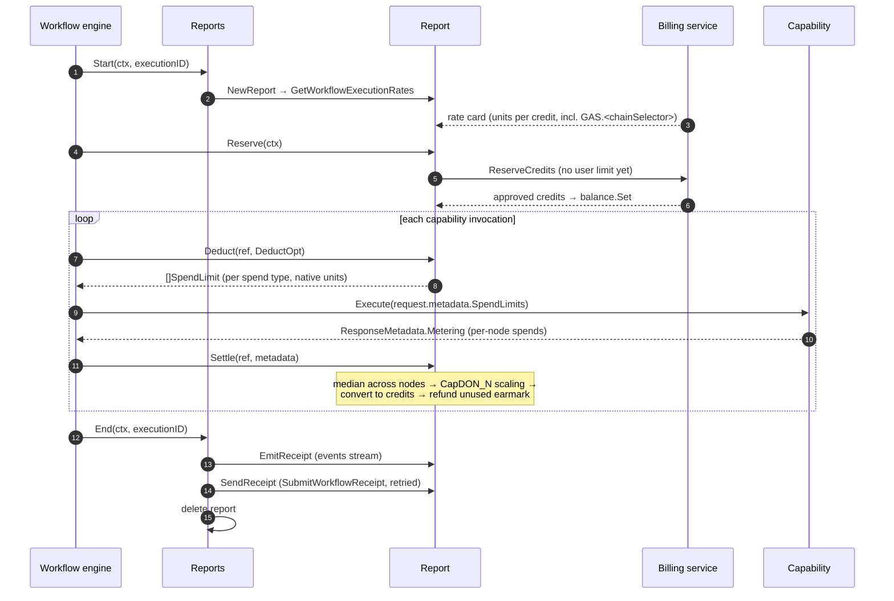
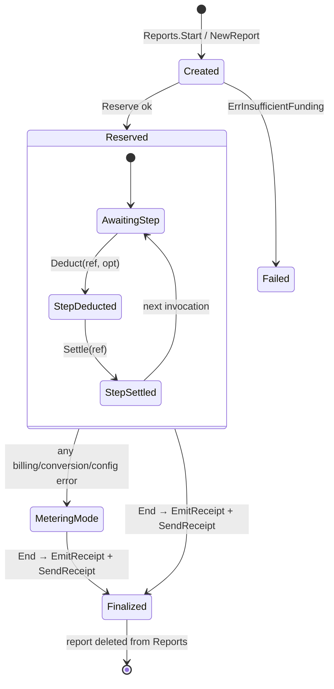
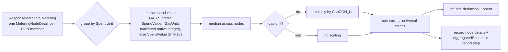

# Workflow Metering (`chainlink/core/services/workflows/metering`)

The **metering** module is the resource-accounting engine for CRE (Chainlink Runtime Environment) workflow executions. For every workflow execution running on a node, it:

- converts heterogeneous resource consumption reported by capabilities (gas per chain, compute, network, ...) into **universal credits** using a rate card fetched from the billing service,
- enforces **per-invocation spend limits** against the execution's reserved credit balance,
- aggregates per-node spend reports (median across capability DON members), and
- produces a `MeteringReport` that is **emitted to the workflow events stream** (observability) and **submitted as a receipt to the billing service** (charging).

A central design property is *fail-open degradation*: whenever billing or conversion cannot be performed (no client, RPC failure, bad rate card, malformed spends, misconfigured ratios), the report silently switches to **metering mode** — resource consumption is still gathered and reported, but no credit accounting or enforcement occurs, so workflow execution never blocks on billing availability.

- Source: `chainlink/core/services/workflows/metering/metering.go` (package `metering`)
- Part of the [Workflows subsystem](../workflows.md) within the [Workflow & Capability Runtime (CRE Engine)](../../Workflow___Capability_Runtime_(CRE_Engine).md)
- Builds on the shared [metering & billing library](../../Shared_Foundation_Libraries___Domain_Types/metering-and-billing.md) (protobufs, gRPC `billing.WorkflowClient`)

---

## 1. Where it fits in the CRE Engine

```
Workflow syncer (registry/file/gRPC sources)  →  Workflow engine (v1/v2)  →  capability executions
                                                        │
                                                        ▼
                                          metering.Reports / metering.Report   ← this module
                                                        │
                          ┌─────────────────────────────┼──────────────────────────────┐
                          ▼                             ▼                              ▼
                 Billing service (gRPC)        Workflow events stream          Engine metrics
                 (reserve / rates / receipt)   (MeteringReport emission)      (metering-mode gauge,
                                                                                missing-report counter)
```

The metering package is consumed almost exclusively by the [workflow engine](workflows_engine.md): the engine's config carries a `BillingClient`, and the engine calls `Reports.Start/End` around each execution and `Report.Reserve/Deduct/Settle` around each capability invocation (see the end-to-end test in `chainlink/core/services/workflows/v2/engine_test.go::TestEngine_Metering_ValidBillingClient`).

## 2. Architecture

```mermaid
flowchart TB
    subgraph NODE["Chainlink node (per DON member)"]
        ENG["Workflow engine<br/>(workflows_engine)"]
        REPS["Reports<br/>concurrency-safe registry<br/>keyed by execution ID"]
        RPT["Report<br/>per workflow execution"]
        BS["balanceStore<br/>credit ledger: available,<br/>spent, unit conversion"]
        BC["BillingClient interface"]
        CAP["Capability execution<br/>(capabilities registry)"]
        MON["WorkflowsMetricLabeler<br/>(engine metrics)"]
    end
    ENG -->|"Start / End"| REPS
    ENG -->|"Reserve / Deduct / Settle"| RPT
    REPS --> RPT
    RPT --> BS
    RPT --> MON
    RPT --> BC
    ENG -->|"request metadata.SpendLimits"| CAP
    CAP -->|"ResponseMetadata.Metering"| ENG
    BC -->|"gRPC"| SVC["Billing service (external)"]
    RPT -->|"EmitReceipt → EmitMeteringReport"| EV["Workflow events stream"]
    EV --> BEH["Beholder telemetry"]
```



Component responsibilities:

| Component | Responsibility |
|---|---|
| `Reports` | Concurrency-safe `map[executionID]*Report` registry. Creates (`Start`), retrieves (`Get`), and finalizes (`End`) per-execution reports. Holds the node-wide billing identity: owner, workflow ID, registry address, registry chain selector, engine version. |
| `Report` | State machine for one execution. Owns the local credit `balanceStore`, the rate card, all step records, and the metering-mode flag. All methods are mutex-guarded. |
| `balanceStore` | Package-internal credit ledger. Converts between native spend units and universal credits via the rate card; tracks available, spent, and earmarked (deducted) credits. Created with `NewBalanceStore`. |
| `BillingClient` | Narrow interface (see below) over the billing service's gRPC API. The production implementation is the gRPC client behind `chainlink-common/pkg/billing.WorkflowClient` (same four methods plus `Close`). A nil client (checked defensively via reflection, since a typed-nil still satisfies the interface) forces metering mode. |
| `WorkflowsMetricLabeler` | Emits the metering-mode gauge and the missing-metering-report counter (see `chainlink/core/services/workflows/monitoring`). |
| `wfEvents.EmitMeteringReport` | Publishes the formatted `MeteringReport` into the workflow events pipeline consumed by the [Beholder telemetry platform](../../Telemetry___Observability_Platform/beholder-telemetry.md). |

### Key types

| Type | Kind | Purpose |
|---|---|---|
| `Report` | struct | Per-execution accounting state machine (`Reserve` → `Deduct` → `Settle` → receipts). |
| `Reports` | struct | Thread-safe registry of `Report`s plus the shared billing identity (owner, workflow ID, registry address/chain selector, engine version, labels). |
| `ReportStep` | struct | One capability invocation's record: capability ID, capability DON size (`CapdonN`), earmarked `Deduction`, per-node `Spends`, per-unit `AggregatedSpends`. |
| `ReportStepDetail` | struct | A single node's raw spend: peer ID, `SpendValue`, `SpendValueInGasUnits`, and the derived `CRESpendValue` (credits). |
| `AggregatedStepDetail` | struct | Per-spend-unit aggregation: unit name, median native `SpendValue`, and `CRESpendValue`. |
| `SpendTuple` | struct | Minimal value type pairing a spend `Unit` name with a decimal `Value`; a convenient currency for callers that pass around single (unit, amount) pairs. |
| `ProtoDetail` | struct | Value type describing a proto message (`Schema`, `Domain`, `Entity`) used when registering/addressing metering detail payloads. |
| `DeductOpt` | func | Strategy hook that customizes `Deduct` (see [Deduction strategies](#6-deduction-strategies-deductopt)). |
| `BillingClient` | interface | `GetOrganizationCreditsByWorkflow`, `GetWorkflowExecutionRates`, `ReserveCredits`, `SubmitWorkflowReceipt`. |

### Constants

| Constant | Value | Meaning |
|---|---|---|
| `RatiosKey` | `"spendRatios"` | Key inside a capability's restricted config holding spend-type ratios. |
| `defaultDecimalPrecision` | `10` | Fixed-point precision of universal-credit strings; **must match the billing service**. |
| `EngineVersionV1` / `EngineVersionV2` | `"v1"` / `"v2"` | Stamped into every report's metadata to identify the producing engine. |
| `defaultBillingCallTimeout` | `5s` | Deadline for every blocking billing RPC (see `chainlink-common/pkg/billing/workflow_client.go`; the client itself sets no deadline). Without it a hung billing call could stall executions until the node falls behind peer consensus — fail-open requires a short budget (CRE-5160). |

## 3. Execution lifecycle



### Step by step

1. **`Reports.Start`** — Registers a new execution. `NewReport` performs a blocking `GetWorkflowExecutionRates` call to build the rate card, so `Start` deliberately runs it **outside** the registry lock: it takes a read-lock fast pre-check, builds the report, then re-checks and inserts under the write lock (concurrent `Start`s for the same ID race safely; the loser gets `ErrReportExists`). Labels for the report come from the node-wide label map plus `platform.KeyWorkflowExecutionID`. If the rate card ends up empty, the report is created anyway in metering mode (`ErrEmptyRateCard`).
2. **`Report.Reserve`** — Opens a credit reservation with the billing service (`ReserveCreditsRequest` with `Credits: nil` — no user-defined cap yet, see CRE-284). The returned credit balance seeds the local ledger. Errors degrade to metering mode; an explicit rejection (`success == false`) is a hard failure: `ErrInsufficientFunding`, which the engine treats as a fatal execution error.
3. **`Report.Deduct(ref, opt)`** — Before each capability invocation. Validates ordering (`ErrNoReserve`), requires a strategy (`ErrDeductOptionRequired`), and rejects duplicate refs (`ErrStepDeductExists`). The chosen strategy earmarks credits and returns `[]capabilities.SpendLimit` in **native units**, which the engine forwards to the capability inside the request metadata.
4. **`Report.Settle(ref, metadata)`** — After the invocation, records the actual per-node spends from `capabilities.ResponseMetadata.Metering`, refunds the difference between the earmark and actual spend, and accumulates spent credits.
5. **`Reports.End`** — Finalizes: calls `EmitReceipt` (event-stream publication) and `SendReceipt` (billing RPC with retry), removes the report, and increments the missing-metering-report metric for any failure. Because the node's copy of the report is deleted either way, a failed receipt is not replayed — observability metrics are the safety net.

### State model



`MeteringMode` is a **sticky, one-way flag** on the report (not a separate lifecycle state): once entered, it is never left, and every subsequent triggering error is appended to `meteringModeErr` via `errors.Join`. The first error is logged once (`"switching to metering mode"`), the total error chain is carried in the report's `Message` field, and the mode is reported both in the receipt (`MeteringMode: true`) and in the workflow metering-mode gauge.

## 4. Data flow: from native spends to universal credits



Rules encoded in `Settle` and its helpers:

- **Spend unit namespaces.** Gas units are named `GAS.<chainSelector>` (`isGasSpendType`); non-gas units today are billing resource types such as `COMPUTE` and `NETWORK`. `RPC_EVM` spends are parsed and recorded but explicitly excluded from credit settlement (pending proper support for non-gas/compute spend types).
- **Gas value handling.** Capabilities may report `SpendValueInGasUnits` — a base-10, non-negative integer in the chain's smallest native unit (wei, lamports, octas…). `parseNativeGasUnits` rejects fractions, scientific notation, and negatives (which `decimal.NewFromString` alone would accept), and valid values are collapsed into `SpendValue` when formatting the report. The legacy path (`SpendValue` shifted by 18 decimal places) is retained for capabilities that don't populate the native field; invalid native values are dropped from settlement but kept in the report.
- **Aggregation.** Per unit, the **median** of node values is used (`medianSpend`), making settlement robust to a single node reporting an outlier.
- **DON scaling.** Non-gas spends are multiplied by `CapDON_N` (capability DON size, defaulting to 1 when unset) since every member incurs compute/network cost, while gas is paid once per execution — a single gas execution per unit is expected, and a second one flips the report to metering mode.
- **Rate card.** Built by `toRateCard` from `GetWorkflowExecutionRatesResponse`: each resource type maps `resourceType → unitsPerCredit`, and gas credits arrive as `map[chainSelector]gasRate`, converted to `GAS.<chainSelector> → unitsPerCredit`. Gas spend limits are rendered at precision 0 (integral wei), everything else at `defaultDecimalPrecision` (10).

## 5. Spend ratios

A capability can declare multiple spend types (e.g. `COMPUTE` + `NETWORK`). The engine splits a universal-credit limit across them using **ratios** supplied in the capability's restricted config under `metering.RatiosKey` (`"spendRatios"`), e.g. `{"COMPUTE": "0.4", "NETWORK": "0.6"}`. Keeping ratios in the (mutable) capabilities registry rather than in billing or in the capability binary lets operators re-weight spend without redeploying the capability (see `ratiosFromConfig`).

- A single spend type implicitly gets ratio `1.0` and needs no config.
- Missing key, non-string values, non-decimal values, or a count mismatch between `CapabilityInfo.SpendTypes` and ratios (`ErrRatiosAndTypesNoMatch`, `ErrInvalidRatios`) push the report into metering mode; the invocation then runs with **empty** `SpendLimits`.
- Each ratio-scaled credit amount is converted to the spend type's native units through the rate card to form the `capabilities.SpendLimit.Limit` string.

## 6. Deduction strategies (`DeductOpt`)

`Deduct` takes a strategy function because the v2 engine needs different earmarking semantics per call site:

| Strategy | Earmark basis | Spend limits returned |
|---|---|---|
| `ByResource(spendType, capabilityID, amount)` | A fixed amount of a **single spend type**, converted to credits via the rate card. | None (empty slice) — the cap is enforced locally on the ledger. |
| `ByDerivedAvailability(userSpendLimit, openConcurrentCallSlots, info, config)` | Per-invocation limit = `availableBalance / openConcurrentCallSlots`, capped by the optional user limit (`getMaxSpendForInvocation`). Requires `openConcurrentCallSlots > 0` (`ErrNoOpenCalls`) and a prior `Reserve`. | One `SpendLimit` per declared spend type, split by ratios and converted to native units. |

In metering mode both strategies return empty spend limits and leave the ledger untouched — capabilities always receive well-formed (possibly empty) `Metadata.SpendLimits`, which is the contract asserted by the engine tests.

## 7. Metering mode (fail-open) triggers

`switchToMeteringMode(err)` is called from many places; the notable triggers are:

| Trigger | Source |
|---|---|
| No billing client configured (nil interface or typed-nil value) | `NewReport`, `Reserve` |
| `GetWorkflowExecutionRates` RPC failure or unparseable rate card | `NewReport`, `toRateCard` |
| Empty rate card | `NewReport` |
| Unparseable registry chain selector | `NewReport` |
| `ReserveCredits` RPC failure, unparseable credit balance | `Reserve` |
| Spend-type ↔ rate-card conversion failures | `ByResource`, `Settle`, `creditToSpendingLimits` |
| Invalid/missing spend ratios for multi-spend capabilities | `ratiosFromConfig` |
| Multiple gas executions for one unit, or unconvertible unit in `Settle` | `Settle` |

Consequences: negative/unchecked local balances, `SpendLimits` omitted, and `MeteringMode: true` + first-error message carried in the emitted report and receipt. Workflow execution and consensus are never blocked by billing problems.

## 8. Reports & receipts

`FormatReport` renders the full `protoEvents.MeteringReport`:

- **Metadata** (`WorkflowMetadata`): owner, workflow name/ID/version, execution ID, DON ID/F/N, P2P ID, workflow registry address and chain selector (node-wide values applied to *all* workflows regardless of source — temporary approach pending multi-environment billing plans, CRE-1716/1717), engine version, trigger ID, org ID.
- **Steps**: keyed by step ref; each carries per-node details (`MeteringReportNodeDetail`: peer ID, unit, spend value, spend value in gas units, credits at fixed precision 10) plus aggregated spend per unit — both the legacy single fields (`AggSpendUnit/AggSpendValue/AggSpendValueCre`) and the newer repeated `AggSpend` list.
- **Determinism**: step units are sorted before rendering so report output is stable across runs.
- **`MeteringMode` flag** and accumulated error `Message`.

Delivery paths at `Reports.End`:

| Path | Mechanism | Failure handling |
|---|---|---|
| `EmitReceipt` | `wfEvents.EmitMeteringReport` into the workflow events stream (Beholder-consumed) | Failure increments `IncrementWorkflowMissingMeteringReport` |
| `SendReceipt` | `SubmitWorkflowReceipt` gRPC with `CreditsConsumed`; up to `maxRetries` (default 1) retries with `retryDelay` (150 ms) on retryable gRPC codes (`Unavailable`, `DeadlineExceeded`, `ResourceExhausted`), each attempt bounded by the 5 s timeout; honours context cancellation between retries | Non-retryable or exhausted retries surface the error; metric incremented; report still deleted |

`Reports.Len` exposes the live execution count (useful for graceful shutdown/drain checks alongside the engine's [shard ownership resolver](workflows_sharding.md)).

## 9. Concurrency model

- `Report` guards all state with a single `sync.RWMutex`; every public method locks (writes exclusive, `FormatReport`/`isMeteringMode` shared).
- `Reports` uses `sync.RWMutex` around the map. The expensive, blocking `NewReport` call is intentionally executed **without** the lock held, with a fast pre-check and a re-check-on-insert to keep concurrent `Start`s for the same execution ID safe. This avoids serializing workflow starts behind billing latency.
- `SendReceipt` is the only method that reads without holding the mutex for the whole RPC; the report is effectively quiescent by the time `End` runs.

## 10. Error catalog

| Error | Raised when |
|---|---|
| `ErrMissingLabels` | Report labels lack owner, workflow ID, or execution ID. |
| `ErrNoBillingClient` | No billing client configured. |
| `ErrInsufficientFunding` | Billing service rejected the reservation (hard failure — execution aborts). |
| `ErrReceiptFailed` | `SubmitWorkflowReceipt` returned an empty response. |
| `ErrNoReserve` / `ErrNoDeduct` | Lifecycle violations: `Deduct`/`Settle`/`SendReceipt` before `Reserve`; `Settle` before `Deduct`. |
| `ErrStepDeductExists` / `ErrStepSpendExists` | Duplicate `Deduct` or `Settle` for the same step ref. |
| `ErrNoOpenCalls` | `ByDerivedAvailability` called with zero concurrent call slots. |
| `ErrReportNotFound` / `ErrReportExists` | `Reports.End`/`Get` on unknown ID; `Reports.Start` on duplicate ID. |
| `ErrRatiosAndTypesNoMatch` / `ErrInvalidRatios` | Spend-ratio configuration problems. |
| `ErrDeductOptionRequired` | `Deduct` called with a nil strategy. |
| `ErrEmptyRateCard` | Billing returned no usable rates. |

## 11. Integration map

| Dependency | Module / page | Relationship |
|---|---|---|
| Workflow engine (consumer) | [workflows_engine](workflows_engine.md) | Drives the full `Start → Reserve → Deduct → Settle → End` lifecycle; injects `BillingClient` via engine config. |
| Workflow syncer (sources) | [workflows_syncer](workflows_syncer.md) | Supplies workflow definitions; the registry address/chain selector used for billing currently come from node-wide settings for all sources. |
| Capabilities runtime | [capabilities](../capabilities.md), [core capabilities runtime](../core_capabilities_runtime.md) | Defines `CapabilityInfo.SpendTypes`, `ResponseMetadata.Metering` (`MeteringNodeDetail`), `SpendLimit`, and the registry config carrying `RatiosKey`. |
| Shared metering & billing library | [metering-and-billing](../../Shared_Foundation_Libraries___Domain_Types/metering-and-billing.md) | Owns the gRPC `billing.WorkflowClient`, `MeteringReport*` protobufs (`chainlink-common/pkg/metering/pb/*.proto`), and metering units; see also `chainlink-common/pkg/resourcemanager/meterable.go` for LOOP-side metering config. |
| Domain types | [types-core](../../Shared_Foundation_Libraries___Domain_Types/types-core.md) | `capabilities` value/contract types referenced by the report (spend limits, response metadata). |
| Observability | [beholder-telemetry](../../Telemetry___Observability_Platform/beholder-telemetry.md) | Metering reports flow into the events pipeline; engine metrics expose metering-mode and missing-report counters. |
| Node configuration | [core_config_workflows](../../Node_Application_Core___Interfaces/core_config/core_config_workflows.md) | Workflow limits (global/per-owner) complement, but are separate from, credit-based metering. |
| Standalone/dev engine | [workflows_standalone](workflows_standalone.md) | Standalone engines typically run without a billing client, exercising the metering-mode path. |

## 12. Source map

| File | Contents |
|---|---|
| `chainlink/core/services/workflows/metering/metering.go` | Everything documented here: `Report`, `Reports`, `ReportStep*`, `AggregatedStepDetail`, `SpendTuple`, `ProtoDetail`, `BillingClient`, `DeductOpt` strategies, rate-card parsing, ratio extraction, metering-mode logic. Sibling package-internal files provide `balanceStore`/`NewBalanceStore`. |
| `chainlink-common/pkg/billing/workflow_client.go` | Production `WorkflowClient` gRPC interface implemented against the billing service. |
| `chainlink-common/pkg/metering/pb/metering.proto`, `meteringstep.proto`, `meteringdetail.proto` | Wire shapes for `MeteringReport`, `MeteringReportStep`, `MeteringReportNodeDetail`. |
| `chainlink/core/services/workflows/v2/engine_test.go` | End-to-end behaviour tests: ratios config, spend-limit propagation, settle/mismatch handling, metering-mode switching. |
