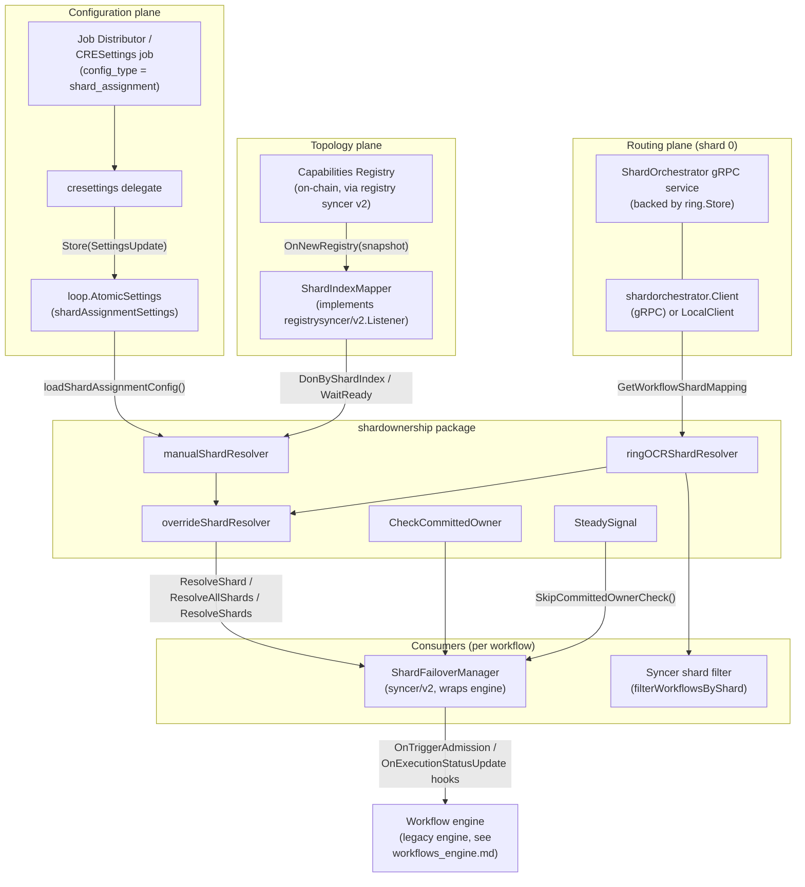
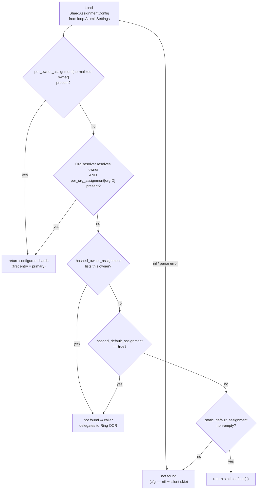
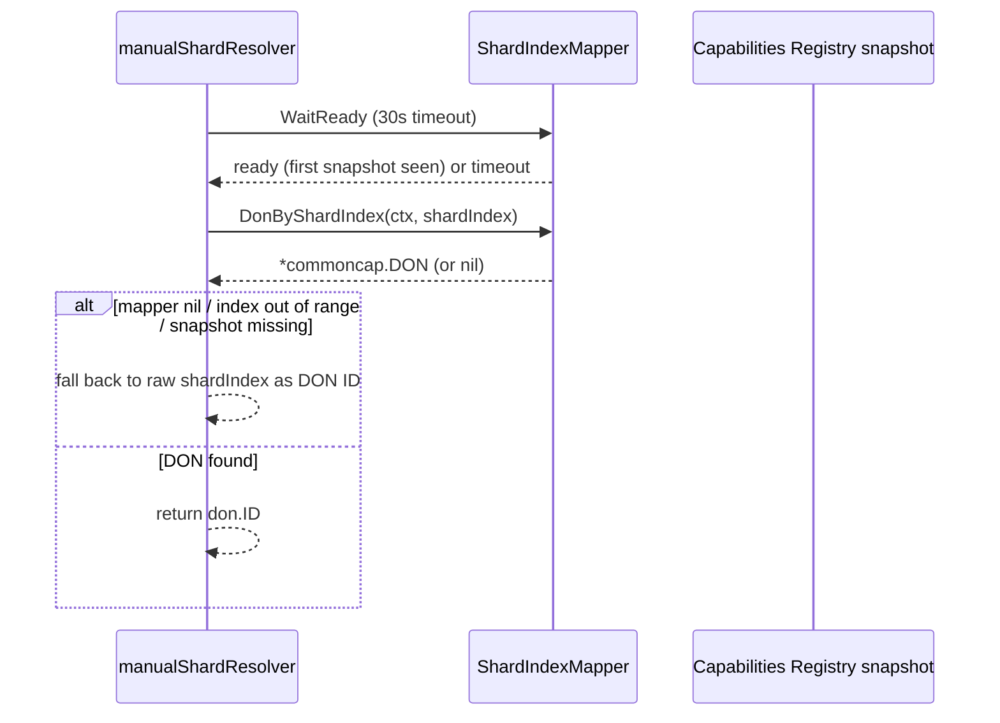
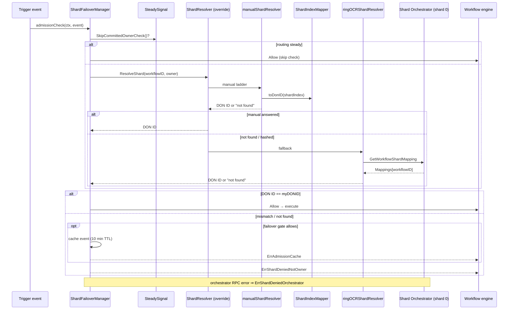
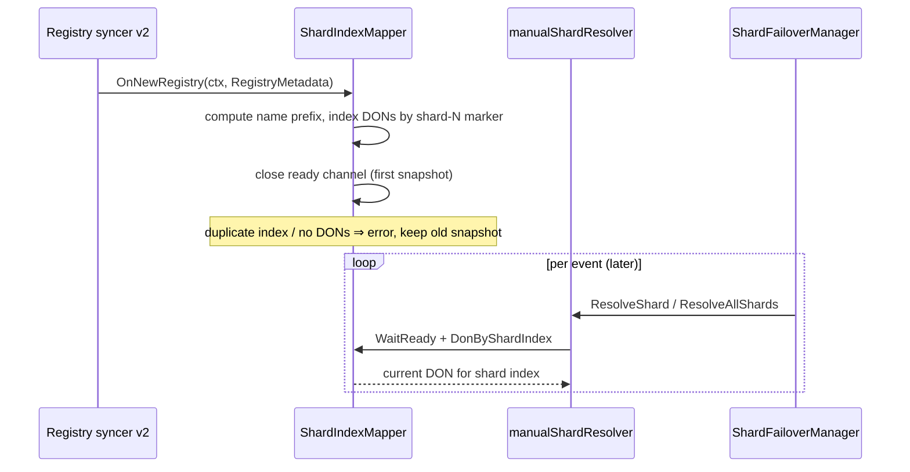

# Workflows Sharding (Shard Ownership)

> **Package:** `chainlink/core/services/workflows/shardownership` (plus `types`)
> **Parent module:** [Workflows](../workflows.md)
> **Core component:** `AllShardsResolver` (`shardownership/resolver.go`)

## 1. Introduction

Workflow **sharding** partitions the workflows registered for a shard group across several *workflow DONs* ("shards", DON IDs 0, 1, 2, …) instead of running every workflow on every DON. Each node must therefore be able to answer three questions at runtime:

1. **Which shard (DON) owns this workflow?** — `ShardResolver`
2. **Which shards own it in order (primary, secondary, …)?** — `AllShardsResolver`
3. **Is this node's DON the owner, and may it execute this trigger event?** — `CheckCommittedOwner` + the `Verdict` type

The `shardownership` package is the single source of truth for those answers. It is deliberately *stateless with respect to ownership decisions*: ownership is re-resolved **per event** (trigger admission, execution status update), so if the orchestrator reassigns a workflow at runtime, the next event automatically picks up the new role. There is no static role assignment and no background polling loop.

The package provides three interchangeable resolver strategies behind one interface:

| Strategy | Constructor | Decision source | Use when |
|---|---|---|---|
| **Ring OCR** | `NewRingOCRShardResolver` | The **Shard Orchestrator** gRPC service running on shard 0 (consensus-allocated shard mapping from the Ring OCR plugin) | Production default; dynamically balanced assignment |
| **Manual** | `NewManualShardResolver` | A TOML `ShardAssignmentConfig` distributed via a `CRESettings` job | Ops-controlled, deterministic assignment (pinning, defaults, hashing) |
| **Override** | `NewOverrideShardResolver` | Manual config **first**, Ring OCR as fallback | Layered deployments: pin hot workflows, let the orchestrator handle the rest |

Supporting pieces complete the picture:

- **`ShardIndexMapper`** — translates configured *shard indices* (0, 1, 2, …) into *live DON IDs* by watching Capabilities Registry snapshots.
- **`SteadySignal`** — tracks whether shard routing is in a steady state so the expensive committed-owner check can be skipped when routing is stable.
- **`types`** — the DON naming conventions (`shard-X` marker, `_workflows` family suffix) that make shard indices discoverable from the registry.

---

## 2. Architecture Overview



### 2.1 Component responsibility matrix

| Component | File | Responsibility |
|---|---|---|
| `ShardResolver`, `AllShardsResolver`, `OrgResolver` | `resolver.go` | Strategy interfaces: single-shard, ordered all-shards, and owner→org lookups |
| `ringOCRShardResolver` | `resolver.go` | Resolves ownership by querying the Shard Orchestrator on shard 0 (Ring OCR allocation); also exposes the raw routing response |
| `manualShardResolver` | `resolver.go` | Resolves ownership from the TOML `ShardAssignmentConfig` (per-owner → per-org → hashed → static default) |
| `overrideShardResolver` | `resolver.go` | Composes manual-over-Ring-OCR with batch-aware fallback |
| `ShardIndexMapper` | `shard_index_mapper.go` | Maps configured shard indices → live DON IDs from Capabilities Registry snapshots; `registrysyncer/v2.Listener` |
| `Verdict`, `CheckCommittedOwner` | `check.go` | Committed-owner gate: `Allow` / `DenyNotOwner` / `DenyOrchestratorError` |
| `SteadySignal` | `steady_signal.go` | Remembers the last observed routing steady-state so owner checks can be skipped |
| `ShardNameMarker`, `WorkflowFamilySuffix` | `types/types.go` | DON naming conventions that encode shard indices and workflow-fetching families |
| `ShardAssignmentConfig` + parser | `core/services/cresettings/shard_assignment_config.go` | TOML schema, validation, and owner normalization (provided by the **cresettings** package) |
| `ShardFailoverManager` | `core/services/workflows/syncer/v2/shard_failover_manager.go` | Primary consumer: per-event admission checks and primary→secondary failover (documented with the [Workflows Syncer](workflows_syncer.md)) |

---

## 3. Core Components

### 3.1 Strategy interfaces (`resolver.go`)

```go
type ShardResolver interface {
    ResolveShard(ctx context.Context, workflowID string, ownerHex string) (donID uint32, found bool, err error)
    ResolveShards(ctx context.Context, workflowIDs []string, ownerHexes []string) (map[string]uint32, error)
}

type AllShardsResolver interface {
    // Returns the ordered list of shard DON IDs for a workflow.
    // Index 0 is the primary shard, index 1 the failover secondary, etc.
    ResolveAllShards(ctx context.Context, workflowID string, ownerHex string) ([]uint32, bool, error)
}

type OrgResolver interface {
    Get(ctx context.Context, owner string) (string, error)
}
```

Conventions every implementation must honor:

- `found == false` (with a nil error) means "this strategy has no answer" — for the override resolver this triggers fallback to the next strategy.
- `ResolveShards` is the batch form used by reconciliation paths; it may return a partial map (only the workflows it could resolve).
- `ownerHex` is the workflow owner's EVM address; it is normalized internally (trimmed, `0x`/`0X` prefix stripped, lowercased) before being matched against config keys.
- Return values are **DON IDs**, not shard indices. `manualShardResolver` performs the shard-index → DON-ID translation internally via `ShardIndexMapper` (see [§3.5](#35-shardindexmapper---shard-index--don-id)).

### 3.2 `ringOCRShardResolver` — orchestrator-backed resolution

Constructed with `NewRingOCRShardResolver(client shardorchestrator.ClientInterface, lggr logger.Logger)`.

- `ResolveShard` / `ResolveShards` call `client.GetWorkflowShardMapping(ctx, workflowIDs)` and read `resp.Mappings[workflowID]`. A nil client (sharding not configured) returns "not found" instead of an error; a batch RPC failure wraps the error as `"shard mapping unavailable: %w"`.
- `GetRoutingResponse(ctx, workflowIDs)` returns the full `*ringpb.GetWorkflowShardMappingResponse` (mappings, transition states, `MappingVersion`, `RoutingSteady`, `RoutingStateId`). This is what the syncer's **registry shard routing observer** consumes to feed the `SteadySignal` (see [§3.7](#37-steadysignal)).
- The client itself defaults to a 15s gRPC timeout when the caller's context has no deadline, and both a gRPC `Client` (remote shard 0) and an in-process `LocalClient` satisfy the same `shardorchestrator.ClientInterface`.

The server side runs **only on shard 0**: `shardorchestrator.Server` serves batch mapping requests from `ring.Store`, and submits any unknown workflow IDs for allocation (`SubmitWorkflowsForAllocation`) so the Ring OCR plugin can assign them on a subsequent round.

### 3.3 `manualShardResolver` — config-driven resolution

Constructed with `NewManualShardResolver(settings *loop.AtomicSettings, orgResolver OrgResolver, shardIndexMapper *ShardIndexMapper, lggr logger.Logger)`.

On every call the resolver **reloads and re-parses** the TOML settings (hot-reload semantics — no caching), then applies the following precedence ladder (`resolveManual` / `resolveAllManual`):



Design intent of the hashed entries: `hashed_owner_assignment` and `hashed_default_assignment` explicitly *decline* to answer so that the surrounding **override resolver** defers those owners to the Ring OCR orchestrator, while per-owner/per-org/static entries *pin* them.

`toDonID` (and `toDonIDs`) then translate a configured shard index into the DON ID currently holding that index:



The 30s `WaitReady` window exists to prevent a boot-time race where a workflow is launched before the registry syncer has delivered its first snapshot; on timeout the resolver logs a warning and proceeds with a possibly incomplete registry view rather than blocking startup.

### 3.4 `overrideShardResolver` — manual overrides with Ring OCR fallback

Constructed with `NewOverrideShardResolver(settings, orgResolver, shardIndexMapper, ringOCR ShardResolver, lggr)`. This is the composition used in production:

| Call | Behavior |
|---|---|
| `ResolveShard` | Try the manual ladder first; if no per-owner/per-org/static entry applies (including hashed entries), fall through to `ringOCR.ResolveShard`. |
| `ResolveAllShards` | Manual ladder first; if it declines, fall back to the Ring OCR **single-shard** result and wrap it as `[shardID]`. |
| `ResolveShards` | Batch-aware: each workflow is tried manually; only the unresolved IDs are sent to Ring OCR in a **single** batch call, and both result sets are merged (`maps.Copy`). |
| `GetRoutingResponse` | Type-asserts the inner resolver to the routing-response interface and forwards; returns `nil, nil` if unsupported. |

Because the manual config is loaded fresh on every call, updating a `CRESettings` job changes pinning behavior on the next event without any restart.

### 3.5 `ShardIndexMapper` — shard index → DON ID

`ShardIndexMapper` is a process-wide singleton that translates the *shard index* convention (0, 1, 2, …) into the *DON IDs* currently assigned to those indices. It implements the `registrysyncer/v2.Listener` interface and is refreshed on every Capabilities Registry update (`OnNewRegistry`).

Discovery algorithm per snapshot:

1. Resolve the **local node's workflow DON** from the registry metadata (skip if `ID == 0`, i.e. the node is not in a workflow DON).
2. Compute the shard-group name prefix: the local DON name with any `shard-X` suffix stripped (`"workflow-1-zone-a-shard-1"` → `"workflow-1-zone-a"`; a name without the marker is its own prefix).
3. Index every workflow DON in the registry that **accepts workflows**, **shares at least one DON family** with the local workflow DON, and **shares the name prefix**, keyed by the single-digit shard index encoded after the `shard-` marker.
4. Error handling is fail-closed at refresh time: two DONs mapping to the same index, a malformed suffix, or *no* matching DONs produce an error (and the previous snapshot is kept).

Concurrency contract: reads go through `WaitReady(ctx)` (blocks until the first snapshot or context deadline) and `DonByShardIndex(ctx, index)` (returns `nil` when the index is out of range or unassigned), both safe for concurrent use via an `RWMutex`.

### 3.6 `CheckCommittedOwner` and `Verdict`

```go
type Verdict int

const (
    Allow Verdict = iota
    DenyNotOwner
    DenyOrchestratorError
)
```

`CheckCommittedOwner(ctx, client, workflowID, myDonID)` is the minimal "am I the committed owner?" gate that talks directly to the orchestrator client (no strategy composition):

| Condition | Verdict |
|---|---|
| `GetWorkflowShardMapping` RPC fails | `DenyOrchestratorError` |
| No mapping entry for the workflow | `DenyNotOwner` |
| Mapping's DON ID ≠ my DON ID | `DenyNotOwner` |
| Mapping's DON ID == my DON ID | `Allow` |

It returns the raw `GetWorkflowShardMappingResponse` alongside the verdict so callers can inspect transition states (`MappingStates`, `MappingVersion`) if needed.

### 3.7 `SteadySignal`

`SteadySignal` is a small, atomic, per-node (optionally per-workflow) latch that records whether shard routing is **steady**:

- `ObserveRoutingSteady(steady bool)` — called by the routing observer whenever an orchestrator response reports `RoutingSteady`; records metrics.
- `Invalidate()` — clears the steady flag (e.g. on a mapping version change / transition).
- `SkipCommittedOwnerCheck() bool` — true only after at least one observation *and* while steady. The `ShardFailoverManager` uses this to skip the per-trigger orchestrator round-trip when routing is known-stable, cutting latency and load on shard 0 during normal operation.

Optional Beholder metrics (`wfmon.SteadySignalMetrics`, wired via `WithSteadySignalMetrics`):

| Instrument | Meaning |
|---|---|
| `platform_shard_routing_steady_signal_state` (gauge) | `0` unobserved, `1` transition, `2` steady |
| `platform_shard_routing_steady_signal_observe_total` (counter) | Observations, labeled with `routing_steady` |
| `platform_shard_routing_steady_signal_invalidate_total` (counter) | Invalidation events |

### 3.8 Naming conventions (`types/types.go`)

```go
ShardNameMarker     = "shard-"       // "workflow-1-zone-a-shard-1" → shard index 1
WorkflowFamilySuffix = "_workflows"  // "zone-a_workflows" also fetches "zone-a" workflows
```

`ShardNameMarker` is what makes shard indices **derivable from the registry topology** (no extra state). `WorkflowFamilySuffix` lets a dedicated workflow-fetching family subscribe to the base family's workflows as well — used by workflow sources when filtering by DON family.

---

## 4. Configuration: `ShardAssignmentConfig`

The manual strategy's TOML schema is defined and parsed in `core/services/cresettings/shard_assignment_config.go`. It reaches the node through the **`CRESettings` job** (`cresettings/delegate.go`): a job with `config_type = "shard_assignment"` stores its `Settings` payload into a dedicated `loop.AtomicSettings` from which the resolver reloads on every call. Only one active `CRESettings` job per config type is allowed.

```toml
static_default_assignment = [0]          # fallback shard indices (DON IDs)
disabled_shards            = []          # indices excluded from allocation

[per_owner_assignment]                   # exact pin, highest precedence
  "0xf39fd6e51aad88f6f4ce6ab8827279cfffb92266" = [1, 0]

[per_org_assignment]                     # pin by resolved org ID
  "org-abc" = [2]

hashed_owner_assignment  = ["0x70997970c51812dc3a010c7d01b50e0d17dc79c8"]  # defer to Ring OCR
hashed_default_assignment = false        # defer all unpinned owners to Ring OCR
```

Parsing rules worth knowing:

- Owner keys are normalized (trim, strip `0x`/`0X`, lowercase) and **must be exactly 40 hex chars**; an owner may not appear in both `per_owner_assignment` and `hashed_owner_assignment`.
- All shard values are validated as DON IDs in `[0, 4294967295]`.
- Assignment lists are ordered: the **first** entry is the primary shard, later entries are failover targets — this is what `ResolveAllShards` returns and what `ShardFailoverManager` uses (`[0]` = primary, `[1]` = secondary).
- An empty/absent settings payload yields a non-nil empty config; a nil `AtomicSettings` yields nil config (treated as "no manual overrides").

The on-chain half of the sharding configuration (deploying and updating the shard config contract, shard count) is handled by the deployment suite — see [CRE & Keystone Deployment Suite — cre-core](../../CRE___Keystone_Deployment_Suite/cre-core.md) (`shard_config/v1` operations: `DeployShardConfig`, `UpdateShardCount`, `TransferOwnership`).

---

## 5. Runtime Flows

### 5.1 Trigger admission — dynamic ownership check

The `ShardFailoverManager` (created per workflow by the syncer's event handler — see [Workflows Syncer](workflows_syncer.md)) wires itself into the engine as the `OnTriggerAdmission` hook:



Fail-closed by design: an error **denies** execution rather than risking duplicate execution on two shards. Denial with failover enabled additionally caches the event so the secondary can replay it (below).

### 5.2 Primary → secondary failover

When sharding with failover is enabled, the manager uses `AllShardsResolver` to learn the *ordered* shard set for the workflow:

- **Primary** (`shards[0] == myDONID`): on every execution status update, forwards a `ringpb.ExecutionStatusUpdate` to the secondary DON (`shards[1]`, resolved via the configured `ShardDonLookup`, e.g. `capRegistry.DONByID`). User errors are marked as such; system errors trigger replay on the secondary.
- **Secondary**: caches every trigger event denied with `ErrAdmissionCache`. On receiving `EXECUTION_STATUS_SYSTEM_ERROR` for a cached `triggerEventID`, it pops the cached event and **replays it through the wrapped engine** directly. `SUCCESS` / `USER_ERROR` outcomes simply evict the cache entry. A prune loop discards entries older than 10 minutes.

Roles are never fixed: because ownership is re-resolved per event, a reassignment by the orchestrator (or a config update) flips primary/secondary behavior on the next event automatically.

### 5.3 Topology refresh — registry snapshot → shard map



---

## 6. Failure-Semantics Cheat Sheet

| Situation | Behavior | Rationale |
|---|---|---|
| `ringOCRShardResolver` has a nil client | `(0, false, nil)` — not found, no error | Sharding simply not configured |
| Batch orchestrator RPC fails (`ResolveShards`) | Wrapped error `"shard mapping unavailable"` | Caller decides; admission path fails closed |
| Orchestrator RPC fails during admission | `DenyOrchestratorError` → `ErrShardDeniedOrchestrator` | Never risk double execution |
| No mapping for workflow ID (Ring OCR) | Not found → workflow is submitted for allocation server-side | Eventually consistent assignment |
| `ShardAssignmentConfig` nil / unparseable | Manual strategy declines (nil config = silent skip) | Overrides are optional |
| Hashed owner / hashed default entry | "Not found" → override resolver defers to Ring OCR | Explicit delegation semantics |
| Registry snapshot not yet seen | `toDonID` waits up to 30s, then warns and uses the raw index | Prefer progress over deadlock at boot |
| Routing steady (observed) | Committed-owner check skipped | Latency optimization, invalidated on routing change |
| Coordinated-engine methods on a sharded node | `ErrCoordinatedShardingUnsupported` | Sharding and the coordinated trigger path are mutually exclusive |

---

## 7. Integration & Related Modules

- **[Workflows](../workflows.md)** — parent module; sharding is one concern of the workflow runtime alongside engine execution, artifacts, metering and the syncer.
- **[Workflows Syncer](workflows_syncer.md)** — owns the `ShardFailoverManager` lifecycle, exposes the sharding-related options (`WithShardOrchestratorClient`, `WithShardEnabled`, `WithShardFailoverEnabled`, `WithRegistryShardRoutingObserver`, `WithRegistryShardResolver`), applies the sync-time shard filter, and drives the `ShardIndexMapper` via its registry listener.
- **[Workflows Engine](workflows_engine.md)** — the wrapped execution engine; sharding is enforced through engine hooks (`OnTriggerAdmission`, `OnExecutionStatusUpdate`), keeping the engine itself sharding-oblivious.
- **[Workflows Artifacts](workflows_artifacts.md)** — persistence for workflow specs/execution state that failover replay depends on.
- **[Capabilities](../capabilities.md)** — the Capabilities Registry supplies DON topology (names, families, `AcceptsWorkflows`) consumed by `ShardIndexMapper`.
- **[Shared Foundation — Settings](../../Shared_Foundation_Libraries___Domain_Types/settings.md)** — `loop.AtomicSettings` / `SettingsUpdate` used to hot-distribute shard assignment config.
- **[CRE & Keystone Deployment Suite — cre-core](../../CRE___Keystone_Deployment_Suite/cre-core.md)** — deploys and updates the on-chain shard configuration contracts (`shard_config/v1` changesets).
- **[Telemetry & Observability — Beholder](../../Telemetry___Observability_Platform/beholder-telemetry.md)** — transport for the steady-signal metrics listed in [§3.7](#37-steadysignal).
