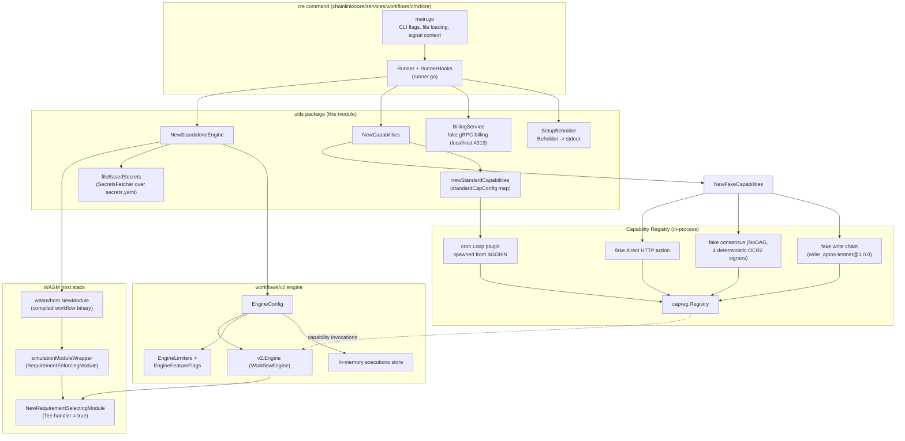
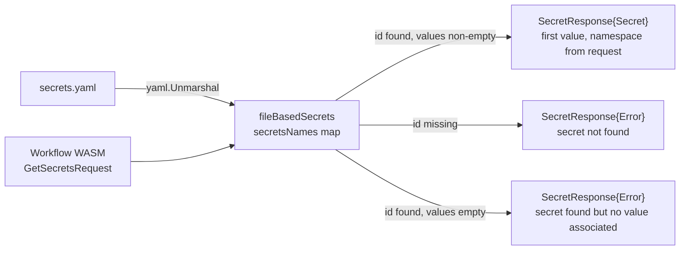
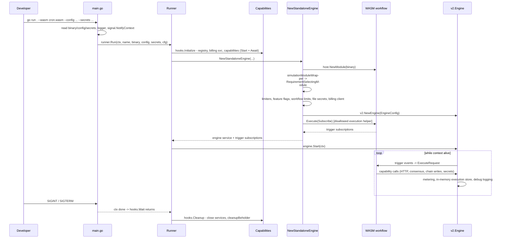

# Workflows Standalone Engine (Local Simulation Mode)

## Introduction

The `workflows_standalone` module (`chainlink/core/services/workflows/cmd/cre/utils/`) provides the glue code required to run the [CRE workflow engine](workflows_engine.md) **standalone** — i.e. outside of a full Chainlink node. It assembles a complete, self-contained workflow execution environment from a compiled WASM workflow binary, local files, and a mix of *fake* and *production-standard* capabilities.

Its primary use cases are:

- **Local development**: run a workflow (trigger → capabilities → execution) on a laptop with `go run .` and no database, P2P network, or blockchain connection.
- **Simulation & testing**: exercise real workflow WASM binaries against real capability plugins (e.g. the `cron` Loop plugin) with deterministic fakes for everything else. The `Runner` exposes lifecycle hooks specifically designed for test harnesses.
- **Debugging**: debug-level logging, Beholder messages echoed to standard output, and a fake billing service that prints metering traffic.

The module is the engine-side counterpart to the authoring/simulation tooling in the [Developer Toolchain](../../Developer_Toolchain_(CLI,_SDKs___API_Clients)/cre-cli-workflow-commands.md): the `cre` binary built from `chainlink/core/services/workflows/cmd/cre` is the entry point that consumes the workflow artifacts produced by the CRE SDKs.

For the production (DON) execution path — registry syncer, remote triggers, sharding, DON time — see the [Workflows overview](../workflows.md) and [Workflows Syncer](workflows_syncer.md).

---

## Source Layout

| File | Core components | Responsibility |
|---|---|---|
| `standalone_engine.go` | `NewStandaloneEngine`, `fileBasedSecrets`, `NewCapabilities`, `NewFakeCapabilities`, `simulationModuleWrapper` | Assembles the standalone engine, file-based secrets, and the capability set |
| `standard_capabilities.go` | `standardCapConfig`, `standardCapabilities`, `newStandardCapabilities`, `standaloneLoopWrapper` | Discovers and runs production "standard capability" Loop plugins (e.g. `cron`) from `$GOBIN` |
| `runner.go` (supporting) | `Runner`, `RunnerConfig`, `RunnerHooks` | Orchestrates the full standalone run: initialize → start → wait → cleanup, with test hooks |
| `billing.go` (supporting) | `BillingService`, `SetupBeholder` | Fake gRPC billing server on `localhost:4319`; Beholder-to-stdout wiring |
| `../main.go` (entry point) | `main` | CLI flags, file loading, signal handling; calls `Runner.Run` |

---

## Architecture

The standalone mode reuses the production `v2.Engine` unchanged, but substitutes every external integration with a local/fake equivalent. The diagram below shows how the pieces fit together.



### What is real vs. what is faked

| Concern | Production DON path | Standalone mode (this module) |
|---|---|---|
| Workflow source | On-chain registry via [Workflows Syncer](workflows_syncer.md) | `--wasm` file loaded from disk |
| Workflow identity | Owner/ID/tag from registry | Hard-coded defaults (`0xaaaa…` owner, `0x1111…` ID, tag `workflowTag`, name `myworkflow` unless overridden) |
| DON time | DON Time plugin / `dontime.Store` | `UseLocalTimeProvider: true` + `types.LocalTimeProvider` |
| DON subscription | P2P DON subscriber | `mockSubscriber` — `Subscribe` returns an empty channel |
| Execution persistence | DB-backed store | `store.NewInMemoryStore` (see [Store interface](#dependencies)) |
| Secrets | Vault capability / encrypted fetcher | `fileBasedSecrets` — plain YAML file |
| Billing | Production gRPC billing service | `BillingService` fake on `localhost:4319` (optional, `--billing`) |
| Telemetry | [Beholder](../../Telemetry___Observability_Platform/beholder-telemetry.md) OTLP exporter | `SetupBeholder` writer that logs messages to stdout (`--beholder`) |
| Capabilities | Registered remote/local capabilities ([Capabilities](../capabilities.md)) | Fakes + production Loop plugins from `$GOBIN` (e.g. [cron](../cron_capability.md)) |
| Sharding | Shard orchestrator / [Sharding](workflows_sharding.md) | Not used; every event executes locally |
| Rate limits | Cluster-wide settings | Generous defaults (global/per-owner workflow limit of 1e9) via [cresettings](../../Shared_Foundation_Libraries___Domain_Types/settings.md) |

---

## Core Components

### `NewStandaloneEngine`

```go
func NewStandaloneEngine(ctx, lggr, registry, binary, config, secrets []byte,
    billingClientAddr string, lifecycleHooks v2.LifecycleHooks,
    workflowName string, workflowSettingsCfgFn func(*cresettings.Workflows),
) (services.Service, []*sdkpb.TriggerSubscription, error)
```

This is the module's central function. It performs the following steps:

1. **Context injection** — wraps `ctx` with `contexts.WithCRE` using the default owner (`0xaaaa…`) and workflow ID (`0x1111…`) so workflow code observes a valid CRE identity.
2. **WASM module creation** — `host.NewModule(ctx, moduleConfig, binary)` loads the compiled workflow. Module config defaults: `MaxCompressedBinarySize` = 1,000,000,000 bytes, `IsUncompressed: true`, `Timeout` = 10 minutes.
3. **Requirement enforcement wrapping**:
   - `simulationModuleWrapper` embeds the module and implements `generichost.RequirementEnforcingModule`, forwarding `SetRequirements(executionID, requirements)` to `LifecycleHooks.OnRequirementsSet` (this hook exists in `v2.LifecycleHooks` explicitly *for the standalone engine*).
   - The wrapped module is placed into `generichost.NewRequirementSelectingModule` with a `RequirementsHandler` whose `Tee` predicate always returns `true` (simulation always satisfies Tee requirements).
4. **Limits and feature flags** — builds `v2.NewLimiters` / `v2.NewFeatureFlags` from a `limits.Factory` and the caller-provided `workflowSettingsCfgFn` (which mutates `cresettings.Workflows`, e.g. `ChainAllowed` per chain selector). The user-metric limiters (`UserMetricEnabled`, `UserMetricPayload`, `UserMetricNameLength`, `UserMetricLabelsPerMetric`, `UserMetricLabelValueLength`) are pushed into the module config. `syncerlimiter.NewWorkflowLimits` creates the global/per-owner workflow execution limiter (defaults of `1e9` in standalone, i.e. effectively unlimited).
5. **Billing client (optional)** — if `billingClientAddr` is non-empty, a `billing.WorkflowClient` is created; addresses with the `https` prefix get TLS credentials from the system cert pool. See [Metering & Billing](../../Shared_Foundation_Libraries___Domain_Types/metering-and-billing.md) for the production client.
6. **Secrets fetcher** — `NewFileBasedSecrets(secrets)` parses the YAML secrets file; the fetcher is plugged into `EngineConfig.SecretsFetcher`.
7. **Engine assembly** — builds a `v2.EngineConfig` with:
   - `DonSubscriber: mockSubscriber{}` (empty channel — no DON configuration updates),
   - `UseLocalTimeProvider: true`,
   - `ExecutionsStore: store.NewInMemoryStore(lggr, clockwork.NewRealClock())`,
   - fixed `WorkflowID` / `WorkflowOwner` / `WorkflowName` (validated via `types.NewWorkflowName`; defaults to `myworkflow`) / `WorkflowTag: "workflowTag"`,
   - `BeholderEmitter: custmsg.NewLabeler()`, optional `BillingClient`, the caller's `LifecycleHooks`,
   - `DebugMode: true` (extra logging of internal workflow events),
   - then constructs the engine via `v2.NewEngine(cfg)`.
8. **Subscribe handshake** — executes one `ExecuteRequest{Request: &sdkpb.ExecuteRequest_Subscribe{}}` against the module (response size capped by the `ExecutionResponse` limiter; uses `v2.NewDisallowedExecutionHelper` so no executions run during subscribe). The result's trigger subscriptions are returned to the caller, which is how the runner learns which triggers the workflow wants.

Returns the engine (as a `services.Service`) and the trigger subscription list. Errors abort assembly eagerly.

### `fileBasedSecrets` — file-based `SecretsFetcher`

Implements the `v2.SecretsFetcher` interface (`GetSecrets(ctx, *sdkpb.GetSecretsRequest) ([]*sdkpb.SecretResponse, error)`) from a YAML file of the shape:

```yaml
secretsNames:
  API_KEY:
    - "value-one"
    - "value-two"
```

Per-request behavior:



Notably, a missing secret does **not** fail the whole request — each `SecretResponse` carries its own success/error payload, matching the semantics workflow authors see in production (the Vault capability surfaces per-secret errors the same way). The module also declares `SecretsFor(...)`, currently a TODO stub returning an empty map.

> **Security note**: this fetcher reads plaintext secrets from disk and pairs with `DebugMode: true` and deterministic signer seeds. The standalone mode is strictly for development/simulation — never point it at production secrets.

### `NewCapabilities` / `NewFakeCapabilities`

`NewCapabilities` composes the capability set used when `--standardCapabilities` is enabled (the default):

1. `NewFakeCapabilities` registers fakes into the shared `capreg.Registry`:
   - **HTTP action**: `fakes.NewDirectHTTPAction` served through `httpserver.NewClientServer` (the standard HTTP capability server binding).
   - **Consensus**: `fakes.NewFakeConsensusNoDAG` with 4 deterministic OCR2 key bundles generated via `ocr2key.MustNewInsecure(fakes.SeedForKeys(), corekeys.EVM)` (addresses are logged so they can be preconfigured on a forwarder contract if needed), served through `consensusserver.NewConsensusServer`.
   - **Chain write**: `fakes.NewFakeWriteChain` for `write_aptos-testnet@1.0.0`.
2. `newStandardCapabilities` then adds production capability plugins (below).

This mirrors the [core capabilities runtime](../core_capabilities_runtime.md) fakes package, which also supplies the dependency mocks used below.

### `standardCapConfig` and `newStandardCapabilities` — production Loop plugins

`standard_capabilities.go` defines which *real* standard capability binaries run in simulation:

```go
type standardCapConfig struct {
    Config  string // passed to the plugin's Initialise method
    Enabled bool   // requires the plugin binary to be installed in $GOBIN
}

var standardCapabilities = map[string]standardCapConfig{
    "cron": {Config: `{"fastestScheduleIntervalSeconds": 1}`, Enabled: true},
}
```

`newStandardCapabilities` for each **enabled** entry:

1. Builds a `job.StandardCapabilitiesSpec` with `Command: path.Join($GOBIN, name)` and the entry's `Config` string.
2. Creates a `standardcapabilities.StandardCapabilities` Loop service — this spawns the capability binary as a separate [Loop plugin process](../../Plugin_Process_Framework_(Loop)/loop-plugin-core.md) communicating over gRPC.
3. Wires the plugin's `core.StandardCapabilitiesDependencies` with fakes for everything except the capability registry, which is the real in-process registry shared with the engine:
   `TelemetryServiceMock`, `KVStoreMock`, `ErrorLogMock`, `PipelineRunnerServiceMock`, `RelayerSetMock`, `OracleFactoryMock`, `GatewayConnectorMock`, `KeystoreMock`.
4. Wraps it in a `standaloneLoopWrapper` so it satisfies `services.Service` (`Ready` delegates; `HealthReport` returns an empty map; `Name` returns `"wrapped"`).

Installing the binaries: the capability executables must exist under `$GOBIN` (the `asdf` version manager is not supported here). Build them with the core node Makefile — `make install-plugins-private` (see `chainlink/GNUmakefile`, which drives `go tool loopinstall` over `./plugins/plugins.private.yaml`) — and verify with `$GOBIN/cron -h`. This is documented in the package README (`chainlink/core/services/workflows/cmd/cre/README.md`).

---

## The Runner (orchestration)

`runner.go` orchestrates a complete standalone run and is the seam used by tests. `RunnerConfig` carries toggles (`EnableBeholder`, `EnableBilling`, `EnableStandardCapabilities`), the logger, `LifecycleHooks`, and the `WorkflowSettingsCfgFn`. `RunnerHooks` defines six phases:

| Hook | Default behavior |
|---|---|
| `Initialize` | Creates `capreg.NewRegistry` (with `TestRegistryMetadata`); optionally starts the fake `BillingService`; creates capabilities (`NewCapabilities` if `EnableStandardCapabilities`, else `NewFakeCapabilities`); starts each and `Await`s Loop plugins; optionally sets up Beholder-to-stdout |
| `BeforeStart` | No-op (test hook — inspect registry/services/subscriptions pre-start) |
| `Wait` | Blocks until the context is done |
| `AfterRun` | No-op (test hook — inspect state after waiting) |
| `Cleanup` | Closes every service; `cleanupBeholder` |
| `Finally` | No-op (test hook — verify cleanup) |

`Runner.Run` then:

1. Calls `hooks.Initialize`.
2. Computes the billing address (`localhost:4319` when billing is enabled — matching the fake server's listen port).
3. Calls `NewStandaloneEngine` and appends the engine to the service list.
4. Calls `hooks.BeforeStart`, `engine.Start(ctx)`, `hooks.Wait`, `hooks.AfterRun`, `hooks.Cleanup`, `hooks.Finally`, deferring `engine.Close()`.

### End-to-end sequence



### Fake billing and Beholder (`billing.go`)

- `BillingService` is a gRPC server on `localhost:4319` implementing `ReserveCredits` (always succeeds, returns a sample rate card and 10000 credits) and `SubmitWorkflowReceipt` (logs the metering report). The engine's `billing.WorkflowClient` points at it when `--billing` is set.
- `SetupBeholder` replaces the global Beholder client with a writer that streams [Beholder](../../Telemetry___Observability_Platform/beholder-telemetry.md) messages to the logger instead of an OTLP collector; `cleanupBeholder` closes it.

---

## Entry Point (`main.go`) and Usage

`chainlink/core/services/workflows/cmd/cre/main.go` is a plain `flag`-based CLI:

| Flag | Default | Meaning |
|---|---|---|
| `--wasm` | *(required)* | Path to the compiled workflow WASM binary |
| `--config` | — | Path to the workflow config file (passed to the module's `Execute`) |
| `--secrets` | — | Path to a `secrets.yaml` consumed by `fileBasedSecrets` |
| `--debug` | `false` | Debug-level logging |
| `--beholder` | `false` | Echo Beholder messages to the standard log |
| `--billing` | `false` | Run the fake billing gRPC service and point the engine at it |
| `--standardCapabilities` | `true` | Use production standard capability binaries from `$GOBIN` (falls back to all-fakes when disabled) |
| `--allChains` | `false` | Allow all chain selectors in `WorkflowSettingsCfgFn` (`ChainAllowed` setting) |

Typical workflow (from the package README, `chainlink/core/services/workflows/cmd/cre/README.md`):

```bash
# 1. Install capability binaries (requires GOBIN set)
make install-plugins-private          # chainlink/GNUmakefile -> loopinstall over plugins.private.yaml
$GOBIN/cron -h                        # sanity check

# 2. Compile the workflow (examples live in core/services/workflows/cmd/cre/examples/v2)
cd core/services/workflows/cmd/cre
GOOS=wasip1 GOARCH=wasm go build -o cron.wasm ./examples/v2/simple_cron/main.go

# 3. Run the standalone engine
go run . --wasm cron.wasm --debug --beholder 2> stderr.log

# With config and secrets:
go run . --wasm cron.wasm --config ./examples/v2/simple_cron_with_secrets/config.yaml \
    --secrets ./examples/v2/simple_cron_with_secrets/secrets.yaml --debug
```

The examples directory also contains `compile_test.go`, which compiles the example workflows as part of the test suite, guarding against SDK drift.

---

## Dependencies

### Internal

| Dependency | Used for | Documented in |
|---|---|---|
| `chainlink-common/pkg/workflows/wasm/host` | `NewModule`, `ModuleConfig` — WASI module hosting | [Workflows Engine](workflows_engine.md) |
| `chainlink-common/pkg/workflows/host` | `Module`, `ModuleV2`, `RequirementEnforcingModule`, `NewRequirementSelectingModule`, `RequirementsHandler` | [Workflows Engine](workflows_engine.md) |
| `chainlink/v2/core/services/workflows/v2` | `Engine`, `EngineConfig`, `NewLimiters`, `NewFeatureFlags`, `NewDisallowedExecutionHelper`, `SecretsFetcher`, `LifecycleHooks` | [Workflows Engine](workflows_engine.md) |
| `chainlink/v2/core/services/workflows/store` | `Store` interface + `NewInMemoryStore` execution persistence | [Workflows Engine](workflows_engine.md) |
| `chainlink/v2/core/services/workflows/syncerlimiter` | `NewWorkflowLimits` — global/per-owner workflow execution limiter (combined resource-pool limiter) | [Workflows Syncer](workflows_syncer.md) |
| `chainlink/v2/core/services/workflows/types` | `NewWorkflowName` validation, `LocalTimeProvider` | [Workflows Common Types](workflows_common_types.md) |
| `chainlink-common/pkg/capabilities/registry` | In-process `Registry` of capabilities | [Capabilities](../capabilities.md) |
| `chainlink/v2/core/capabilities/fakes` | Fake HTTP/consensus/write capabilities + dependency mocks (`TelemetryServiceMock`, `RelayerSetMock`, …) | [Core Capabilities Runtime](../core_capabilities_runtime.md) |
| `chainlink-common/keystore/corekeys/ocr2key`, `corekeys` | Deterministic OCR2 signer key bundles for the fake consensus capability | [Keystore](../../Node_Platform_Services/keystore.md) |
| `chainlink/v2/core/services/standardcapabilities`, `chainlink/v2/plugins`, `chainlink/v2/core/services/job` | Loop plugin lifecycle (`StandardCapabilitiesSpec`, registrar config, process supervision) | [Loop Plugin Core](../../Plugin_Process_Framework_(Loop)/loop-plugin-core.md), [Job Service](../../Node_Platform_Services/job_service.md) |
| `chainlink-common/pkg/billing` | `WorkflowClient` gRPC billing client | [Metering & Billing](../../Shared_Foundation_Libraries___Domain_Types/metering-and-billing.md), [Metering](workflows_metering.md) |
| `chainlink-common/pkg/beholder` | Telemetry message emission (writer client in standalone) | [Beholder Telemetry](../../Telemetry___Observability_Platform/beholder-telemetry.md) |
| `chainlink-common/pkg/settings/cresettings`, `pkg/settings/limits` | Dynamic CRE settings (`ChainAllowed`, workflow limits) and the limiter factory | [Settings](../../Shared_Foundation_Libraries___Domain_Types/settings.md) |
| `chainlink-common/pkg/contexts`, `pkg/custmsg`, `pkg/services`, `pkg/logger` | CRE context, Beholder labeler emitter, service lifecycle/state machine, logging | [Shared Foundation Libraries](../../Shared_Foundation_Libraries___Domain_Types/types-core.md) |

### External (notable)

`github.com/jonboulle/clockwork` (real clock for the in-memory store), `google.golang.org/grpc` (billing client/server, TLS), `gopkg.in/yaml.v3` (secrets parsing), `go.uber.org/zap` (logging levels in `main.go`).

---

## Testing

- `runner_test.go` exercises the `Runner` against a real engine using custom `RunnerHooks` — the hooks were designed so tests can inject assertions at `BeforeStart`, `AfterRun`, and `Finally` without patching the engine.
- The [engine test suite](workflows_engine.md) (`engine_test.go` in `workflows/v2`) covers the engine itself; this module contributes the fakes and mocks it depends on.
- End-to-end usage of the same building blocks (compiled workflows + cron + fakes) appears in the [System Tests](../../Dev,_Test___Simulation_Environments/system-tests.md), which run full CRE environments.

---

## Summary

`workflows_standalone` is deliberately thin: it owns no execution logic of its own. Its value is in **substitution wiring** — every production integration of the [CRE engine](workflows_engine.md) (registry syncer, DON subscriber, DON time, DB store, vault secrets, billing, telemetry, remote capabilities) is swapped for a local, deterministic, or file-based equivalent, while keeping the engine, limiters, metering hooks, and the WASM host identical to production. This makes it the fastest feedback loop for workflow authors and the foundation for engine-level simulation tests.
