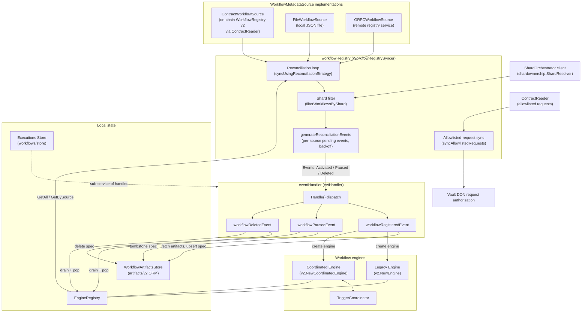
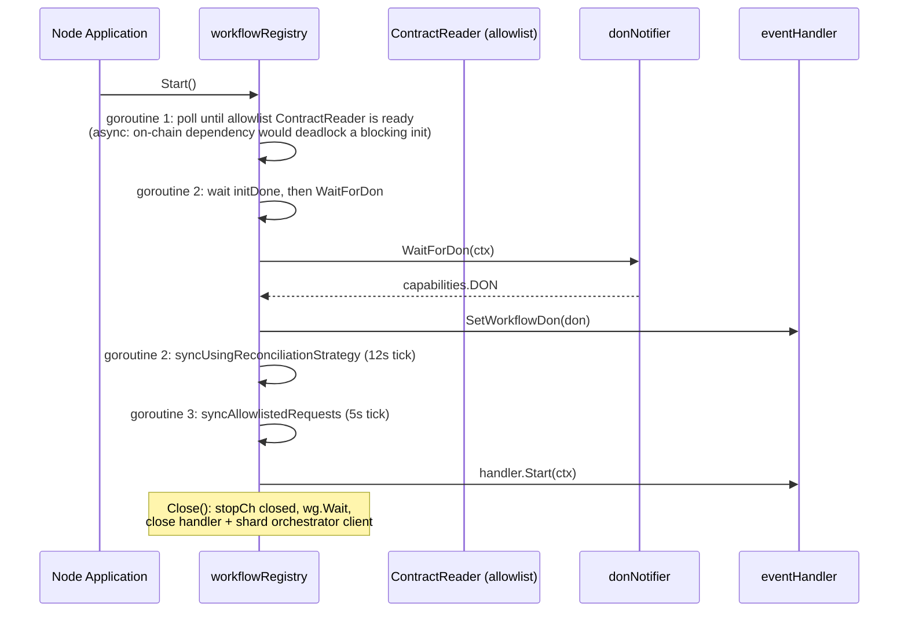
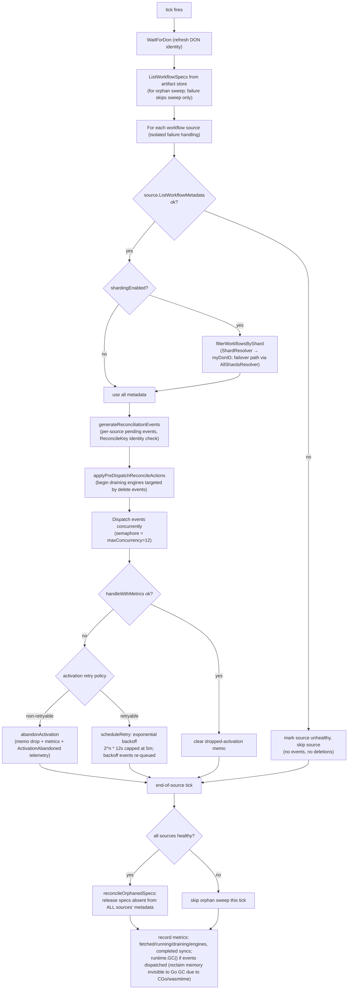
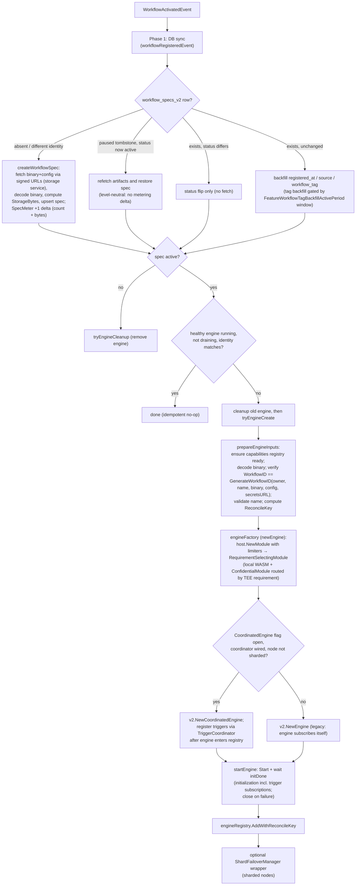
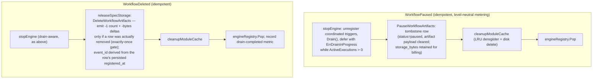
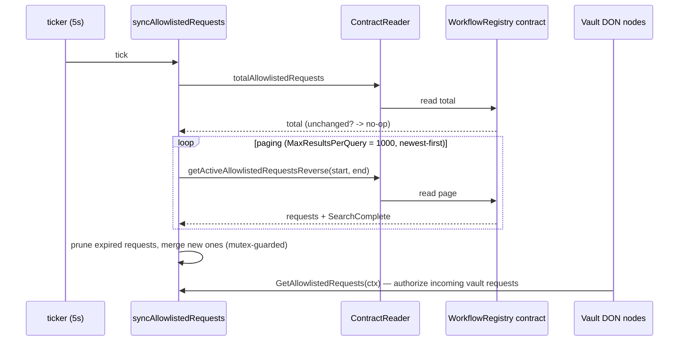

# Workflows Syncer (Workflow Registry Syncer v2)

> **Package:** `chainlink/core/services/workflows/syncer/v2`
> **Parent module:** [Workflows](../workflows.md)
> **Public interface:** `WorkflowRegistrySyncer`

## 1. Introduction

The **workflows syncer** is the control-plane component of the Chainlink Workflow Runtime (CRE engine) that keeps a node's locally-running workflow engines consistent with the *desired state* of workflow registrations published in the **WorkflowRegistry** ecosystem. It answers, continuously and idempotently, the question:

> "Which workflows should this node be running, and which running engines must be stopped, paused, replaced or created?"

It does this by:

1. **Polling workflow metadata** from one or more `WorkflowMetadataSource`s (an on-chain `WorkflowRegistry` contract, a local JSON file, and/or a gRPC registry service).
2. **Reconciling** that metadata against the local [EngineRegistry](#33-engineregistry) (engines actually running in-process).
3. **Emitting reconciliation events** (`WorkflowActivated`, `WorkflowPaused`, `WorkflowDeleted`) to the [eventHandler](#34-eventhandler--the-event-applier), which persists workflow specs, fetches artifacts, and creates/stops [workflow engines](workflows_engine.md).
4. **Serving allowlisted vault requests** fetched from the registry contract — used by Vault DON nodes to authorize incoming vault requests.

The syncer is intentionally *stateless across ticks* (aside from in-memory retry/pending-event bookkeeping): every reconciliation cycle re-derives the full desired state from the sources, making the system self-healing after crashes, restarts, or transient fetch failures.

---

## 2. Architecture Overview



### 2.1 Component responsibility matrix

| Component | File | Responsibility |
|---|---|---|
| `WorkflowRegistrySyncer` / `workflowRegistry` | `workflow_registry.go` | Service lifecycle, multi-source reconciliation loop, event dispatch, shard filtering, allowlisted-request polling |
| `eventHandler` | `handler.go` | Applies events: artifact fetching, spec persistence, engine creation/start/stop, drain semantics, telemetry |
| `WorkflowMetadataSource` (interface) | `types.go` | Uniform abstraction over contract / file / gRPC metadata sources |
| `ContractWorkflowSource` | `contract_workflow_source.go` | Reads `getWorkflowListByDON` (+ paging) from the on-chain registry via a versioned `ContractReaderFactory` |
| `FileWorkflowSource` | `file_workflow_source.go` | Reads workflow metadata from a local JSON file (`FileWorkflowSourceData`), filters by DON family |
| `GRPCWorkflowSource` | `grpc_workflow_source.go` | Fetches workflow metadata from a gRPC registry service (paged, retried, JWT-authenticated, optional TLS) |
| `EngineRegistry` | `engine_registry.go` | In-memory map of `WorkflowID → {engine, source, ReconcileKey}` |
| `reconciliationEvent` / retries | `retries.go` | Event envelopes with signature, retry count, and exponential-backoff scheduling; `droppedActivations` memo |
| `ActivationRetryPolicy` | `activation_errors.go` | Classifies activation failures as retryable vs non-retryable |
| `EvictableModule` / `ModuleLRU` | `evictable_module.go` | L1/L2 (strong/weak) WASM module cache with on-disk spill via `SerialisedModuleStore` |
| `SpecMeter` | `spec_meter.go` | Durable-storage metering for `workflow_specs_v2` (deltas at register/delete generation boundaries) |
| `ShardFailoverManager` | `shard_failover_manager.go` | Wraps an engine so it only executes triggers for events routed to this shard/DON |
| `metrics` | `metrics.go`, `prom_metrics.go` | OTel instruments for sync health, source health, reconciliation, drains, activations |
| `DiskMonitor`, `CentralizedOwnerVerifier` | `disk_monitor.go`, `centralized_owner_verification.go` | Disk-capacity guard for the module cache; owner/org verification for centralized gRPC sources |

---

## 3. Core Components

### 3.1 `WorkflowRegistrySyncer` — the public service

```go
type WorkflowRegistrySyncer interface {
    services.Service

    // GetAllowlistedRequests returns the latest list of allowlisted requests,
    // fetched periodically from the workflow registry contract.
    GetAllowlistedRequests(ctx context.Context) []workflow_registry_wrapper_v2.WorkflowRegistryOwnerAllowlistedRequest
}
```

The implementation (`workflowRegistry`) is constructed with `NewWorkflowRegistry(...)`, which accepts:

- a logger, a `versioning.ContractReaderFactory` (relay-provided contract reader), the registry **address** and **chain selector**;
- a `Config` (only `SyncStrategyReconciliation` is supported by v2 contracts);
- an `evtHandler` (the applier), a `donNotifier` (`WaitForDon`), and the shared `EngineRegistry`;
- functional `Option`s: `WithTicker`, `WithRetryInterval`, `WithSyncTickInterval`, `WithMaxConcurrency`, `WithMaxActivationRetries`, `WithAdditionalSources`, `WithCentralizedOwnerVerification`, `WithShardOrchestratorClient`, `WithShardEnabled`, `WithShardFailoverEnabled`, `WithRegistryShardRoutingObserver`, `WithRegistryShardResolver`.

**Defaults:** 12s sync tick (`defaultTickInterval`), 12s base retry interval with 5m cap (`defaultRetryInterval`/`defaultMaxRetryInterval`), 12 concurrent event handlers (`defaultMaxConcurrency`), 100 activation retries (`defaultMaxActivationRetries`), 5s allowlisted-request tick, `MaxResultsPerQuery = 1000` for paged contract reads.

### 3.2 Workflow metadata sources

All sources implement the uniform `WorkflowMetadataSource` interface and return `[]WorkflowMetadataView` plus a `*commontypes.Head`:

```go
type WorkflowMetadataSource interface {
    ListWorkflowMetadata(ctx context.Context, don capabilities.DON) ([]WorkflowMetadataView, *commontypes.Head, error)
    Name() string
    SourceIdentifier() string
    Ready() error
}
```

| Source | Activation | `SourceIdentifier()` format | Notes |
|---|---|---|---|
| `ContractWorkflowSource` | Added automatically when a registry address is configured (non-empty `addr` to `NewWorkflowRegistry`) | `contract:{chain_selector}:{contract_address}` | Paged reads of `getWorkflowListByDON` with `GetWorkflowListByDONParams{DonFamily, Start, Limit}`; lazy reader initialization |
| `FileWorkflowSource` | Via `WithAdditionalSources` with a `file://` URL | `file:{source_name}:v1` | JSON root structure **`FileWorkflowSourceData`** (`{"workflows": [...]}`) with `FileWorkflowMetadata` entries; filtered by the DON's families (expanded via `ExpandWorkflowFamilies`, which also matches un-sharded base families for sharded `…shard` suffixed families); synthetic head derived from wall-clock time |
| `GRPCWorkflowSource` | Via `WithAdditionalSources` with any other URL | `grpc:{source_name}:v1` | Paged gRPC fetch with exponential retry (`MaxRetries`, `RetryBaseDelay`, `RetryMaxDelay`), JWT auth (`nodeauthjwt.JWTGenerator`), optional TLS, and optional centralized owner verification (see [§7](#7-centralized-owner-verification)) |

**Status normalization** (all sources map to internal `0=Active, 1=Paused`): contract and file statuses already match on-chain values; the gRPC proto enum (`UNSPECIFIED=0, ACTIVE=1, PAUSED=2`) is translated by `GRPCStatusToInternal`, and unknown/unspecified values fail safe to *paused*.

**Multi-source semantics** are the key architectural property:

- Each source is processed **independently per tick**; a fetch failure skips only that source's reconciliation (no events, no deletions) — a failed source can never tear down workflows from a healthy one.
- Deletion reconciliation is **source-scoped**: `generateReconciliationEvents` only considers engines whose `ServiceWithMetadata.Source` matches the current `SourceIdentifier()`. A colliding/reused `WorkflowID` from another source is never torn down from here.
- An **orphan sweep** (`reconcileOrphanedSpecs`) covers the union case: when *all* sources fetched successfully, persisted `workflow_specs_v2` rows whose workflow ID is absent from *every* source's metadata are released. This catches workflows deleted while the node was down (no engine exists, so per-source engine reconciliation can't produce the delete event). Workflow IDs are content-addressed, so a row is live if *any* source lists it.

### 3.3 `EngineRegistry`

An in-memory, mutex-guarded registry mapping `types.WorkflowID` ([32]byte, see `core/services/workflows/types/workflow_meta.go`) to an `engineEntry{engine, source, reconcileKey}`:

- `Add` / `AddWithReconcileKey` — registration; duplicates return `ErrAlreadyExists`.
- `Get`, `GetAll`, `GetBySource`, `Contains` — lookups used by the reconciliation loop.
- `Pop`, `PopAll` — removal after successful cleanup (a failed engine close *stays* registered so cleanup can be retried).
- `ReconcileKey(owner, name)` — keccak-hash fingerprint of the on-chain record identity. Used to detect a **reused/colliding workflow ID**: if the running engine was started for a different `(owner, name)` pair than the incoming metadata, the engine is treated as stale and replaced.
- `ServiceWithMetadata.Coordinated()` — reports whether the engine delegates trigger registration/dequeue/ACK to the `TriggerCoordinator` ([Trigger Coordinator](workflows_engine.md)).
- `NewTriggerEngineRegistry` adapts the registry to the trigger coordinator's `triggers.EngineRegistry` view.

### 3.4 `eventHandler` — the event applier

`eventHandler` (satisfying the syncer's `evtHandler` interface) converts reconciliation events into local state changes. It is itself a `services.Engine` whose **sub-services** (the execution `store.Store`, the optional `SpecMeter`, the optional `TriggerCoordinator`) start and stop with it. `NewEventHandler` wires the engine factory (`engineFactoryFn`), capabilities registry, execution handlers (confidential relay), engine limiters, feature flags, rate limiter, workflow count limits, artifact store, workflow encryption key and DON subscriber; dozens of `With*` options configure observability, sharding, module caching, secrets and debug mode.

`Handle(ctx, event)` dispatches on `event.Name`:

- resolves the **organization ID** for the workflow owner via the `OrgResolver` (fail-open with a warning) and stamps the CRE context + `custmsg` labels (`workflow_id`, `workflow_name`, `workflow_owner`, `workflow_tag`, `organization_id`, registry address/chain selector, `source`);
- on completion (success *or* failure) emits a Beholder `workflows.v2.WorkflowActivated/Paused/Deleted` status event via `events.EmitWorkflowStatusChangedEventV2`, with `customerFacingError` scrubbing per-node details (e.g. signed-URL `ArtifactFetchError`) into deterministic, aggregatable messages;
- delegates to `workflowRegisteredEvent` (activated — note `WorkflowActivatedEvent` is a direct conversion of `WorkflowRegisteredEvent`), `workflowPausedEvent`, or `workflowDeletedEvent`.

### 3.5 `DrainableService` and graceful lifecycle

```go
type DrainableService interface {
    Drain() bool
    ActiveExecutions() int32
    DrainStartedAt() (time.Time, bool)
}
```

Engines that implement this interface support **drain-then-close**: `Drain()` initiates graceful shutdown, and deletion/pause is *deferred with `ErrDrainInProgress`* while `ActiveExecutions() > 0`. The syncer adds pre-dispatch drain kick-off (`applyPreDispatchReconcileActions`) so a delete event's drain begins before the handler runs, and the reconcile loop treats a draining engine as *not healthy* (it will be replaced with a fresh engine rather than assumed running).

The `ORM` interface declared in `handler.go` (`artifacts.WorkflowSpecsDS`) is the persistence contract used by the artifact store — see [Workflows Artifacts](workflows_artifacts.md) for the `workflow_specs_v2` schema, tombstone semantics, and metering columns.

---

## 4. Configuration & Key Types

### 4.1 Syncer config (`types.go`)

```go
type Config struct {
    QueryCount   uint64
    SyncStrategy SyncStrategy // only SyncStrategyReconciliation is valid for v2
}
```

Events and payloads:

- `Event{Name, Data, Head, Info}` where `Name ∈ {WorkflowRegistered, WorkflowActivated, WorkflowPaused, WorkflowDeleted}` (registered and activated share identical processing).
- Event payloads: `WorkflowRegisteredEvent`/`WorkflowActivatedEvent`/`WorkflowPausedEvent` (ID, owner, createdAt, status, name, tag, binary/config URLs, attributes, **source**) and `WorkflowDeletedEvent{WorkflowID, Source}`.
- `WorkflowMetadataView` — the chain-agnostic metadata record every source normalizes to (owner as bytes, 32-byte `WorkflowID`), including the provenance `Source` string.
- `Head{Hash, Height, Timestamp}` — a local, string-height head record converted at the boundaries (`toLocalHead` / `toCommonHead`).
- `GetWorkflowListByDONParams` / **`GetWorkflowListByDONReturnVal`** (`{WorkflowMetadataList []WorkflowMetadataView}`) and `GetActiveAllowlistedRequestsReverseParams` — shapes for paged contract reads.
- `FetcherFunc` — abstraction for fetching bytes at a URL (satisfied by the gateway-helpers fetcher in production; `mockFetcher` in tests).

Node-level workflow settings (limits, engine feature gates) are documented in [Core Config — Workflows](../../Node_Application_Core___Interfaces/core_config/core_config_workflows.md).

### 4.2 Wiring into the node

The syncer is started as part of the node's application lifecycle and its peers — capabilities registry, confidential-relay execution handlers, trigger coordinator, shard orchestrator client — are assembled in the same application bootstrap that reads the workflows config. See [Node Application](../../Node_Application_Core___Interfaces/node_application.md) for how services are started/stopped, and [CRE & Keystone Deployment Suite — Workflow Registry](../../CRE___Keystone_Deployment_Suite/cre-workflow-registry.md) for how the on-chain registry the syncer polls is deployed.

---

## 5. Runtime Flows

### 5.1 Startup

`Start` launches three goroutines and starts the handler:



On DON resolution failure the `Hooks.OnStartFailure` hook fires (used by callers to surface syncer startup errors).

### 5.2 Reconciliation loop (`syncUsingReconciliationStrategy`)

Runs every `syncTickInterval` (default 12s). Per tick:



**Event derivation rules** (`generateReconciliationEvents`, per source):

| Metadata status | Engine in registry (owned by this source)? | Resulting event |
|---|---|---|
| `Active` | not found | `WorkflowActivated` (activation/registration are unified — the DB is not trusted to distinguish) |
| `Active` | found, healthy, `ReconcileKey` matches | no-op (mark seen; stale pending events for the ID are dropped) |
| `Active` | found but draining or identity mismatch | cleanup + re-create (via activation path) |
| `Paused` | found | `WorkflowPaused` (handled by the handler as a delete-with-tombstone; clears the DB spec's artifact payload) |
| `Paused` | not found | clears any conflicting pending event |
| (absent from metadata) | found (this source only) | `WorkflowDeleted` |

A **pending-events map per source** plus event *signatures* (`type-id-status`) provide exactly-once-per-tick handling, dedup across ticks, and an invariant check (unhandled pending events fail the tick loudly). Failed activations dropped via `abandonActivation` are memoized in `droppedActivations` (in-memory only; cleared on restart, giving a fresh retry budget) so they are neither retried nor re-registered until the workflow's signature changes.

### 5.3 Activation (`WorkflowActivated` → engine running)



Non-retryable activation failures (`activation_errors.go`) — workflow ID/name mismatch, undecodable binary/owner, workflow-count limit errors, permanent engine-init errors (bad cron schedule, disallowed host calls during subscription, zero trigger subscriptions) — abandon immediately; everything else retries with backoff up to `maxActivationRetries` (~10h at defaults).

**Module caching:** when `ModuleLRU` + `SerialisedModuleStore` are wired, compiled WASM modules are registered as `EvictableModule`s (L1 strong pointer, L2 weak pointer, on-disk spill), tagged with `moduleEngineVersion` so process upgrades never reload ABI-incompatible binaries. **Trigger subscription caching** (gated by `CRE.CachedTriggerSubscriptionsEnabled`) persists a freshly computed subscription set to the spec row so subsequent engine starts skip the WASM `Subscribe()` call.

### 5.4 Pause & delete



Pause keeps the registration generation metered until deletion (mirroring the on-chain registry, which retains paused registrations); re-activation of a tombstone refetches artifacts from the URLs. Delete is the only metering *release* point, and its dedup key is derived after the delete from the row's own persisted `registered_at`, so every DON node emits identical event IDs regardless of local staleness. See [Workflows Metering](workflows_metering.md) for the billing unit model.

### 5.5 Allowlisted requests (Vault DON authorization)

A dedicated, lazily-initialized `ContractReader` (built only from `getActiveAllowlistedRequestsReverse` + `totalAllowlistedRequests` bindings — deliberately separate from workflow-metadata reads) is refreshed every 5s:



---

## 6. Sharding & failover

When `WithShardEnabled(true)` and a shard resolver are configured, `filterWorkflowsByShard` maps each workflow (by ID + owner hex) through the `shardownership.ShardResolver` (backed by the **Shard Orchestrator** service) and keeps only workflows assigned to this node's DON (`myDonID`, resolved from `WaitForDon`). Resolver failures invalidate the shard-routing-steady signal (`shardRoutingSteadyObserver`) so upstream routing health can be reported.

With the failover gate open (`WithShardFailoverEnabled`), the resolver's `AllShardsResolver.ResolveAllShards` extension is used instead: a workflow is kept if *any* shard owning it equals this DON, enabling takeover when the primary shard's nodes are unavailable. At engine-creation time, `ShardFailoverManager` wraps engines on sharded nodes (via the remote `Dispatcher` + `ShardFailoverCommunicator`) so that trigger events are only executed by the shard currently responsible for the workflow. Sharded nodes never use the coordinated engine (incompatible until further notice). See [Workflows Sharding](workflows_sharding.md) for the ownership model.

---

## 7. Centralized owner verification

For **GRPCWorkflowSource**s (centralized registries), `WithCentralizedOwnerVerification(gate, settingsGetter)` wires a verifier that validates workflow owner ↔ organization claims reported by the source against node settings (e.g. tenant scope). It is gated by a `limits.GateLimiter` so operations can enable/disable it dynamically; when enabled, workflows failing verification are excluded from reconciliation.

---

## 8. Observability & metering

- **Beholder events:** `workflows.v2.WorkflowActivated / Paused / Deleted` (status-change events carrying registry address/chain selector/source labels) and `activation abandoned` events with typed reasons (`non_retryable`, `retry_limit_exceeded`). Emitted through the node's `custmsg` labeler — see [Beholder Telemetry](../../Telemetry___Observability_Platform/beholder-telemetry.md).
- **OTel tracing:** disabled by default (noop tracer, zero overhead); `WithDebugMode(true)` enables spans for syncer events and engine creation (with a loud production warning).
- **Metrics (`metrics.go`/`prom_metrics.go`):** handle duration, fetched/running/draining workflow gauges, coordinated-vs-legacy engine gauges (zero-series always reported), completed syncs, drain started/completed/duration, delete-deferred count, per-source health & fetch latency/error counters, per-tick reconcile dispatch/backoff histograms, activation dropped/abandoned counters, module-cache store duration, and workflow-tag backfill counter (reason `filled_empty` vs `refreshed`).
- **Durable-storage metering:** the `SpecMeter` sub-service emits `metering.v1.MeterRecord` events for `workflow_specs_v2` lifecycle (+1/-1 count, storage-byte deltas) with DON-agnostic, generation-scoped event IDs — detailed in [Workflows Metering](workflows_metering.md).

---

## 9. Module map & related documentation

| Concern | Where documented |
|---|---|
| Workflows module overview | [Workflows](../workflows.md) |
| Workflow engine internals (legacy + coordinated, modules, WASM host) | [Workflows Engine](workflows_engine.md) |
| Artifact store & `workflow_specs_v2` persistence | [Workflows Artifacts](workflows_artifacts.md) |
| Billing/metering units and records | [Workflows Metering](workflows_metering.md) |
| Shard ownership model (`ShardResolver`, `AllShardsResolver`) | [Workflows Sharding](workflows_sharding.md) |
| Shared domain types (`WorkflowID`, `WorkflowName`, exec results) | [Workflows Common Types](workflows_common_types.md) |
| Standalone/local engine tooling (`fileBasedSecrets`, standard capabilities) | [Workflows Standalone](workflows_standalone.md) |
| Capabilities registry consumed by the handler | [Capabilities](../capabilities.md) |
| Remote messaging (`Dispatcher`, trigger publish/subscribe) | [Core Capabilities Runtime](../core_capabilities_runtime.md) |
| Service primitives (`services.Service`, `StateMachine`), limits, org resolver | [Shared Foundation Libraries](../../Shared_Foundation_Libraries___Domain_Types.md) |
| PostgreSQL layer backing the ORM | [Database Persistence](../../Node_Platform_Services/database_persistence.md) |
| Deploying the on-chain WorkflowRegistry this syncer polls | [CRE & Keystone Deployment — Workflow Registry](../../CRE___Keystone_Deployment_Suite/cre-workflow-registry.md) |
| CLI that registers workflows into the registry | [cre-cli Workflow Commands](../../Developer_Toolchain_(CLI,_SDKs___API_Clients)/cre-cli-workflow-commands.md) |

---

## 10. Build & test notes

- The node binary embedding this module is built via the `chainlink` targets in `chainlink/GNUmakefile`; WASM runtime (wasmtime) upgrades flow through `chainlink-common/script/wasmtime-bump.sh` — module-cache `moduleEngineVersion` tagging exists precisely to keep cached binaries coherent across such upgrades.
- Test WASM binaries are compiled on demand from `core/services/workflows/test/wasm/v2/cmd/{with_tee,without_tee}` (`wasmtest.GetTestBinary`) and fetched via `go.mod`-managed workspace dependencies (`chainlink/go.mod`, `chainlink-common/go.mod`).
- Go module wiring for the CRE workspace (capabilities, protos, storage-service clients) is described in [Capabilities Workspace Tooling](../../Build,_CI___Release_Infrastructure/capabilities_workspace_tooling.md).

## 11. Testing

`handler_test.go` and the neighboring `_test.go` files cover the module's critical invariants:

- **Storage state machine** (`Test_specStorage_StateMachine`): every `(row state × event)` transition — absent/tombstone/active × activated/paused/deleted — including redelivery idempotence and exactly-one artifact fetch per state change.
- **Source parity** (`Test_handler_SourceParity_PauseActivateCycle`): a full register→pause→activate→delete cycle produces byte-identical storage outcomes and identical metering records/event IDs for contract-style (`contract:…`) and gRPC-style (`grpc:…`) source identifiers.
- **Organization ID propagation** (`Test_Handler_OrganizationID`): linking-service org IDs appear in emitted Beholder events.
- **Drain semantics** (`Test_workflowDeletedEvent_DrainInProgress`, `Test_tryEngineCleanup_*`): deletion deferred while executions are active; `ErrAlreadyStopped` tolerated; failed closes keep engines registered for retry.
- **Engine replacement** (`Test_workflowRegisteredEvent_DrainingEngineNotTreatedAsHealthy`): draining engines are replaced, not assumed healthy.
- **Trigger subscription caching** (`Test_parseCachedTriggerSubscriptions`, `Test_wireTriggerSubscriptionCacheHook`): persisted payloads are passed to the engine factory and fresh subscriptions are saved best-effort.
- **Confidential routing** (`Test_workflowRegisteredHandler_confidentialRouting`): TEE-requirement triggers are delegated to the confidential-workflows capability; non-TEE triggers execute locally.
- Multi-source, sharding, backoff, and orphan-sweep behaviour are exercised in `workflow_registry_test.go` / `workflow_syncer_v2_test.go`, using the `mockFetchResp`/`mockFetcher`, `mockEngine`/`mockDrainableEngine`, and `stubWorkflowArtifactsStore` test doubles defined in `handler_test.go`.
