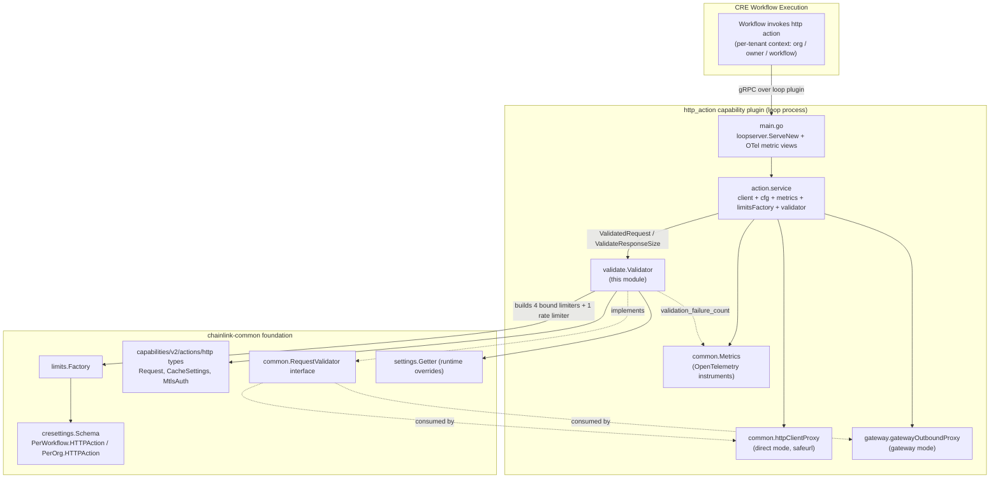
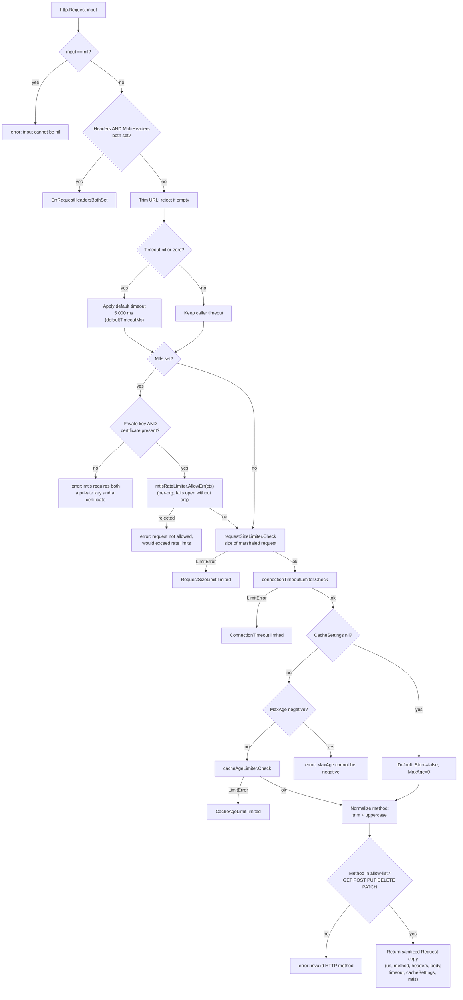
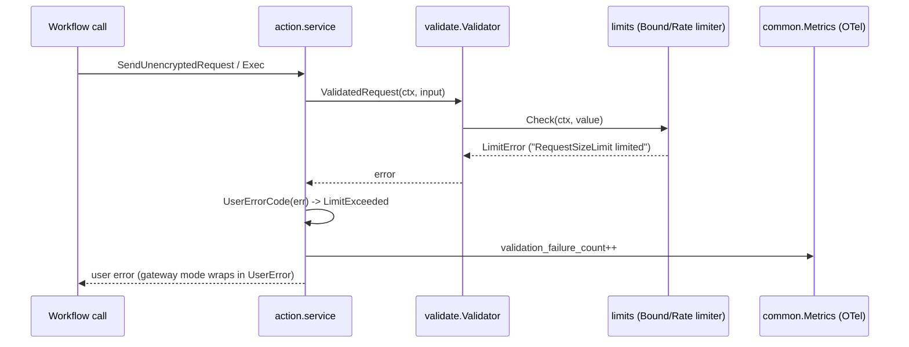

# HTTP Action Capability — Validation & Limits

The `validate` package (`capabilities/http_action/validate`) is the **single enforcement point for request/response validation and resource limits** in the HTTP Action capability. Its core component, the [`Validator`](../../../capabilities/http_action/validate/validator.go), sits between the [action service](http_action_capability_action_service.md) and the outbound [direct](http_action_capability_direct_proxy.md) / [gateway](http_action_capability_gateway_proxy.md) proxies, guaranteeing that no HTTP request issued by a CRE workflow exceeds platform-configurable size, timeout, cache-age, or rate budgets.

This page documents the validator's contract, the limiters it is bound to, how those limiters are wired to the CRE settings framework, and how validation failures are classified and observed. For request execution, proxy modes, and SSRF protection, see the [HTTP Action Capability overview](../http_action_capability.md) and its sibling pages.

---

## 1. Module Purpose

CRE workflows (V2/NoDAG engine) call the HTTP Action capability to make outbound HTTP requests to external systems. Because workflow authors are effectively untrusted tenants on a shared node, every request must be checked against per-workflow and per-organization budgets **before** any network I/O occurs, and every response must be checked **after** it arrives.

The validation & limits module is responsible for:

- **Structural validation** — required fields (`url`, `method`), HTTP method allow-list (`GET`, `POST`, `PUT`, `DELETE`, `PATCH`), header representation rules (`Headers` vs. `MultiHeaders` mutual exclusivity), and mTLS credential completeness.
- **Normalization** — trimming the URL, upper-casing the method, applying the default 5-second timeout, and defaulting empty `CacheSettings`, returning a **sanitized copy** of the request.
- **Limit enforcement** — rejecting requests/responses that exceed request-size, response-size, connection-timeout, and cache-age bounds, and rate-limiting mTLS-authenticated requests per organization.
- **Gateway routing input** — resolving the configured gateway DON for outbound proxy routing (`GatewayProxyDonID` setting).

It is deliberately a *pure* validation layer: it performs no I/O itself and holds no HTTP client state. All network execution is delegated to the proxies, which consume the validator through the `common.RequestValidator` interface.

---

## 2. Architecture & Component Relationships

The `Validator` is constructed once per capability process by the [action service](http_action_capability_action_service.md), which receives a `limits.Factory` from the loop plugin server (`main.go` wires `action.NewService(s.Logger, s.LimitsFactory)`). The same validator instance is injected into whichever outbound proxy is active, satisfying the `common.RequestValidator` interface:

```go
// capabilities/http_action/common/proxy.go
type RequestValidator interface {
    ResponseValidator
    ValidatedRequest(ctx context.Context, input *httpcap.Request) (*httpcap.Request, error)
    ResolveGatewayProxyDonID(ctx context.Context) (string, error)
}
```



Key relationships:

| Relationship | Detail |
|---|---|
| Validator ← action service | `action.service.validator` holds the singleton `*validate.Validator`; see [Action Service](http_action_capability_action_service.md). |
| Validator → proxies | Injected as the `common.RequestValidator`; both `httpClientProxy` and `gatewayOutboundProxy` re-validate through it rather than reimplementing checks. |
| Validator → limits framework | Five limiters built at startup from `cresettings.Default` via `limits.Factory`. See [Settings](../../Shared_Foundation_Libraries___Domain_Types/settings.md). |
| Validator → gateway routing | `ResolveGatewayProxyDonID` feeds the `routingGatewayConnector` in [Gateway Proxy](http_action_capability_gateway_proxy.md). |
| Validator → telemetry | Validation failures increment `http_action_validation_failure_count` via `common.Metrics` (see [Shared Runtime](http_action_capability_shared_runtime.md)). |

The plugin is its own Go module (`github.com/smartcontractkit/capabilities/http_action`, see `capabilities/http_action/go.mod`) inside the [capabilities workspace tooling](../../Build,_CI___Release_Infrastructure/capabilities_workspace_tooling.md); it depends on `chainlink-common` for the settings/limits framework, on `google.golang.org/protobuf` for `durationpb`, and on OpenTelemetry for metrics.

---

## 3. The `Validator` Component

**Source:** `capabilities/http_action/validate/validator.go::Validator`

### 3.1 Structure

```go
type Validator struct {
    lggr                     logger.SugaredLogger
    settingsGetter           settings.Getter
    responseSizeLimiter      limits.BoundLimiter[config.Size]
    requestSizeLimiter       limits.BoundLimiter[config.Size]
    connectionTimeoutLimiter limits.BoundLimiter[time.Duration]
    cacheAgeLimiter          limits.BoundLimiter[time.Duration]
    mtlsRateLimiter          limits.RateLimiter
}
```

### 3.2 Public API

| Member | Signature | Purpose |
|---|---|---|
| `NewValidator` | `(lggr logger.Logger, limitsFactory limits.Factory) (*Validator, error)` | Builds all five limiters from the CRE settings defaults and stores the factory's `settings.Getter` for runtime lookups. Returns an error if any limiter cannot be constructed. |
| `ValidatedRequest` | `(ctx, input *http.Request) (*http.Request, error)` | Full validation + normalization pipeline (see §4). Returns a sanitized copy; the input's `Timeout` may be filled in with the default. |
| `ValidateResponseSize` | `(ctx, response []byte) error` | Bound-checks raw response bytes (`config.SizeOf`) against `ResponseSizeLimit`. |
| `ResolveGatewayProxyDonID` | `(ctx) (string, error)` | Reads `PerWorkflow.HTTPAction.GatewayProxyDonID` through the settings getter. **Empty string means all connected gateways are eligible** (via `GatewayIDsForDon`). |
| `RequestHeaders` | `(input *http.Request) error` | Exported helper re-exporting the header mutual-exclusivity check so callers can surface `ErrRequestHeadersBothSet` as a user-facing error (e.g. wrapped in a gateway `UserError`). |
| `ErrRequestHeadersBothSet` | sentinel error | Returned when a request sets both the deprecated single-value `Headers` map and the newer `MultiHeaders` map. The two representations are mutually exclusive. |

### 3.3 Bound limiters

Each `limits.BoundLimiter` is created with `limits.MakeBoundLimiter(limitsFactory, setting)` and takes its ceiling from the corresponding CRE setting's default value. Checks are executed with the caller's CRE context, so per-org / per-workflow overrides resolved through the factory's `settings.Getter` apply at check time. Rejections return `limits.LimitError` implementations whose message names the setting (e.g. `"RequestSizeLimit limited"`), which is what downstream error classification keys on.

| Limiter | Type | Bound source (`cresettings`) | Checked value | Scope |
|---|---|---|---|---|
| `requestSizeLimiter` | `BoundLimiter[config.Size]` | `PerWorkflow.HTTPAction.RequestSizeLimit` | JSON-marshaled size of the **entire** `http.Request` (not just the body) | per workflow |
| `responseSizeLimiter` | `BoundLimiter[config.Size]` | `PerWorkflow.HTTPAction.ResponseSizeLimit` | raw response body bytes | per workflow |
| `connectionTimeoutLimiter` | `BoundLimiter[time.Duration]` | `PerWorkflow.HTTPAction.ConnectionTimeout` | `input.Timeout.AsDuration()` | per workflow |
| `cacheAgeLimiter` | `BoundLimiter[time.Duration]` | `PerWorkflow.HTTPAction.CacheAgeLimit` | `CacheSettings.MaxAge` | per workflow |
| `mtlsRateLimiter` | `limits.RateLimiter` | `PerOrg.HTTPAction.MtlsRateLimit` (rate + burst; default burst of 3, refills every 30 s — see `validator_test.go`) | each mTLS-authenticated request | per org |

The relevant settings schema (from `chainlink-common/pkg/settings/cresettings`):

```go
type httpAction struct {
    CallLimit         Setting[int] `unit:"{call}"`
    CacheAgeLimit     Setting[time.Duration]
    ConnectionTimeout Setting[time.Duration]
    RequestSizeLimit  Setting[config.Size]
    ResponseSizeLimit Setting[config.Size]
    GatewayProxyDonID Setting[string]
}
```

> **Note:** `CallLimit` is defined in the settings schema but is not enforced by the validator; workflow-level call concurrency is governed by the workflow execution engine ([Workflows Engine](../workflows/workflows_engine.md)).

---

## 4. Request Validation Pipeline

`ValidatedRequest` applies checks in a fixed order. Structural errors short-circuit first; limit checks run once the input is structurally sound. Limit checks require the CRE context (`org`/`owner`/`workflow`) to resolve tenant-scoped bounds.



### 4.1 Validation rules in detail

| Rule | Behavior |
|---|---|
| **Nil input** | Rejected immediately. |
| **Header exclusivity** | `Headers` (deprecated) and `MultiHeaders` may not both be set; the exported sentinel `ErrRequestHeadersBothSet` allows callers to detect this specific failure with `errors.Is`. |
| **URL** | Whitespace-trimmed; must be non-empty. Scheme/IP-level SSRF filtering is *not* done here — it is enforced by the outbound proxies ([Direct Proxy](http_action_capability_direct_proxy.md) via `safeurl`, [Gateway Proxy](http_action_capability_gateway_proxy.md)). |
| **Timeout default** | If `Timeout` is nil or zero, a default of **5 000 ms** (`defaultTimeoutMs`) is applied before limit checks, so the timeout limiter always sees a concrete duration. |
| **mTLS credentials** | `Mtls` requires both `PrivateKey` and `Certificate` (non-empty). mTLS requests additionally consume per-org rate budget; the limiter **fails open** when the context carries no org, and non-mTLS requests never touch the rate limiter (verified in `validator_test.go`). |
| **Request size** | The *entire* request is JSON-marshaled and sized, so headers, URL, and body all count toward `RequestSizeLimit`. On marshal failure (not expected for protobuf-backed types), the real error is logged and an opaque `internal error` string is returned to avoid leaking internals. |
| **Cache settings** | Nil cache settings are replaced with `{Store: false, MaxAge: 0}` (caching disabled). `MaxAge` may be zero with `Store: true` (always revalidate) but never negative; positive values are bound-checked against `CacheAgeLimit`. |
| **Method** | Trimmed and upper-cased, then checked against the `allowedMethods` allow-list (`GET`, `POST`, `PUT`, `DELETE`, `PATCH`). The normalized method is what the proxy ultimately sends. |
| **Output purity** | The returned `Request` is a fresh struct built from the validated fields — callers can treat it as the authoritative, normalized form. |

---

## 5. Error Classification & Observability

The validator is the origin of the *user-caused* failure class in the HTTP Action capability's error taxonomy: everything it rejects is attributable to the calling workflow, never to platform faults. The shared runtime's `UserErrorCode` helper (`capabilities/http_action/common/util.go`) maps validator failures to capability error codes:

```go
func UserErrorCode(err error) caperrors.ErrorCode {
    if _, ok := errors.AsType[limits.LimitError](err); ok {
        return caperrors.LimitExceeded
    }
    return caperrors.InvalidArgument
}
```

| Validator failure | Go error | Capability code | Metric counter |
|---|---|---|---|
| Any limit exceeded (size, timeout, cache age, mTLS rate) | `limits.LimitError` (message names the setting) | `LimitExceeded` (user) | `http_action_validation_failure_count` |
| Structural validation failure (nil, empty URL, bad method, mtls fields, headers conflict) | plain error / sentinel | `InvalidArgument` (user) | `http_action_validation_failure_count` |
| Request marshal failure | opaque `internal error` | `InvalidArgument` (user) | `http_action_validation_failure_count` |



In **gateway mode**, validation errors are wrapped as [`gateway.UserError`](http_action_capability_gateway_proxy.md) so they are reported to the caller as user faults; system faults (`TimeoutError`, `CanceledError`, unreachable gateways) use different wrappers and counters, as covered in the [Gateway Proxy](http_action_capability_gateway_proxy.md) and [Shared Runtime](http_action_capability_shared_runtime.md) pages. The OTel instruments themselves are registered through the loop server in `main.go` (`loop.WithOtelViews(common.MetricViews())`) and flow to the platform telemetry stack ([Beholder Telemetry](../../Telemetry___Observability_Platform/beholder-telemetry.md)).

---

## 6. Gateway Proxy DON Resolution

`ResolveGatewayProxyDonID` is a small but operationally significant piece of the validation module: it reads the `GatewayProxyDonID` workflow-scoped setting and hands it to the [gateway outbound proxy](http_action_capability_gateway_proxy.md)'s `routingGatewayConnector`.

- **Empty result (default)** — no DON restriction is configured; all connected gateways are eligible and selection falls back to `GatewayIDsForDon`.
- **Non-empty result** — outbound requests are routed only through gateways belonging to the configured DON.
- **Scoping** — the setting participates in the standard CRE settings override chain, so an organization can pin its own routing without affecting others. The test suite demonstrates an org-scoped override via a JSON settings getter:

```json
{"org": {"test-org": {"PerWorkflow": {"HTTPAction": {"GatewayProxyDonID": "gateway_don_eu"}}}}}
```

---

## 7. Construction, Testing & Build Notes

**Construction.** The validator is built by the action service from the loop server's `limits.Factory`:

```go
// capabilities/http_action/main.go
loopserver.ServeNew(action.ServiceName, func(s *loop.Server) loop.StandardCapabilities {
    return server.NewClientServer(action.NewService(s.Logger, s.LimitsFactory))
}, loop.WithOtelViews(common.MetricViews()))
```

**Testing.** `validator_test.go` constructs the validator with a bare `limits.Factory{Logger, Settings}` so the compiled-in `cresettings.Default` bounds apply, and uses `contexts.WithCRE(ctx, contexts.CRE{Org, Owner, Workflow})` to exercise tenant-scoped checks. The suite covers: valid normalization, nil/empty/invalid inputs, header exclusivity (sentinel identity via `errors.Is`), request-size and timeout limit rejections, cache-settings defaults and bounds, mTLS credential completeness, mTLS burst behavior (allowed within burst, rejected after, untouched for non-mTLS requests), response-size rejection, and `GatewayProxyDonID` resolution (empty default + org override).

**Build.** The module builds as a standalone loop plugin binary (e.g. `CGO_ENABLED=0 GOOS=linux GOARCH=amd64 go build -o ./bin/amd64/http_action .`, per `capabilities/http_action/README.md`). It is regenerated/linted through the capabilities workspace — `capabilities/Makefile` targets `protoc` (regenerates the `capabilities/v2/actions/http` message types the validator validates) and `gomods`/`tidy` (module hygiene). The dependency surface in `capabilities/http_action/go.mod` is intentionally narrow: `chainlink-common` (settings, limits, http types, logger), protobuf/`durationpb`, and OpenTelemetry.

---

## 8. Related Documentation

- [HTTP Action Capability](../http_action_capability.md) — parent module overview: proxy modes, SSRF protection, deployment.
- [HTTP Action — Action Service](http_action_capability_action_service.md) — the orchestration layer that owns the validator and routes between proxies.
- [HTTP Action — Direct Proxy](http_action_capability_direct_proxy.md) — `OutboundRequestClient` / `RequestValidator` interface and SSRF-filtered direct execution.
- [HTTP Action — Gateway Proxy](http_action_capability_gateway_proxy.md) — gateway-mode execution, `UserError`/`TimeoutError`/`CanceledError` wrappers, consistent-hash deduplication.
- [HTTP Action — Shared Runtime](http_action_capability_shared_runtime.md) — `ServiceConfig`, `Metrics`, and request-ID/error-code utilities shared by all components.
- [Capabilities Core](../capabilities/capabilities_core.md) — the `ExecutableAndTriggerCapability` contract and capability validation framework the HTTP action implements.
- [Workflows Engine](../workflows/workflows_engine.md) — the workflow runtime whose per-tenant context drives settings scoping.
- [Settings](../../Shared_Foundation_Libraries___Domain_Types/settings.md) — the CRE settings framework (`cresettings.Schema`, scoped overrides, `Setting[T]`).
- [Beholder Telemetry](../../Telemetry___Observability_Platform/beholder-telemetry.md) — where the OTel metrics emitted on validation failure land.
- [Capabilities Workspace Tooling](../../Build,_CI___Release_Infrastructure/capabilities_workspace_tooling.md) — workspace Makefile/protoc tooling used to build and regenerate this module.
