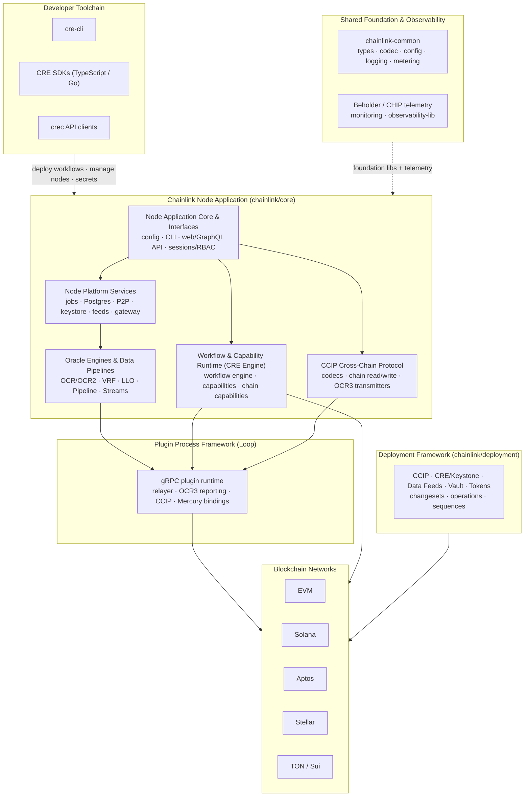
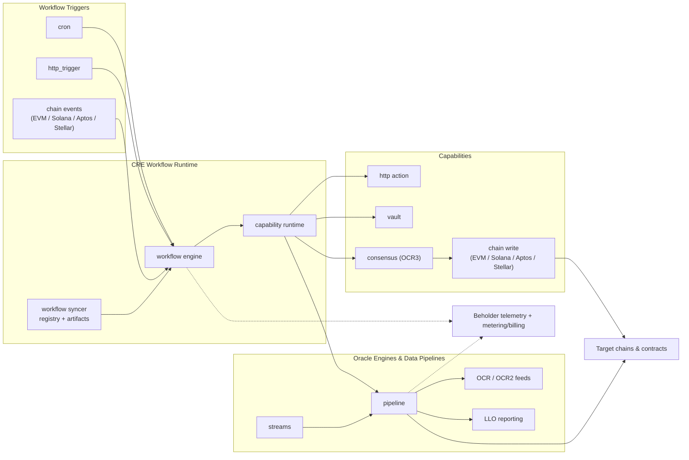

# `mahogany-octopus` — Repository Overview

## Purpose

`mahogany-octopus` is the monorepo for the **Chainlink Runtime Environment (CRE) platform**. It consolidates everything required to build, deploy, and operate Chainlink's decentralized oracle infrastructure:

- The **Chainlink node** (`chainlink/core`) — application core, user interfaces, platform services and oracle engines (OCR/OCR2, VRF, LLO, Pipeline, Streams).
- The **Workflow & Capability Runtime (CRE engine)** — workflow syncer/engine plus standard capabilities (cron, HTTP, consensus, vault) and chain capabilities for EVM, Solana, Aptos and Stellar.
- **CCIP**, the cross-chain messaging protocol, both its node-side implementation and its deployment suite.
- The **Loop plugin framework**, which runs oracle plugins (relayers, OCR3 reporting, CCIP, Mercury) as separate processes over gRPC.
- **Shared foundation libraries** (`chainlink-common`), a unified telemetry/observability platform, deployment frameworks for all products, the developer toolchain (`cre-cli`, CRE SDKs, API clients), and dev/test/simulation environments.

All products are developed against a single versioned codebase with shared code generation, CI/CD, release tooling and observability, targeting EVM, Solana, Aptos, Stellar, TON and Sui.

## End-to-End Architecture

### High-level component view

### Runtime data flow (workflow execution & oracle reporting)

## Core Module Documentation

| Module | Root path(s) | Documentation |
|---|---|---|
| Node Application Core & Interfaces | `chainlink/core` | [Node Application Core & Interfaces](<Node_Application_Core___Interfaces.md>) |
| Node Platform Services | `chainlink/core/services` | [Node Platform Services](<Node_Platform_Services.md>) |
| Oracle Engines & Data Pipelines | `chainlink/core/services` | [Oracle Engines & Data Pipelines](<Oracle_Engines___Data_Pipelines.md>) |
| Workflow & Capability Runtime (CRE Engine) | `chainlink/core/capabilities`, `capabilities/` | [Workflow & Capability Runtime (CRE Engine)](<Workflow___Capability_Runtime_(CRE_Engine).md>) |
| CCIP Cross-Chain Protocol | `chainlink/core/capabilities/ccip`, `chainlink-common/pkg/types/ccip` | [CCIP Cross-Chain Protocol](<CCIP_Cross-Chain_Protocol.md>) |
| Plugin Process Framework (Loop) | `chainlink-common/pkg/loop` | [Plugin Process Framework (Loop)](<Plugin_Process_Framework_(Loop).md>) |
| Shared Foundation Libraries & Domain Types | `chainlink-common` | [Shared Foundation Libraries & Domain Types](<Shared_Foundation_Libraries___Domain_Types.md>) |
| Telemetry & Observability Platform | `chainlink-common/pkg/beholder`, `chainlink-common/pkg/chipingress`, `chainlink-common/pkg/monitoring` | [Telemetry & Observability Platform](<Telemetry___Observability_Platform.md>) |
| CCIP Deployment Suite | `chainlink/deployment/ccip` | [CCIP Deployment Suite](<CCIP_Deployment_Suite.md>) |
| CRE & Keystone Deployment Suite | `chainlink/deployment/cre`, `chainlink/deployment/keystone` | [CRE & Keystone Deployment Suite](<CRE___Keystone_Deployment_Suite.md>) |
| Deployment Framework Core & Product Deployments | `chainlink/deployment` | [Deployment Framework Core & Product Deployments](<Deployment_Framework_Core___Product_Deployments.md>) |
| Dev, Test & Simulation Environments | `chainlink/devenv`, `chainlink/tools/docker`, `chainlink/integration-tests`, `chainlink/system-tests` | [Dev, Test & Simulation Environments](<Dev,_Test___Simulation_Environments.md>) |
| Developer Toolchain (CLI, SDKs & API Clients) | `cre-cli`, `cre-sdk-typescript`, `crec-sdk`, `crec-api-go` | [Developer Toolchain (CLI, SDKs & API Clients)](<Developer_Toolchain_(CLI,_SDKs___API_Clients).md>) |
| Build, CI & Release Infrastructure | repo root, `chainlink/tools/ci`, `scripts/` | [Build, CI & Release Infrastructure](<Build,_CI___Release_Infrastructure.md>) |

## Build, Test and Run

- **Workspaces**: Primarily Go, organised as many small Go modules (~30 `go.mod` files) across `chainlink/`, `chainlink-common/`, `capabilities/` (per-capability modules), `cre-cli/`, `crec-sdk/` and `crec-api-go/`; TypeScript code lives in the `cre-sdk-typescript` Bun/Turborepo workspace and the pnpm/Nx workspace under `capabilities/`.
- **Build & code generation**: The node binary, plugin Docker images and docs are driven by `chainlink/GNUmakefile`, with per-module Makefiles (e.g. `capabilities/`, `chainlink-common/`, `cre-cli/`) orchestrating `protoc` codegen for the extensive protobuf schemas (capabilities, chain bindings, Loop gRPC, Beholder, metering), `mockery` mocks, and go-module tidy/release tasks. `cre-cli` additionally generates EVM/Solana contract bindings, and the GraphQL schema (`chainlink/core/web/schema/schema.graphql`) feeds the node web SDK.
- **Quality gates**: golangci-lint configs per workspace, SonarQube properties, `_typos.toml`, lefthook git hooks, and dedicated CI tooling under `chainlink/tools/ci` (job matrices, runners, release ops) plus a weekly docs-refresh GitHub workflow.
- **Packaging & release**: Dockerfiles and compose bundles (node, devnets, Postgres, Kafka-based monitoring, Grafana/Prometheus observability stack), goreleaser-based packaging for `cre-cli` with shell/PowerShell installers, and changelog/release reporting via `chainlink/tools/release/release-changelog`.
- **Running & testing**: Local multi-chain environments via `chainlink/devenv` and `chainlink/tools/docker`, end-to-end verification through `chainlink/integration-tests`, `chainlink/system-tests` (CRE topologies, capability features, BenchSpy) and `capabilities/integration_tests`, with CRIB-based environments from `chainlink/deployment/environment`.

For full details on build orchestration, CI pipelines and release automation, see [Build, CI & Release Infrastructure](<Build,_CI___Release_Infrastructure.md>); for local development, simulation and test harnesses, see [Dev, Test & Simulation Environments](<Dev,_Test___Simulation_Environments.md>).